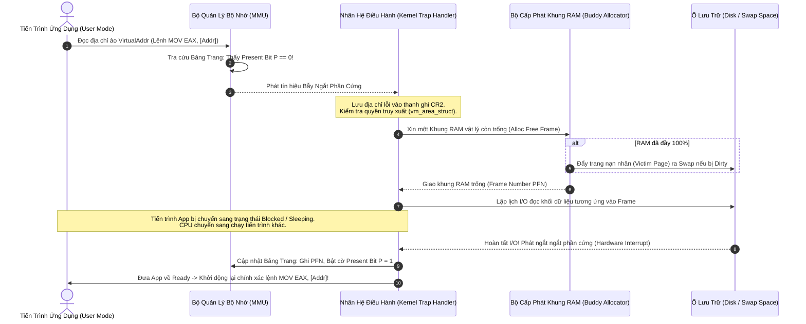

# 1_7_5 Virtual Memory and Demand Paging

> **Khóa học**: Cloud DevOps Basic — Hệ Điều Hành (OS Core)  
> **Domain**: 1 Domain 1 - Operating System Core Fundamentals  
> **Chủ đề**: 1_7 Memory Management and Virtual Memory  
> **Trạng thái**: Hoàn thành  
> **Checklist đối chiếu**: [CHECKLIST.md](<../../../CHECKLIST.md#17-memory-management--virtual-memory>) · **Roadmap**: [os/README.md](<../../README.md#module-7-memory-management--virtual-memory>)

---

## 1. Khái Niệm Cốt Lõi & Bản Chất Kỹ Thuật (Core Concepts & Technical Deep Dive)

Trong các hệ thống máy tính sơ khai, một chương trình chỉ có thể khởi chạy nếu toàn bộ mã lệnh, biến toàn cục, ngăn xếp và vùng nhớ động của nó được nạp trọn vẹn vào thanh RAM vật lý. Giả sử máy chủ của bạn chỉ có $8\text{ GB}$ RAM, bạn sẽ hoàn toàn bất lực nếu muốn chạy một mô hình trí tuệ nhân tạo hoặc một tiến trình phân tích dữ liệu đòi hỏi $32\text{ GB}$ bộ nhớ.

Tuy nhiên, các nhà khoa học máy tính đã phát hiện ra một sự thật thực nghiệm kinh điển: **Tại bất kỳ thời điểm thực thi nào, tiến trình chỉ thực sự cần đến một phần rất nhỏ mã nguồn và dữ liệu của nó** (ví dụ: các hàm xử lý lỗi hiếm khi được gọi, mảng dữ liệu khổng lồ nhưng chỉ duyệt tuần tự từng phần, hoặc các chức năng khởi tạo chỉ chạy một lần duy nhất lúc khởi động).

Sự thật này dẫn tới sự ra đời của một trong những phát minh vĩ đại nhất của công nghệ phần mềm: **Bộ Nhớ Ảo (Virtual Memory)** và cơ chế **Nạp Trang Theo Yêu Cầu (Demand Paging)**.

```text
+-------------------------------------------------------------------------------+
|                       TRIẾT LÝ CỦA DEMAND PAGING (LAZY PAGER)                 |
+-------------------------------------------------------------------------------+
| Không gian địa chỉ ảo 32 GB             Thanh RAM Vật Lý 8 GB                 |
| +-------------------------+             +-------------------------+           |
| | Page 0: main() [DÙNG]   | ----------> | Frame 1 [Nạp vào RAM]   |           |
| +-------------------------+             +-------------------------+           |
| | Page 1: error_handler() | - - - - - - | [CHƯA NẠP - Ở TRÊN ĐĨA] |           |
| +-------------------------+             +-------------------------+           |
| | Page 2: array[0..1023]  | ----------> | Frame 5 [Nạp vào RAM]   |           |
| +-------------------------+             +-------------------------+           |
| | Page 3: array[1024..]   | - - - - - - | [CHƯA NẠP - Ở TRÊN ĐĨA] |           |
| +-------------------------+             +-------------------------+           |
+-------------------------------------------------------------------------------+
```

### 1.1. Bản Chất Của Bộ Nhớ Ảo (Virtual Memory)

Bộ nhớ ảo là kỹ thuật cho phép **tách rời hoàn toàn không gian địa chỉ logic của lập trình viên khỏi không gian bộ nhớ vật lý thực tế của phần cứng**. 
- Hệ điều hành cung cấp cho mỗi tiến trình ảo tưởng rằng nó có quyền sở hữu một không gian RAM khổng lồ, sạch sẽ và liên tục.
- Dung lượng bộ nhớ khả dụng cho các tiến trình không còn bị giới hạn bởi kích thước vật lý của các thanh RAM cắm trên bo mạch chủ.
- Chương trình có kích thước bộ nhớ lớn hơn nhiều lần so với dung lượng RAM vật lý vẫn có thể khởi chạy và hoạt động trơn tru.

### 1.2. Cơ Chế Nạp Trang Theo Yêu Cầu (Demand Paging / Lazy Pager)

Thay vì nạp toàn bộ các trang của tiến trình vào RAM ngay khi chương trình được gọi (gọi là *Pre-paging*), hệ điều hành hiện đại áp dụng chiến lược **Lười biếng tối đa (Lazy Paging)**:
- Một trang ảo **CHỈ ĐƯỢC NẠP VÀO RAM KHI VÀ CHỈ KHI CÓ MỘT LỆNH CPU THỰC SỰ THAM CHIẾU TỚI NÓ**!
- Khi tiến trình bắt đầu khởi chạy, nhân hệ điều hành chỉ nạp vài trang đầu tiên chứa hàm `main()` hoặc mã khởi động. Toàn bộ các trang còn lại đều được gán cờ `Present bit = 0` trong Bảng Trang (Page Table).
- Lợi ích vượt trội:
  1. Thời gian khởi động tiến trình cực nhanh (không mất thời gian đọc hàng Gigabyte từ ổ cứng lên RAM).
  2. Tiết kiệm dung lượng RAM tối đa, cho phép hệ thống tăng độ đa chương (Degree of Multiprogramming - chạy được hàng trăm tiến trình cùng lúc).
  3. Giảm thiểu áp lực băng thông I/O giữa RAM và ổ cứng.

### 1.3. Vòng Đời 6 Bước Xử Lý Sự Kiện Ngắt Thiếu Trang (The 6-Step Page Fault Lifecycle)

Khi một tiến trình cố gắng đọc hoặc ghi vào một trang ảo mà trang đó hiện chưa có mặt trên RAM vật lý (`Present bit P = 0`), một sự kiện ngắt ngoại lệ mang tên **Page Fault** sẽ được kích hoạt. Quá trình xử lý bao gồm đúng 6 bước nghiêm ngặt:

```text
+------------------------------------------------------------------------------------+
|                         CHU TRÌNH 6 BƯỚC XỬ LÝ PAGE FAULT                          |
+------------------------------------------------------------------------------------+
[1] CPU phát lệnh truy xuất địa chỉ ảo -> MMU phát hiện Present Bit P = 0.
                                  |
                                  v
[2] MMU kích hoạt Bẫy Phần Cứng (Hardware Trap) -> Chuyển sang Kernel Mode (#PF).
    Địa chỉ lỗi được lưu vào thanh ghi CR2 của CPU.
                                  |
                                  v
[3] Nhân OS kiểm tra cấu trúc quản lý bộ nhớ (vm_area_struct):
    - Nếu địa chỉ bất hợp pháp (ngoài vùng cấp phát) -> Bắn SIGSEGV kết liễu tiến trình!
    - Nếu địa chỉ hợp lệ -> Xác nhận đây là một Page Fault hợp lệ.
                                  |
                                  v
[4] Nhân OS tìm một Khung RAM trống (Free Page Frame) từ Free List của bộ nhớ:
    - Nếu RAM đã đầy 100% -> Kích hoạt Thuật toán thay thế trang (Page Replacement)
      để chọn ra một trang nạn nhân (Victim Page) và đẩy ra swap disk.
                                  |
                                  v
[5] Nhân OS phát lệnh I/O đọc nội dung trang từ Ổ đĩa (File nhị phân hoặc Swap) vào Khung RAM vừa cấp.
    Tiến trình bị đình chỉ (Blocked / Waiting state) để nhường CPU cho tiến trình khác.
                                  |
                                  v
[6] Đĩa nạp xong -> Phát ngắt I/O ngắt -> Nhân OS cập nhật lại Bảng Trang (Page Table):
    - Ghi số hiệu Khung RAM (PFN) vào phần tử PTE.
    - Bật cờ Present bit: P = 1.
    - Đưa tiến trình về trạng thái Ready.
    - Khởi động lại CHÍNH XÁC lệnh máy tính đã gây ra Page Fault ban đầu!
+------------------------------------------------------------------------------------+
```

### 1.4. Phân Biệt: Lỗi Thiếu Trang Nhẹ (Minor Fault) vs Nặng (Major Fault)

Trong việc giám sát hiệu năng hệ thống Linux (DevOps Monitoring), kỹ sư cần phân định rõ ràng giữa hai loại Page Fault:

| Tiêu chí | Minor Page Fault (Lỗi Nhẹ / Soft Fault) | Major Page Fault (Lỗi Nặng / Hard Fault) |
| :--- | :--- | :--- |
| **Bản chất** | Trang dữ liệu **đã nằm sẵn trên RAM vật lý**, chỉ là Bảng Trang của tiến trình chưa được cập nhật liên kết. | Trang dữ liệu **chưa hề có trong RAM**, bắt buộc phải phát lệnh I/O đọc từ ổ đĩa lưu trữ (HDD/SSD/Swap). |
| **Hoàn cảnh xảy ra** | - Cấp phát bộ nhớ ẩn danh mới (`malloc`, `brk`, `mmap`) khi tiến trình chạm vào trang đầu tiên.<br>- Trang thuộc một Shared Library đã được nạp sẵn vào RAM bởi một tiến trình khác.<br>- Trang đang nằm trong bộ nhớ đệm trang của nhân (Linux Page Cache). | - Đọc trang mã lệnh lần đầu tiên từ file thực thi trên ổ cứng.<br>- Nạp lại trang bộ nhớ trước đó đã bị hoán đổi (swapped out) ra phân vùng swap trên đĩa cứng. |
| **Chi phí thời gian** | **Cực nhanh (Dưới microsecond - $< 1\ \mu\text{s}$)**: Chỉ cập nhật cấu trúc dữ liệu trong kernel và thanh ghi MMU. | **Cực kỳ tốn kém (Millisecond - $1\text{ ms} \to 10\text{ ms}$)**: Bị chặn nghẽn bởi tốc độ đọc cơ học của ổ đĩa. |
| **Trường thống kê Linux** | Trường `ru_minflt` trong `getrusage(2)` hoặc `minflt/s` trong `pidstat -r`. | Trường `ru_majflt` trong `getrusage(2)` hoặc `majflt/s` trong `pidstat -r`. |

---

## 2. Ví Dụ Đời Sống Thực Tế Dễ Hiểu (Intuitive Real-World Analogies)

### Ẩn dụ: Thư viện cho mượn sách theo nhu cầu (On-Demand Book Delivery)

Hãy tưởng tượng bạn đang nghiên cứu một bộ bách khoa toàn thư đồ sộ gồm 100 tập (Chương trình có kích thước lớn hơn nhiều so với RAM):

- **Kỷ nguyên Pre-paging cũ**:
  Người thủ thư bắt bạn phải bê toàn bộ 100 tập sách đặt lên chiếc bàn làm việc nhỏ bé của bạn (RAM vật lý) trước khi bạn được phép ngồi xuống đọc. Chiếc bàn của bạn chỉ chứa được tối đa 5 cuốn sách, dẫn đến việc bạn không bao giờ có thể bắt đầu nghiên cứu!
- **Cơ chế Demand Paging (Nạp trang lười biếng)**:
  Thư viện áp dụng chính sách hiện đại: Bạn chỉ cần ngồi vào bàn với một cuốn sổ ghi chú mục lục rỗng (Page Table với $P=0$).
  1. Khi bạn bắt đầu đọc trang đầu tiên của Tập 1: Bạn nhìn trên bàn không thấy Tập 1 (Present bit = 0).
  2. Bạn bấm chuông gọi thủ thư (**Page Fault Trap**).
  3. Người thủ thư chạy vào kho sách dưới tầng hầm (Ổ cứng Disk/Swap) tìm cuốn Tập 1.
  4. Người thủ thư mang cuốn Tập 1 đặt lên bàn làm việc của bạn (Nạp vào Khung RAM trống).
  5. Người thủ thư đánh dấu vào sổ: *"Tập 1 đang ở góc bàn A"* ($P=1$, ghi nhận PFN).
  6. Bạn mở cuốn Tập 1 ra và tiếp tục đọc dòng chữ đầu tiên mà không hề hay biết đã có một cuộc tìm kiếm diễn ra dưới hầm!
- **Minor Fault vs Major Fault**:
  - **Minor Fault (Lỗi nhẹ)**: Bạn cần đọc Tập 3. Bạn bấm chuông, người thủ thư nhìn sang bàn bên cạnh thấy bạn đồng nghiệp vừa đọc xong cuốn Tập 3 đang đặt ở xe sách trong phòng. Thủ thư chỉ việc cầm cuốn sách đặt sang bàn của bạn (Không cần chạy xuống tầng hầm, tốn đúng 2 giây).
  - **Major Fault (Lỗi nặng)**: Bạn cần đọc Tập 50. Cuốn sách này bị cất sâu trong kho lưu trữ dưới tầng hầm. Bạn phải ngồi đợi 15 phút để thủ thư đi thang máy xuống hầm mở khóa kho lấy lên (Bị nghẽn I/O ổ đĩa).

---

## 3. Kiến Trúc, Luồng Hoạt Động & Hình Ảnh Trực Quan (Architecture, Diagrams & Visual Media)

### 3.1. Sơ Đồ Tuần Tự Chi Tiết Xử Lý Page Fault (Page Fault Sequence Diagram)



---

## 4. Code Mẫu Trực Quan Hoặc Dòng Lệnh Thực Chiến (Runnable Sample Code / CLI)

### 4.1. Chương Trình C Đo Lường Minor Page Faults Thực Nghiệm (`page_fault_demo.c`)

Chương trình dưới đây cấp phát $4\text{ MB}$ bộ nhớ ảo bằng hàm `mmap()` ẩn danh, sau đó sử dụng lời gọi hệ thống `getrusage(2)` để chứng minh một cách không thể chối cãi:
1. Khi gọi `mmap()`, hệ điều hành không hề cấp phát RAM thực tế (số lượng Page Faults tăng thêm bằng đúng $0$).
2. Khi tiến trình duyệt qua từng trang $4\text{ KB}$ và ghi dữ liệu, cứ mỗi trang chạm tới sẽ kích hoạt chính xác $1$ Minor Page Fault! (Tổng cộng $1024$ trang = đúng $1024$ Minor Faults).

```c
#include <stdio.h>
#include <stdlib.h>
#include <sys/mman.h>
#include <sys/resource.h>
#include <unistd.h>

#define PAGE_SIZE 4096
#define NUM_PAGES 1024
#define TOTAL_BYTES (NUM_PAGES * PAGE_SIZE) // 4 MB

// Hàm đọc số lượng Page Faults của tiến trình hiện tại
void get_faults(long *min_flt, long *maj_flt) {
    struct rusage usage;
    getrusage(RUSAGE_SELF, &usage);
    *min_flt = usage.ru_minflt;
    *maj_flt = usage.ru_majflt;
}

int main(void) {
    long min0, maj0, min1, maj1, min2, maj2;

    printf("=================================================================\n");
    printf("     THỰC NGHIỆM ĐO LƯỜNG DEMAND PAGING VÀ MINOR PAGE FAULTS     \n");
    printf("=================================================================\n\n");

    get_faults(&min0, &maj0);
    printf("[1. Khởi đầu]: Minor Faults = %ld, Major Faults = %ld\n\n", min0, maj0);

    // Giai đoạn 1: Xin cấp phát 4MB bộ nhớ ảo bằng mmap ẩn danh (Lazy Allocation)
    char *buffer = (char *)mmap(NULL, TOTAL_BYTES, PROT_READ | PROT_WRITE,
                                MAP_PRIVATE | MAP_ANONYMOUS, -1, 0);
    if (buffer == MAP_FAILED) {
        perror("mmap thất bại");
        return 1;
    }

    get_faults(&min1, &maj1);
    printf("[2. Sau khi mmap() 4 MB địa chỉ ảo]:\n");
    printf("   - Minor Faults mới: +%ld\n", min1 - min0);
    printf("   - Major Faults mới: +%ld\n", maj1 - maj0);
    printf("   ===> KẾT LUẬN: Hệ điều hành CHƯA CẤP PHÁT một byte RAM vật lý nào!\n\n");

    // Giai đoạn 2: Tiến hành chạm (touch) và ghi dữ liệu vào từng trang 4 KB một
    printf("Đang tiến hành ghi dữ liệu vào từng trang một trong tổng số %d trang...\n", NUM_PAGES);
    for (int i = 0; i < NUM_PAGES; i++) {
        // Ghi vào byte đầu tiên của trang thứ i -> Kích hoạt Page Fault cho trang đó!
        buffer[i * PAGE_SIZE] = 'A';
    }

    get_faults(&min2, &maj2);
    printf("\n[3. Sau khi chạm và ghi vào toàn bộ 1024 trang 4 KB]:\n");
    printf("   - Minor Faults phát sinh thêm: +%ld\n", min2 - min1);
    printf("   - Major Faults phát sinh thêm: +%ld\n", maj2 - maj1);
    printf("   ===> KẾT LUẬN: Đúng %d Minor Page Faults đã được kích hoạt theo nhu cầu (Demand)!\n\n", NUM_PAGES);

    // Dọn dẹp bộ nhớ
    munmap(buffer, TOTAL_BYTES);
    return 0;
}
```

### 4.2. Biên Dịch và Kết Quả Thực Thi Thực Tế

```bash
# Biên dịch mã nguồn
gcc -Wall -Wextra page_fault_demo.c -o page_fault_demo

# Chạy chương trình
./page_fault_demo
```

**Đầu ra trên Terminal (Minh họa):**
```text
=================================================================
     THỰC NGHIỆM ĐO LƯỜNG DEMAND PAGING VÀ MINOR PAGE FAULTS     
=================================================================

[1. Khởi đầu]: Minor Faults = 65, Major Faults = 0

[2. Sau khi mmap() 4 MB địa chỉ ảo]:
   - Minor Faults mới: +0
   - Major Faults mới: +0
   ===> KẾT LUẬN: Hệ điều hành CHƯA CẤP PHÁT một byte RAM vật lý nào!

Đang tiến hành ghi dữ liệu vào từng trang một trong tổng số 1024 trang...

[3. Sau khi chạm và ghi vào toàn bộ 1024 trang 4 KB]:
   - Minor Faults phát sinh thêm: +1024
   - Major Faults phát sinh thêm: +0
   ===> KẾT LUẬN: Đúng 1024 Minor Page Faults đã được kích hoạt theo nhu cầu (Demand)!
```

### 4.3. Giám Sát Page Faults Thời Gian Thực Bằng Dòng Lệnh Linux CLI

Kỹ sư vận hành hệ thống có thể theo dõi tốc độ phát sinh Page Faults của các tiến trình máy chủ đang chạy bằng công cụ `pidstat`:

```bash
# Cài đặt bộ sysstat nếu chưa có (Ubuntu/Debian: apt-get install sysstat)
# Theo dõi thống kê lỗi trang nhớ mỗi giây một lần (-r: báo cáo bộ nhớ)
pidstat -r 1
```

**Đầu ra mẫu trên Terminal:**
```text
Linux 6.8.0 (cloud-node-1)      11/14/2026      _x86_64_        (8 CPU)

15:30:00 UID   PID  minflt/s  majflt/s     VSZ     RSS   %MEM  Command
15:30:01   0  1450   1250.00      0.00  150420   35200   0.43  nginx
15:30:01 999  2204      8.00     45.00 4520480 3210400  39.12  postgres
```

> **Phân tích cảnh báo DevOps:**
> - Tiến trình `nginx` có `minflt/s = 1250` và `majflt/s = 0`: Hoàn toàn khỏe mạnh! Nginx đang cấp phát bộ nhớ động phục vụ các kết nối HTTP mới mà không cần đọc từ đĩa.
> - Tiến trình `postgres` có `majflt/s = 45.00`: **DẤU HIỆU NGUY CƠ NGHẼN CỔ CHAI ĐĨA!** Postgres đang liên tục phải đọc các trang dữ liệu từ ổ cứng (hoặc từ swap) vào RAM, biểu thị dung lượng `shared_buffers` trong RAM không đủ để chứa tập dữ liệu hoạt động.

---

## 5. Cạm Bẫy Thực Tế & Thực Tiễn Sản Xuất (Production Gotchas & Best Practices)

### 5.1. Công Thức Đánh Giá Thời Gian Truy Xuất Hiệu Dụng (Effective Access Time - EAT)

- **Công thức toán học**:
  $$\text{EAT} = (1 - p) \times \text{Memory Access Time} + p \times \text{Page Fault Service Time}$$
  Trong đó:
  - $p$: Tỷ lệ xảy ra lỗi thiếu trang ($0 \le p \le 1$).
  - $\text{Memory Access Time}$: Thời gian đọc RAM vật lý (thường khoảng $100\text{ ns}$).
  - $\text{Page Fault Service Time}$: Thời gian phục vụ ngắt và đọc ổ đĩa (thường khoảng $8\text{ ms} = 8.000.000\text{ ns}$).

- **Bài toán thực tế**: Giả sử hệ thống có tỷ lệ Page Fault chỉ là $0.1\%$ ($p = 0.001$):
  $$\text{EAT} = (1 - 0.001) \times 100\text{ ns} + 0.001 \times 8.000.000\text{ ns} \approx 99.9\text{ ns} + 8000\text{ ns} = \mathbf{8099.9\text{ ns}}$$
  > **Hệ quả gây sốc**: Dù tỷ lệ Page Fault chỉ chiếm **1 trên 1000 lần truy xuất**, tốc độ truy cập bộ nhớ của hệ thống đã bị **kéo tụt xuống hơn 80 lần**!  
  > **Quy tắc vàng sản xuất**: Tỷ lệ Major Page Fault trong các hệ thống đám mây bắt buộc phải duy trì ở mức cực kỳ thấp ($p < 0.00001$).

### 5.2. Cạm Bẫy Cạn Kiệt Giới Hạn Vùng Nhớ Ảo: `vm.max_map_count`

- **Sự cố kinh điển với Elasticsearch, Lucene, Kafka, Kafka Streams**:
  Elasticsearch sử dụng lệnh gọi hệ thống `mmap` để ánh xạ hàng nghìn tệp chỉ mục tìm kiếm (Lucene Index files) trực tiếp vào không gian bộ nhớ ảo nhằm đạt tốc độ truy vấn tối đa.
- Mặc định, nhân Linux giới hạn số lượng vùng nhớ ảo tối đa mà một tiến trình được phép ánh xạ là `vm.max_map_count = 65530`. Khi số lượng index tăng lên, Elasticsearch sẽ bị sụp đổ ngay lập tức với lỗi: `OutOfMemoryError: Map failed` hoặc từ chối khởi động (`max virtual memory areas vm.max_map_count [65530] is too low, increase to at least [262144]`).
- **Khắc phục chuẩn hóa DevOps**:
  ```bash
  # Tăng giới hạn số vùng nhớ ảo trong file cấu hình sysctl
  echo "vm.max_map_count=262144" | sudo tee -a /etc/sysctl.conf
  sudo sysctl -p
  ```

### 5.3. Kỹ Thuật Khóa RAM (Memory Locking) Cho Các Ứng Dụng Đòi Hỏi Độ Trễ Cực Thấp

- Đối với các hệ thống giao dịch tài chính tốc độ cao (High-Frequency Trading) hoặc cơ sở dữ liệu In-Memory (Redis), việc gặp một Page Fault giữa lúc xử lý giao dịch có thể gây thiệt hại hàng triệu đô la.
- **Giải pháp**: Lập trình viên sử dụng các cờ khóa trang nhớ của Linux để ép buộc hệ điều hành nạp và ghim chặt toàn bộ dữ liệu vào RAM vật lý, không bao giờ để xảy ra Page Fault hoặc bị swap ra đĩa:
  - Gọi `mlock(addr, length)` hoặc `mlockall(MCL_CURRENT | MCL_FUTURE)`.
  - Sử dụng cờ `MAP_POPULATE` khi gọi `mmap()`, ép buộc kernel nạp trước (pre-fault) toàn bộ các trang nhớ ngay tại thời điểm tạo ánh xạ.

---

## 6. Câu Hỏi Củng Cố Kiến Thức (Active Recall Quiz)

<details>
<summary><b>Câu hỏi 1:</b> Trình bày chu trình 6 bước của nhân hệ điều hành khi xử lý một sự kiện ngắt thiếu trang (Page Fault Exception). Tại sao lệnh máy tính gây ra lỗi phải được khởi động lại từ đầu sau khi trang nhớ đã được nạp vào RAM?</summary>

> **Đáp án:**
> - **Chu trình 6 bước**:
>   1. MMU kiểm tra PTE của địa chỉ ảo thấy Present Bit $P = 0$, phát ngắt bẫy phần cứng Page Fault (`#PF`).
>   2. CPU lưu địa chỉ gây lỗi vào thanh ghi `CR2` và chuyển quyền điều khiển cho Page Fault Handler của Kernel.
>   3. Kernel kiểm tra cấu trúc quản lý bộ nhớ (`vm_area_struct`): Nếu truy xuất trái phép thì gửi `SIGSEGV`; nếu hợp lệ thì tiếp tục.
>   4. Kernel tìm một Khung RAM vật lý trống từ Free List (nếu hết RAM thì chạy thuật toán thay thế trang để chọn trang nạn nhân đẩy ra swap).
>   5. Kernel lập lịch I/O đọc nội dung trang từ ổ cứng/swap vào khung RAM vừa cấp (tiến trình tạm thời bị đình chỉ).
>   6. Khi I/O hoàn tất, Kernel cập nhật Bảng Trang ($P=1$, ghi nhận PFN), chuyển tiến trình về trạng thái Ready, và khởi động lại lệnh máy tính gây lỗi.
> - **Lý do phải khởi động lại lệnh máy tính**:
>   - Ở lần thực thi đầu tiên, lệnh máy tính (ví dụ: `MOV EAX, [0x1000]`) đã bị ngắt nửa chừng và chưa thể hoàn tất do ô nhớ chưa có trên RAM. 
>   - Sau khi trang đã được đưa vào RAM và Bảng Trang đã được cập nhật, việc khởi động lại chính xác lệnh đó sẽ giúp MMU dịch thành công địa chỉ ảo sang địa chỉ vật lý, cho phép lệnh hoàn thành thao tác đọc dữ liệu vào thanh ghi `EAX` một cách minh bạch đối với chương trình.
</details>

<details>
<summary><b>Câu hỏi 2:</b> Phân biệt sự khác nhau bản chất giữa Minor Page Fault và Major Page Fault. Khi hệ thống giám sát Prometheus/Grafana cảnh báo chỉ số <code>majflt/s</code> tăng vọt trên một cụm máy chủ Database, kỹ sư DevOps cần kết luận điều gì và hành động như thế nào?</summary>

> **Đáp án:**
> - **Phân biệt bản chất**:
>   - *Minor Page Fault*: Trang nhớ đã có mặt trên RAM vật lý (do được nạp sẵn, nằm trong Page Cache, hoặc là trang ẩn danh mới), việc xử lý không tốn I/O đĩa và diễn ra cực nhanh ($< 1\ \mu\text{s}$).
>   - *Major Page Fault*: Trang nhớ hoàn toàn chưa có trong RAM, bắt buộc CPU phải chờ lệnh I/O đọc dữ liệu từ ổ cứng hoặc phân vùng swap, tiêu tốn thời gian rất lớn ($1\text{ ms} \to 10\text{ ms}$).
> - **Kết luận và hành động DevOps khi `majflt/s` tăng vọt trên Database**:
>   - *Kết luận*: Dung lượng RAM vật lý của máy chủ đã bị cạn kiệt; tập dữ liệu làm việc thường xuyên (Working Set) của Database lớn hơn kích thước RAM được cấp; hệ thống đang phải liên tục đọc từ ổ đĩa hoặc đang xảy ra hiện tượng hoán đổi bộ nhớ (Swapping).
>   - *Hành động*: (1) Kiểm tra dung lượng RAM trống bằng `free -h` và `vmstat 1`; (2) Nâng cấp cấu hình RAM cho máy chủ (Scale Up); (3) Tối ưu hóa lại câu lệnh truy vấn SQL để giảm bớt việc quét toàn bộ bảng (Full Table Scan); (4) Tinh chỉnh lại các tham số đệm bộ nhớ của cơ sở dữ liệu (ví dụ `innodb_buffer_pool_size` trong MySQL hoặc `shared_buffers` trong PostgreSQL).
</details>

<details>
<summary><b>Câu hỏi 3:</b> Giả sử một hệ thống máy tính có thời gian truy cập RAM là $200\text{ ns}$ và thời gian phục vụ một Major Page Fault từ ổ cứng SSD là $2\text{ ms} = 2.000.000\text{ ns}$. Nếu chúng ta muốn hiệu năng truy xuất bộ nhớ hiệu dụng (EAT) không bị suy giảm quá $10\%$ so với tốc độ RAM thuần túy (nghĩa là $\text{EAT} \le 220\text{ ns}$), tỷ lệ Page Fault tối đa cho phép là bao nhiêu?</summary>

> **Đáp án:**
> - Áp dụng công thức Thời gian truy xuất hiệu dụng:
>   $$\text{EAT} = (1 - p) \times 200 + p \times 2.000.000 \le 220$$
>   $$200 - 200p + 2.000.000p \le 220$$
>   $$1.999.800p \le 20$$
>   $$p \le \frac{20}{1.999.800} \approx \mathbf{0.000010001}\text{ (hay } 0.001\%\text{)}$$
> - **Kết luận**: Để hiệu năng hệ thống không bị tụt giảm quá $10\%$, tỷ lệ xảy ra lỗi trang không được phép vượt quá **1 lỗi trên 100.000 lần truy xuất bộ nhớ**!
</details>

---

## 7. 📚 Nguồn Tài Liệu Chính Thống (Tier-1 Official References)

- [OSTEP Chapter 21: Beyond Physical Memory: Mechanisms (Remzi H. Arpaci-Dusseau and Andrea C. Arpaci-Dusseau)](https://pages.cs.wisc.edu/~remzi/OSTEP/vm-beyondphys.pdf) - Giáo trình chuẩn mực phân tích triết lý bộ nhớ ảo, cơ chế Demand Paging, cấu trúc Present bit và chu trình xử lý ngắt Page Fault (Mục 21.1 - 21.5, trang 1-14).
- [Intel 64 and IA-32 Architectures Software Developer's Manual (Volume 3A: Chapter 4.7: Page-Fault Exceptions)](https://www.intel.com/content/www/us/en/developer/articles/technical/intel-sdm.html) - Đặc tả kỹ thuật phần cứng của Intel về ngắt ngoại lệ Page Fault Vector 14, thanh ghi điều khiển lỗi `CR2` và mã lỗi phần cứng Page Fault Error Code.
- [Linux Programmer's Manual: mmap(2)](https://man7.org/linux/man-pages/man2/mmap.2.html) - Tài liệu giao diện lập trình hệ thống Linux chuẩn cho hàm tạo ánh xạ trang nhớ ảo, cờ `MAP_ANONYMOUS` và `MAP_POPULATE`.
- [Linux Programmer's Manual: getrusage(2)](https://man7.org/linux/man-pages/man2/getrusage.2.html) - Đặc tả kỹ thuật đọc các chỉ số thống kê tiêu thụ tài nguyên của tiến trình, đo lường `ru_minflt` và `ru_majflt`.
- [Linux Programmer's Manual: mlock(2)](https://man7.org/linux/man-pages/man2/mlock.2.html) - Cẩm nang các lời gọi hệ thống khóa trang nhớ vật lý `mlock`, `mlockall` để vô hiệu hóa hiện tượng Demand Paging cho ứng dụng thời gian thực.
