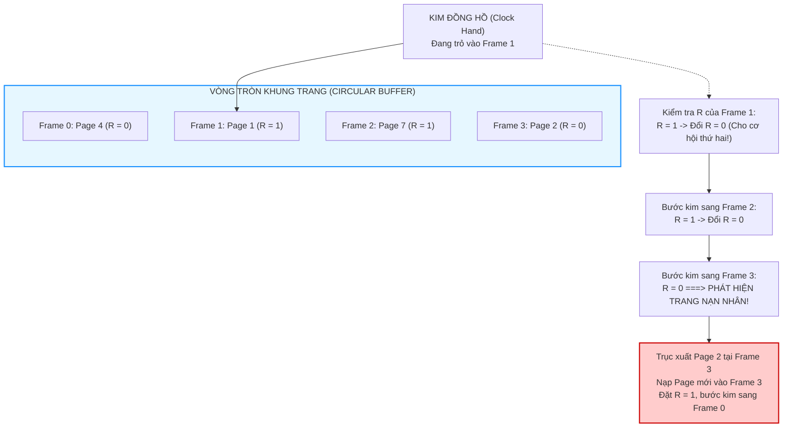

# 1_7_6 Page Replacement Algorithms

> **Khóa học**: Cloud & DevOps Cơ Bản  
> **Phân nhóm**: Domain 1 - Operating System Core Fundamentals  
> **Chủ đề**: 1_7 Memory Management and Virtual Memory  
> **Checklist đối chiếu**: [1_7_6](../../../CHECKLIST.md#domain-1-operating-system-core-fundamentals-45-items)  
> **Trạng thái**: Hoàn thành  

---

## 1. Khái Niệm Cốt Lõi & Bản Chất Kỹ Thuật (Core Concepts & Technical Deep Dive)

Trong cơ chế Bộ nhớ ảo nạp trang theo yêu cầu (Demand Paging), hệ điều hành cho phép tổng không gian địa chỉ ảo của các tiến trình vượt xa dung lượng vật lý của thanh RAM. Khi một tiến trình truy cập vào một trang chưa có trong bộ nhớ, phần cứng phát sinh một ngoại lệ **Lỗi trang (Page Fault)** để nạp trang đó từ ổ cứng (Swap Space / Page File) vào RAM.

Tuy nhiên, khi toàn bộ các khung trang vật lý (Physical Frames) của RAM đã bị lấp đầy $100\%$, hệ điều hành rơi vào tình thế bắt buộc: **Phải chọn ra một trang đang nằm trong RAM để trục xuất (Evict) ra ổ cứng nhằm dọn chỗ trống cho trang mới.** 

Trang bị trục xuất được gọi là **Trang nạn nhân (Victim Page)**, và giải thuật quyết định xem trang nào phải hy sinh được gọi là **Thuật toán thay thế trang (Page Replacement Algorithm)**.

```
                           QUY TRÌNH THAY THẾ TRANG KHI RAM ĐẦY
                           
    [ CPU truy cập Virtual Page X ] ----> (Page Fault! RAM không còn Frame trống)
                                                |
                                                v
    +-------------------------------------------------------------------------+
    | BỘ ĐIỀU PHỐI BỘ NHỚ ẢO (PAGING SUB-SYSTEM)                              |
    |                                                                         |
    |  1. Thực thi Thuật toán thay thế trang (FIFO / LRU / Clock)             |
    |     ===> LỰA CHỌN TRANG NẠN NHÂN (VICTIM FRAME Y)                       |
    |                                                                         |
    |  2. Kiểm tra Dirty Bit (Modified Bit) của Trang Y:                      |
    |     - Dirty Bit = 1 (Đã bị ghi dữ liệu): BẮT BUỘC GHI XUỐNG DISK / SWAP  |
    |     - Dirty Bit = 0 (Chỉ đọc / Chưa đổi): HỦY TRỰC TIẾP KHÔNG CẦN GHI!  |
    |                                                                         |
    |  3. Cập nhật Bảng trang (Page Table): Đánh dấu Trang Y là Invalid (V=0) |
    |                                                                         |
    |  4. Đọc Trang X từ Disk nạp vào Frame Y vừa giải phóng                  |
    |                                                                         |
    |  5. Cập nhật Bảng trang cho Trang X: Valid (V=1) -> Khởi động lại lệnh! |
    +-------------------------------------------------------------------------+
```

---

### 1.1. Bốn Thuật Toán Thay Thế Trang Kinh Điển

#### 1. Thuật Toán Vào Trước - Ra Trước (FIFO - First-In, First-Out)
- **Nguyên lý**: Gắn nhãn thời điểm nạp cho mỗi trang trong RAM. Trang nào được nạp vào bộ nhớ **sớm nhất (cũ nhất)** sẽ bị chọn làm nạn nhân đầu tiên khi cần chỗ trống.
- **Hiện thực**: Quản lý các khung trang bằng một hàng đợi FIFO đơn giản.
- **Hạn chế nghiêm trọng (Dị thường Belady)**: Một trang được nạp từ sớm có thể là một biến dùng chung toàn cục hoặc một hàm thư viện được gọi liên tục. Trục xuất nó sẽ gây ra Page Fault lặp đi lặp lại ngay sau đó.

#### 2. Thuật Toán Tối Ưu (Optimal Algorithm - OPT / MIN)
- **Nguyên lý (László Bélády, 1966)**: Trục xuất trang **sẽ lâu được sử dụng nhất trong tương lai**.
- **Đặc tính**: Đảm bảo số lần Page Fault là **thấp nhất tuyệt đối** cho bất kỳ chuỗi truy cập bộ nhớ nào.
- **Tính khả thi**: **Bất khả thi trong thực tế** trên các hệ điều hành thông thường, vì hạt nhân không thể nhìn thấu tương lai xem tiến trình sẽ gọi biến nào tiếp theo. OPT chỉ được sử dụng trong phòng thí nghiệm làm **"Thước đo chuẩn vàng" (Benchmark)** để so sánh và đánh giá hiệu năng của các thuật toán khác.

#### 3. Thuật Toán Ít Sử Dụng Gần Đây Nhất (Least Recently Used - LRU)
- **Nguyên lý**: Sử dụng quá khứ gần để dự đoán tương lai (dựa trên Nguyên lý cục bộ thời gian - Temporal Locality). Trang nào **đã lâu nhất không được CPU đụng tới** sẽ bị coi là ít có khả năng được dùng lại và bị chọn làm nạn nhân.
- **Đặc tính**: Tiệm cận rất sát với hiệu năng của thuật toán tối ưu OPT.
- **Chi phí phần cứng**: Để triển khai LRU chuẩn xác $100\%$, mỗi lần đọc/ghi bộ nhớ đều phải cập nhật một bộ đếm thời gian 64-bit (Counter) hoặc di chuyển một nút trong danh sách liên kết kép (Doubly-Linked Stack). Chi phí đồng bộ hóa phần cứng trên mỗi chu kỳ xung nhịp là quá đắt đỏ, nên các CPU x86-64 không hỗ trợ LRU thuần túy.

#### 4. Thuật Toán Chiếc Đồng Hồ / Cơ Hội Thứ Hai (Clock / Second-Chance Algorithm)
- **Nguyên lý**: Là giải pháp **xấp xỉ phần cứng thực tế và phổ biến nhất của LRU**, sử dụng một hàng đợi vòng tròn (Circular Queue) và một con trỏ đồng hồ (Clock Hand).
- **Cơ chế Reference Bit (Accessed Bit `R`)**:
  - Mỗi khung trang có một bit phần cứng `R` nằm trong Page Table Entry (PTE), được CPU tự động bật lên `1` mỗi khi trang đó được đọc hoặc ghi.
  - Khi cần tìm nạn nhân, kim đồng hồ quét qua từng trang:
    - Nếu $R = 1$: Trang đã được dùng gần đây $\to$ Hệ thống xóa bit về $R = 0$ (cho "cơ hội thứ hai") và bước kim đồng hồ sang trang kế tiếp.
    - Nếu $R = 0$: Trang đã không được dùng kể từ vòng quét trước $\to$ **Chọn ngay làm nạn nhân để trục xuất!**

---

### 1.2. Dị Thường Belady (Belady's Anomaly) & Thuật Toán Dạng Ngăn Xếp (Stack Algorithms)

Thông thường, trực giác kỹ thuật cho rằng: *Nếu ta nâng cấp máy tính, bổ sung thêm thanh RAM (tăng số lượng Frame vật lý), số lần bị lỗi trang (Page Fault) bắt buộc phải giảm đi hoặc tối thiểu là giữ nguyên.*

Tuy nhiên, vào năm 1969, László Bélády đã phát hiện ra một nghịch lý chấn động: **Đối với giải thuật FIFO, việc tăng số lượng khung trang có thể làm tăng số lượng Page Fault!** Hiện tượng kỳ quặc này được đặt tên là **Dị thường Belady (Belady's Anomaly)**.

```
       BẢN CHẤT CỦA THUẬT TOÁN DẠNG NGĂN XẾP (STACK ALGORITHM)
       
       Tại mọi thời điểm t:
       Tập hợp các trang nằm trong RAM của hệ thống n khung trang: M_t(n)
       Tập hợp các trang nằm trong RAM của hệ thống (n+1) khung trang: M_t(n+1)
       
       ĐIỀU KIỆN STACK ALGORITHM:    M_t(n)  CON  M_t(n+1)
       
       - Nếu cấp thêm 1 frame, bộ nhớ mới luôn BAO TRỌN toàn bộ các trang của bộ nhớ cũ!
       - Do đó, một truy cập trúng (Hit) ở bộ nhớ n khung trang CHẮC CHẮN sẽ Hit ở bộ nhớ (n+1) khung trang!
       ===> MIỄN NHIỄM HOÀN TOÀN VỚI DỊ THƯỜNG BELADY!
```

- **Định lý**: Một thuật toán thay thế trang được gọi là **Thuật toán dạng ngăn xếp (Stack Algorithm)** nếu nó thỏa mãn tính chất bao hàm: Tập hợp các trang được lưu trong $n$ khung trang luôn là tập con của tập hợp các trang được lưu trong $(n+1)$ khung trang:
  $$M_t(n) \subseteq M_t(n + 1)$$
- **Hệ quả**:
  - **LRU** và **OPT** là các Stack Algorithms, do đó chúng **miễn nhiễm tuyệt đối $100\%$ với Dị thường Belady**.
  - **FIFO** không phải là Stack Algorithm, vì tập hợp trang trong RAM không có tính kế thừa bao hàm theo dung lượng, dẫn đến xuất hiện dị thường Belady trên một số chuỗi tham chiếu đặc biệt.

---

## 2. Ví Dụ Đời Sống Thực Tế Dễ Hiểu (Intuitive Real-World Analogies)

```
        BÀN LÀM VIỆC CHẬT CHỘI VÀ THÓI QUEN DỌN SÁCH

  Mặt bàn chỉ đủ chỗ đặt đúng 3 cuốn sách giáo trình:
  [ Cuốn A ]   [ Cuốn B ]   [ Cuốn C ]
  
  Bây giờ bạn cần đọc tiếp Cuốn D: Buộc phải cất 1 cuốn vào giá sách!
  
  1. THÓI QUEN FIFO: Cất cuốn sách được mang lên bàn sớm nhất, bất kể bạn vừa lật
     đọc nó cách đây 1 giây! (Ngớ ngẩn và dễ sai lầm).
  2. THÓI QUEN OPT (NHÀ TIÊN TRI): Nhìn thấu tương lai 1 tháng tới, biết cuốn nào
     lâu nhất mới cần đọc lại thì cất đi. (Hoàn hảo nhưng không có thật).
  3. THÓI QUEN LRU (KẺ THỰC TẾ): Nhìn vào lớp bụi bám trên bìa sách, cuốn nào lâu
     nhất không ai chạm vào thì cất đi. (Rất thông minh và thực dụng).
  4. THÓI QUEN CLOCK: Dán mẩu giấy nhớ lên gáy sách. Ai đọc thì gạt giấy lên.
     Khi dọn bàn, liếc qua thấy giấy gạt lên thì hạ xuống (tha bổng);
     thấy giấy đã hạ từ trước thì cất ngay!
```

### 2.1. Phép So Sánh: Bàn Làm Việc Hữu Hạn 3 Chỗ Ngồi
- Bạn là một sinh viên y khoa đang ôn thi, chiếc bàn học nhỏ chỉ để vừa đúng 3 cuốn sách:
  - Cuốn 1: Giải phẫu học (mượn từ 8h sáng, dùng liên tục).
  - Cuốn 2: Dược lý học (mượn lúc 9h sáng).
  - Cuốn 3: Sinh lý học (mượn lúc 10h sáng).
- Đến 11h, bạn cần mở thêm Cuốn 4: Bệnh học.
- **Nếu chọn theo FIFO**: Bạn nhìn giờ mượn sách. Cuốn Giải phẫu học mượn sớm nhất lúc 8h sáng $\to$ Bạn đem trả vào kho! Nhưng vừa cất xong, 1 phút sau câu hỏi thi lại đòi hỏi tra cứu Giải phẫu học $\to$ Bạn lại phải hớt hải chạy vào kho mượn lại cuốn Giải phẫu học. Rất lãng phí công sức!
- **Nếu chọn theo LRU**: Bạn nhìn xem cuốn nào bạn không đụng đến lâu nhất. Mặc dù cuốn Giải phẫu học mượn từ 8h sáng, nhưng bạn vừa đọc nó cách đây 30 giây. Cuốn Dược lý học đã bị bạn bỏ xó suốt 1 tiếng qua. Bạn cất cuốn Dược lý học. Quyết định này vô cùng chuẩn xác vì bạn có thể tiếp tục làm việc mà không bị gián đoạn.

---

## 3. Kiến Trúc, Luồng Hoạt Động & Hình Ảnh Trực Quan (Architecture & Diagrams)

### 3.1. Sơ Đồ Cơ Chế Hoạt Động Của Thuật Toán Chiếc Đồng Hồ (Clock Algorithm)



---

## 4. Bài Tập Tính Toán Thực Hành Chuẩn Mực (Two Mandatory Worked Numerical Exercises)

> 🎯 **BÀI TẬP BẮT BUỘC THEO KẾ HOẠCH BÀI DẠY (Plan Section 6.2 - Page Replacement Trace Exercises)**  
> Hai bài toán dưới đây được trình bày với bảng theo dõi trạng thái từng bước (Full State Trace), tính toán chính xác tỷ lệ lỗi trang (Page Fault Rate) và chứng minh toán học dị thường Belady.

---

### 4.1. Bài Tập 1: So Sánh Toàn Diện FIFO vs OPT vs LRU Trên Chuỗi Chuẩn 20 Tham Chiếu

Cho hệ thống có **3 khung trang vật lý (3 Frames)**, ban đầu hoàn toàn trống.  
Chuỗi tham chiếu trang (Reference String) gồm 20 yêu cầu:
$$\mathbf{7, 0, 1, 2, 0, 3, 0, 4, 2, 3, 0, 3, 2, 1, 2, 0, 1, 7, 0, 1}$$

#### 1. Bảng diễn biến chi tiết thuật toán FIFO:
*(Ký hiệu: $M$: Lỗi trang / Page Fault; $H$: Trúng trang / Page Hit)*

| Bước | Yêu cầu | Frame 0 | Frame 1 | Frame 2 | Kết quả | Ghi chú trục xuất |
| :---: | :---: | :---: | :---: | :---: | :---: | :--- |
| 1 | **7** | **7** | | | **Fault ($M_1$)** | Nạp vào Frame 0 |
| 2 | **0** | 7 | **0** | | **Fault ($M_2$)** | Nạp vào Frame 1 |
| 3 | **1** | 7 | 0 | **1** | **Fault ($M_3$)** | Nạp vào Frame 2 |
| 4 | **2** | **2** | 0 | 1 | **Fault ($M_4$)** | 7 cũ nhất $\to$ Trục xuất 7 |
| 5 | **0** | 2 | 0 | 1 | **Hit ($H_1$)** | Đã có sẵn 0 |
| 6 | **3** | 2 | **3** | 1 | **Fault ($M_5$)** | 0 cũ nhất $\to$ Trục xuất 0 |
| 7 | **0** | 2 | 3 | **0** | **Fault ($M_6$)** | 1 cũ nhất $\to$ Trục xuất 1 |
| 8 | **4** | **4** | 3 | 0 | **Fault ($M_7$)** | 2 cũ nhất $\to$ Trục xuất 2 |
| 9 | **2** | 4 | **2** | 0 | **Fault ($M_8$)** | 3 cũ nhất $\to$ Trục xuất 3 |
| 10 | **3** | 4 | 2 | **3** | **Fault ($M_9$)** | 0 cũ nhất $\to$ Trục xuất 0 |
| 11 | **0** | **0** | 2 | 3 | **Fault ($M_{10}$)** | 4 cũ nhất $\to$ Trục xuất 4 |
| 12 | **3** | 0 | 2 | 3 | **Hit ($H_2$)** | Đã có sẵn 3 |
| 13 | **2** | 0 | 2 | 3 | **Hit ($H_3$)** | Đã có sẵn 2 |
| 14 | **1** | 0 | **1** | 3 | **Fault ($M_{11}$)** | 2 cũ nhất $\to$ Trục xuất 2 |
| 15 | **2** | 0 | 1 | **2** | **Fault ($M_{12}$)** | 3 cũ nhất $\to$ Trục xuất 3 |
| 16 | **0** | 0 | 1 | 2 | **Hit ($H_4$)** | Đã có sẵn 0 |
| 17 | **1** | 0 | 1 | 2 | **Hit ($H_5$)** | Đã có sẵn 1 |
| 18 | **7** | **7** | 1 | 2 | **Fault ($M_{13}$)** | 0 cũ nhất $\to$ Trục xuất 0 |
| 19 | **0** | 7 | **0** | 2 | **Fault ($M_{14}$)** | 1 cũ nhất $\to$ Trục xuất 1 |
| 20 | **1** | 7 | 0 | **1** | **Fault ($M_{15}$)** | 2 cũ nhất $\to$ Trục xuất 2 |

- **Tổng kết FIFO**:
  - Số lần Page Fault: **$15$**
  - Số lần Page Hit: **$5$**
  - Tỷ lệ trúng đệm (Hit Rate): $\frac{5}{20} = \mathbf{25\%}$

---

#### 2. Bảng diễn biến chi tiết thuật toán Tối ưu (OPT / MIN):
*(Luôn trục xuất trang có lần tái sử dụng xa nhất trong tương lai)*

| Bước | Yêu cầu | Frame 0 | Frame 1 | Frame 2 | Kết quả | Phân tích tương lai & Trục xuất |
| :---: | :---: | :---: | :---: | :---: | :---: | :--- |
| 1 | **7** | **7** | | | **Fault ($M_1$)** | Khởi tạo |
| 2 | **0** | 7 | **0** | | **Fault ($M_2$)** | Khởi tạo |
| 3 | **1** | 7 | 0 | **1** | **Fault ($M_3$)** | Khởi tạo (Đầy 3 frame: {7, 0, 1}) |
| 4 | **2** | **2** | 0 | 1 | **Fault ($M_4$)** | Tương lai: 0 ở b5, 1 ở b14, 7 ở b18. 7 xa nhất $\to$ Trục xuất 7 |
| 5 | **0** | 2 | 0 | 1 | **Hit ($H_1$)** | Có sẵn |
| 6 | **3** | 2 | 0 | **3** | **Fault ($M_5$)** | Tương lai: 0 ở b7, 2 ở b9, 1 ở b14. 1 xa nhất $\to$ Trục xuất 1 |
| 7 | **0** | 2 | 0 | 3 | **Hit ($H_2$)** | Có sẵn |
| 8 | **4** | 2 | **4** | 3 | **Fault ($M_6$)** | Tương lai: 2 ở b9, 3 ở b10, 0 ở b11. 0 xa nhất $\to$ Trục xuất 0 |
| 9 | **2** | 2 | 4 | 3 | **Hit ($H_3$)** | Đã có sẵn 2 trong Frame 0 |
| 10 | **3** | 2 | 4 | 3 | **Hit ($H_4$)** | Đã có sẵn 3 trong Frame 2 |
| 11 | **0** | 2 | **0** | 3 | **Fault ($M_7$)** | Tương lai: 3 ở b12, 2 ở b13, 4 không bao giờ dùng nữa $\to$ Trục xuất 4 |
| 12 | **3** | 2 | 0 | 3 | **Hit ($H_5$)** | Đã có sẵn 3 trong Frame 2 |
| 13 | **2** | 2 | 0 | 3 | **Hit ($H_6$)** | Đã có sẵn 2 trong Frame 0 |
| 14 | **1** | 2 | 0 | **1** | **Fault ($M_8$)** | Tương lai: 2 ở b15, 0 ở b16, 3 không dùng nữa $\to$ Trục xuất 3 |
| 15 | **2** | 2 | 0 | 1 | **Hit ($H_7$)** | Đã có sẵn 2 trong Frame 0 |
| 16 | **0** | 2 | 0 | 1 | **Hit ($H_8$)** | Đã có sẵn 0 trong Frame 1 |
| 17 | **1** | 2 | 0 | 1 | **Hit ($H_9$)** | Đã có sẵn 1 trong Frame 2 |
| 18 | **7** | **7** | 0 | 1 | **Fault ($M_9$)** | Tương lai: 0 ở b19, 1 ở b20, 2 không dùng nữa $\to$ Trục xuất 2 |
| 19 | **0** | 7 | 0 | 1 | **Hit ($H_{10}$)** | Đã có sẵn 0 trong Frame 1 |
| 20 | **1** | 7 | 0 | 1 | **Hit ($H_{11}$)** | Đã có sẵn 1 trong Frame 2 |

- **Tổng kết OPT**:
  - Số lần Page Fault: **$9$** (Số lỗi tối thiểu tuyệt đối)
  - Số lần Page Hit: **$11$**
  - Tỷ lệ trúng đệm (Hit Rate): $\frac{11}{20} = \mathbf{55\%}$

---

#### 3. Bảng diễn biến chi tiết thuật toán LRU:
*(Luôn trục xuất trang có thời điểm truy cập gần nhất nằm xa nhất trong quá khứ)*

| Bước | Yêu cầu | Frame 0 | Frame 1 | Frame 2 | Kết quả | Phân tích quá khứ gần & Trục xuất |
| :---: | :---: | :---: | :---: | :---: | :---: | :--- |
| 1 | **7** | **7** | | | **Fault ($M_1$)** | Khởi tạo |
| 2 | **0** | 7 | **0** | | **Fault ($M_2$)** | Khởi tạo |
| 3 | **1** | 7 | 0 | **1** | **Fault ($M_3$)** | Khởi tạo (Thứ tự LRU: 7 cũ nhất) |
| 4 | **2** | **2** | 0 | 1 | **Fault ($M_4$)** | 7 lâu nhất $\to$ Trục xuất 7 |
| 5 | **0** | 2 | 0 | 1 | **Hit ($H_1$)** | Thứ tự LRU: 1 cũ nhất, 2, 0 mới nhất |
| 6 | **3** | 2 | 0 | **3** | **Fault ($M_5$)** | 1 lâu nhất $\to$ Trục xuất 1 |
| 7 | **0** | 2 | 0 | 3 | **Hit ($H_2$)** | Thứ tự LRU: 2 cũ nhất, 3, 0 |
| 8 | **4** | **4** | 0 | 3 | **Fault ($M_6$)** | 2 lâu nhất $\to$ Trục xuất 2 |
| 9 | **2** | 4 | 0 | **2** | **Fault ($M_7$)** | 3 lâu nhất $\to$ Trục xuất 3 |
| 10 | **3** | 4 | **3** | 2 | **Fault ($M_8$)** | 0 lâu nhất $\to$ Trục xuất 0 |
| 11 | **0** | **0** | 3 | 2 | **Fault ($M_9$)** | 4 lâu nhất $\to$ Trục xuất 4 |
| 12 | **3** | 0 | 3 | 2 | **Hit ($H_3$)** | Có sẵn (Thứ tự: 2, 0, 3) |
| 13 | **2** | 0 | 3 | 2 | **Hit ($H_4$)** | Có sẵn (Thứ tự: 0, 3, 2) |
| 14 | **1** | **1** | 3 | 2 | **Fault ($M_{10}$)** | 0 lâu nhất $\to$ Trục xuất 0 |
| 15 | **2** | 1 | 3 | 2 | **Hit ($H_5$)** | Có sẵn (Thứ tự: 3, 1, 2) |
| 16 | **0** | 1 | **0** | 2 | **Fault ($M_{11}$)** | 3 lâu nhất $\to$ Trục xuất 3 |
| 17 | **1** | 1 | 0 | 2 | **Hit ($H_6$)** | Có sẵn (Thứ tự: 2, 0, 1) |
| 18 | **7** | 1 | 0 | **7** | **Fault ($M_{12}$)** | 2 lâu nhất $\to$ Trục xuất 2 |
| 19 | **0** | 1 | 0 | 7 | **Hit ($H_7$)** | Có sẵn (Thứ tự: 1, 7, 0) |
| 20 | **1** | 1 | 0 | 7 | **Hit ($H_8$)** | Có sẵn (Thứ tự: 7, 0, 1) |

- **Tổng kết LRU**:
  - Số lần Page Fault: **$12$**
  - Số lần Page Hit: **$8$**
  - Tỷ lệ trúng đệm (Hit Rate): $\frac{8}{20} = \mathbf{40\%}$

---

### 4.2. Bài Tập 2: Chứng Minh Thực Nghiệm Dị Thường Belady Của Thuật Toán FIFO

> 🎯 **BÀI TOÁN KINH ĐIỂN VỀ DỊ THƯỜNG BÉLÁDY (Belady's Anomaly Proof per Plan Section 6.2)**

Xét chuỗi tham chiếu gồm 12 bước:
$$\mathbf{1, 2, 3, 4, 1, 2, 5, 1, 2, 3, 4, 5}$$

Hãy so sánh số lần lỗi trang của thuật toán FIFO khi chạy trên hệ thống có **3 Khung trang** và hệ thống có **4 Khung trang**.

---

#### Lời giải chi tiết:

#### 1. FIFO với 3 Khung Trang (3 Frames)

| Bước | Ref | F0 | F1 | F2 | Kết quả | Diễn biến hàng đợi FIFO |
| :---: | :---: | :---: | :---: | :---: | :---: | :--- |
| 1 | **1** | **1** | | | **Fault ($M_1$)** | Nạp 1 |
| 2 | **2** | 1 | **2** | | **Fault ($M_2$)** | Nạp 2 |
| 3 | **3** | 1 | 2 | **3** | **Fault ($M_3$)** | Nạp 3 (Hàng đợi: 1, 2, 3) |
| 4 | **4** | **4** | 2 | 3 | **Fault ($M_4$)** | 1 cũ nhất $\to$ Thay bằng 4 |
| 5 | **1** | 4 | **1** | 3 | **Fault ($M_5$)** | 2 cũ nhất $\to$ Thay bằng 1 |
| 6 | **2** | 4 | 1 | **2** | **Fault ($M_6$)** | 3 cũ nhất $\to$ Thay bằng 2 |
| 7 | **5** | **5** | 1 | 2 | **Fault ($M_7$)** | 4 cũ nhất $\to$ Thay bằng 5 |
| 8 | **1** | 5 | 1 | 2 | **Hit ($H_1$)** | Đã có sẵn 1! |
| 9 | **2** | 5 | 1 | 2 | **Hit ($H_2$)** | Đã có sẵn 2! |
| 10 | **3** | 5 | **3** | 2 | **Fault ($M_8$)** | 1 cũ nhất $\to$ Thay bằng 3 |
| 11 | **4** | 5 | 3 | **4** | **Fault ($M_9$)** | 2 cũ nhất $\to$ Thay bằng 4 |
| 12 | **5** | 5 | 3 | 4 | **Hit ($H_3$)** | Đã có sẵn 5! |

$$\implies \mathbf{Số\ lần\ Page\ Fault\ (3\ Frames) = 9\ lần}$$

---

#### 2. FIFO với 4 Khung Trang (4 Frames)

| Bước | Ref | F0 | F1 | F2 | F3 | Kết quả | Diễn biến hàng đợi FIFO |
| :---: | :---: | :---: | :---: | :---: | :---: | :---: | :--- |
| 1 | **1** | **1** | | | | **Fault ($M_1$)** | Nạp 1 |
| 2 | **2** | 1 | **2** | | | **Fault ($M_2$)** | Nạp 2 |
| 3 | **3** | 1 | 2 | **3** | | **Fault ($M_3$)** | Nạp 3 |
| 4 | **4** | 1 | 2 | 3 | **4** | **Fault ($M_4$)** | Nạp 4 (Đầy 4 frame) |
| 5 | **1** | 1 | 2 | 3 | 4 | **Hit ($H_1$)** | Đã có sẵn 1! |
| 6 | **2** | 1 | 2 | 3 | 4 | **Hit ($H_2$)** | Đã có sẵn 2! |
| 7 | **5** | **5** | 2 | 3 | 4 | **Fault ($M_5$)** | 1 cũ nhất $\to$ Thay bằng 5 |
| 8 | **1** | 5 | **1** | 3 | 4 | **Fault ($M_6$)** | 2 cũ nhất $\to$ Thay bằng 1 |
| 9 | **2** | 5 | 1 | **2** | 4 | **Fault ($M_7$)** | 3 cũ nhất $\to$ Thay bằng 2 |
| 10 | **3** | 5 | 1 | 2 | **3** | **Fault ($M_8$)** | 4 cũ nhất $\to$ Thay bằng 3 |
| 11 | **4** | **4** | 1 | 2 | 3 | **Fault ($M_9$)** | 5 cũ nhất $\to$ Thay bằng 4 |
| 12 | **5** | 4 | **5** | 2 | 3 | **Fault ($M_{10}$)** | 1 cũ nhất $\to$ Thay bằng 5 |

$$\implies \mathbf{Số\ lần\ Page\ Fault\ (4\ Frames) = 10\ lần}$$

---

#### 3. Phân Tích Bản Chất Dị Thường:
- **Hiện tượng**: Khi tăng từ 3 frames lên 4 frames, số lỗi trang thay vì giảm đi thì lại **tăng từ 9 lên 10 lỗi**!
- **Nguyên nhân toán học**: Ở bước 7 trong kịch bản 4 frames, do các bước 5 và 6 đã trúng đệm (Hit), trang 1 và 2 trở thành trang "cũ nhất" trong hàng đợi FIFO mà không hề được làm mới vị trí. Đến bước 7, trang 1 bị trục xuất oan uổng, kéo theo một phản ứng dây chuyền liên hoàn làm toàn bộ các bước từ 8 đến 12 đều bị Fault!
- Ngược lại, đối với **LRU** hoặc **OPT**, do thuộc tính Stack Algorithm ($M_t(n) \subseteq M_t(n+1)$), bất kỳ trang nào nằm trong bộ nhớ 3 frames chắc chắn sẽ có mặt trong bộ nhớ 4 frames, do đó **không bao giờ** xảy ra hiện tượng nghịch lý này.

---

## 5. Cạm Bẫy Thực Tế & Thực Tiễn Sản Xuất (Production Gotchas & Best Practices)

### 5.1. Kiến Trúc Two-List Active/Inactive Page Cache Của Linux Kernel

- Trong mã nguồn nhân Linux thực tế, bộ quản lý trang không dùng một danh sách Clock đơn lẻ mà sử dụng biến thể **Hai danh sách liên kết kép (Two-List Strategy)**:
  - **`active_list`**: Chứa các trang bộ nhớ đang được truy cập rất thường xuyên.
  - **`inactive_list`**: Chứa các trang ứng viên tiềm năng để thu hồi (Reclaim / Evict).
- **Cơ chế thanh lọc**:
  - Khi một trang mới được nạp vào, nó được đưa vào `inactive_list`.
  - Nếu trang đó được tham chiếu thêm một lần nữa trong khi đang nằm ở `inactive_list`, nó được "thăng hạng" chuyển sang `active_list`.
  - Khi RAM cạn kiệt, tiến trình kernel **`kswapd`** sẽ chỉ quét và đẩy các trang ở đuôi của `inactive_list` ra swap, bảo vệ an toàn tuyệt đối các trang quan trọng trong `active_list`.
- **Quan sát trên Linux CLI**:
  ```bash
  grep -E "Active|Inactive" /proc/meminfo
  ```
  *Đầu ra minh họa:*
  ```text
  Active:          4210452 kB
  Inactive:        2150320 kB
  Active(anon):    1204012 kB
  Inactive(anon):   350124 kB
  Active(file):    3006440 kB
  Inactive(file):  1800196 kB
  ```

---

## 6. Câu Hỏi Củng Cố Kiến Thức (Active Recall Quiz)

<details>
<summary><b>Câu hỏi 1:</b> Tại sao thuật toán Tối ưu (Optimal Algorithm - OPT) không thể triển khai được trên các hệ điều hành thông dụng như Windows hay Linux, nhưng các nhà nghiên cứu vẫn bắt buộc phải mô phỏng nó?</summary>

> **Đáp án:**
> Bởi vì thuật toán OPT đòi hỏi tri thức hoàn hảo về tương lai (phải biết trước chính xác trang nào sẽ lâu được tham chiếu nhất trong những giây tiếp theo), điều mà hệ điều hành tại thời gian thực thi (runtime) không thể nào biết trước được. Tuy nhiên, các nhà khoa học vẫn mô phỏng OPT trên các tập dữ liệu vết (trace logs) thu thập sẵn để làm **thước đo giới hạn lý thuyết tối đa (Theoretical Upper Bound Benchmark)**: Một thuật toán thực tế (như LRU hay Clock) càng đạt số lỗi trang tiệm cận gần với OPT thì thuật toán đó càng được đánh giá là xuất sắc.
</details>

<details>
<summary><b>Câu hỏi 2:</b> Dị thường Belady (Belady's Anomaly) là gì? Lớp thuật toán nào được chứng minh toán học là miễn nhiễm hoàn toàn với dị thường này?</summary>

> **Đáp án:**
> Dị thường Belady là hiện tượng nghịch lý xảy ra trong thuật toán FIFO, khi ta **tăng số lượng khung trang vật lý (Frames) nhưng số lượng lỗi trang (Page Faults) lại tăng lên** thay vì giảm đi. 
> Lớp thuật toán được chứng minh miễn nhiễm hoàn toàn với dị thường này là **Thuật toán dạng ngăn xếp (Stack Algorithms)** (điển hình là LRU và OPT). Chúng thỏa mãn tính chất bao hàm: Tập hợp các trang nằm trong $n$ khung trang luôn là tập con của tập hợp các trang nằm trong $(n+1)$ khung trang tại mọi thời điểm ($M_t(n) \subseteq M_t(n+1)$).
</details>

<details>
<summary><b>Câu hỏi 3:</b> Trong thuật toán Chiếc đồng hồ (Clock Algorithm), tại sao một khung trang có bit tham chiếu $R = 1$ lại không bị trục xuất ngay mà được đặt lại thành $R = 0$?</summary>

> **Đáp án:**
> Thao tác này biểu thị cho việc trao cho trang đó một **"cơ hội thứ hai" (Second Chance)**. Bit $R = 1$ chứng minh rằng trang này đã được CPU đọc hoặc ghi ít nhất một lần kể từ lần kim đồng hồ ghé qua trước đó, nghĩa là nó vẫn đang có giá trị sử dụng. Hệ thống xóa bit về $R = 0$ để kiểm tra: Nếu trong toàn bộ một vòng quay tiếp theo của kim đồng hồ mà CPU không hề chạm lại vào trang đó nữa (bit vẫn giữ nguyên là $0$), thì lúc đó trang này mới chính thức bị coi là ít dùng gần đây và bị trục xuất.
</details>

---

## 7. 📚 Nguồn Tài Liệu Chính Thống (Tier-1 Official References)

- [OSTEP Chapter 22: Beyond Physical Memory: Policies](https://pages.cs.wisc.edu/~remzi/OSTEP/vm-beyondphys-policy.pdf) - Phân tích chi tiết các thuật toán thay thế trang FIFO, OPT, LRU, Clock và Dị thường Belady.
- [Bélády, L. A. (1966) - A study of replacement algorithms for a virtual-storage computer](https://ieeexplore.ieee.org/document/5392028) - Công trình nghiên cứu lịch sử trên IBM Systems Journal thiết lập thuật toán thay thế trang tối ưu MIN/OPT.
- [Linux Kernel Documentation - Page Frame Reclamation](https://docs.kernel.org/admin-guide/sysctl/vm.html) - Cơ chế thu hồi khung trang và tiến trình kswapd trong nhân hệ điều hành Linux.
- [Linux Kernel Documentation - Memory Management /proc/meminfo](https://docs.kernel.org/filesystems/proc.html) - Đặc tả chi tiết các trường Active/Inactive page cache trong `/proc/meminfo`.