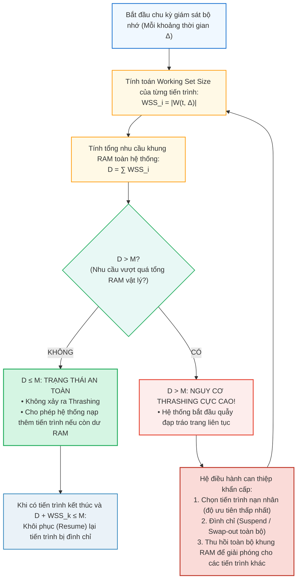

# 1_7_7 Thrashing and the Working Set Model

> **Khóa học**: Cloud DevOps Basic — Hệ Điều Hành (OS Core)  
> **Domain**: 1 Domain 1 - Operating System Core Fundamentals  
> **Chủ đề**: 1_7 Memory Management and Virtual Memory  
> **Trạng thái**: Hoàn thành  
> **Checklist đối chiếu**: [CHECKLIST.md](<../../../CHECKLIST.md#17-memory-management--virtual-memory>) · **Roadmap**: [os/README.md](<../../README.md#module-7-memory-management--virtual-memory>)

---

## 1. Khái Niệm Cốt Lõi & Bản Chất Kỹ Thuật (Core Concepts & Technical Deep Dive)

Trong cơ chế bộ nhớ ảo và nạp trang theo yêu cầu (Demand Paging), hệ điều hành có thể cho phép tổng dung lượng bộ nhớ ảo của tất cả các tiến trình vượt xa kích thước của thanh RAM vật lý thực tế. Miễn là các tiến trình không đồng thời đòi hỏi toàn bộ dữ liệu của chúng, hệ thống vẫn hoạt động trơn tru.

Tuy nhiên, điều gì sẽ xảy ra nếu tổng số trang nhớ mà các tiến trình **đang tích cực sử dụng cùng một lúc** vượt quá sức chứa tối đa của RAM? Khi đó, hệ thống sẽ rơi vào một thảm họa hiệu năng tồi tệ bậc nhất trong khoa học máy tính: hiện tượng **Trì trệ / Quẫy đạp bộ nhớ (Thrashing)**.

```text
+-------------------------------------------------------------------------------+
|                       ĐƯỜNG CONG SỤP ĐỔ HIỆU NĂNG DO THRASHING                |
+-------------------------------------------------------------------------------+
| Hiệu suất CPU (%)                                                             |
| 100% ^                   Đỉnh tối ưu                                          |
|      |                      /\                                                |
|      |                     /  \                                               |
|      |                    /    \  <--- SỤP ĐỔ DO THRASHING                    |
|      |                   /      \      (CPU chỉ lo swap đĩa)                  |
|      |                  /        \                                            |
|      |                 /          \                                           |
|   0% +----------------/------------\--------------------------->              |
|      0        Độ đa chương (Degree of Multiprogramming - Số tiến trình)       |
+-------------------------------------------------------------------------------+
```

### 1.1. Hiện Tượng Thrashing Là Gì?

**Thrashing** là trạng thái bệnh lý nghiêm trọng mà trong đó:
- Hệ thống máy tính dành **hầu hết thời gian (thậm chí 99% thời gian) chỉ để làm một việc duy nhất: hoán đổi trang (swapping/paging) liên tục giữa RAM và ổ cứng**, thay vì thực thi các lệnh tính toán hữu ích của người dùng.
- Tốc độ phát sinh lỗi thiếu trang (**Page Fault Rate**) tăng vọt tới mức chóng mặt.
- Mọi tiến trình đều bị rơi vào trạng thái ngủ chờ I/O (`Blocked / Disk Sleep` hoặc `D` state trên Linux). Hàng đợi I/O của ổ đĩa bị nghẽn $100\%$, trong khi mức sử dụng CPU thực tế tụt dốc không phanh về gần bằng $0\%$.

### 1.2. Vòng Xoáy Tự Hủy Hoại (The Vicious Downward Spiral of Thrashing)

Tại sao hệ điều hành lại tự đẩy mình vào thảm họa Thrashing? Nguyên nhân xuất phát từ một thuật toán tự động điều phối có phần "ngây thơ" của bộ lập lịch:
1. Ban đầu, khi số lượng tiến trình tăng lên, mức sử dụng CPU (CPU Utilization) tăng đều đặn.
2. Đến một ngưỡng giới hạn, tổng nhu cầu trang nhớ của các tiến trình vượt quá dung lượng RAM vật lý. Tiến trình A cần trang mới, hệ điều hành buộc phải tước đoạt một trang của tiến trình B và đẩy ra swap.
3. Khi tiến trình B được CPU cấp lượt chạy, nó lập tức chạm vào trang vừa bị cướp mất $\to$ kích hoạt Page Fault $\to$ CPU đẩy trang của tiến trình C ra đĩa để lấy lại trang cho B.
4. Toàn bộ các tiến trình lần lượt bị chặn chờ nạp đĩa. Bộ điều phối CPU (CPU Scheduler) nhận thấy mức sử dụng CPU tụt giảm nghiêm trọng.
5. **Sai lầm chết người của OS**: Bộ điều phối CPU lầm tưởng rằng hệ thống đang "nhàn rỗi" vì thiếu việc làm. Để tăng mức sử dụng CPU, nó quyết định **nạp thêm các tiến trình mới vào RAM** (tăng Degree of Multiprogramming)!
6. Các tiến trình mới nhảy vào tiếp tục đòi hỏi RAM, làm tốc độ Page Fault tăng vọt theo cấp số nhân. Toàn bộ hệ thống bị đóng băng hoàn toàn.

### 1.3. Nguyên Lý Cục Bộ (Principle of Locality)

Để hiểu cách phòng ngừa Thrashing, trước hết phải hiểu **Nguyên lý Cục bộ**:
- Một chương trình máy tính không truy cập ngẫu nhiên khắp toàn bộ bộ nhớ. Trong một khoảng thời gian ngắn, nó luôn tập trung truy xuất vào một tập hợp trang nhớ cục bộ xác định:
  - **Cục bộ thời gian (Temporal Locality)**: Một ô nhớ vừa được truy xuất thì có xác suất rất cao sẽ được truy xuất lại trong tương lai gần (ví dụ: các biến đếm vòng lặp `for`, mã của các hàm đệ quy).
  - **Cục bộ không gian (Spatial Locality)**: Khi một ô nhớ được truy xuất, các ô nhớ nằm liền kề nó cũng sẽ sớm được truy xuất theo (ví dụ: duyệt tuần tự một mảng dữ liệu, thực thi mã máy tính nối tiếp nhau).

### 1.4. Mô Hình Tập Làm Việc Của Peter J. Denning (The Working Set Model - 1968)

Để ngăn chặn thảm họa Thrashing, nhà khoa học máy tính huyền thoại **Peter J. Denning** đã công bố công trình lịch sử năm 1968 định nghĩa **Mô Hình Tập Làm Việc (Working Set Model)**:

1. **Cửa sổ Tập làm việc ($\Delta$ - Working Set Window)**:
   - Hệ điều hành quy định một tham số $\Delta$, đại diện cho một số lượng lượt tham chiếu bộ nhớ gần nhất (ví dụ: $\Delta = 10.000$ lệnh truy xuất) hoặc một cửa sổ thời gian gần nhất.
2. **Tập làm việc ($W(t, \Delta)$ - Working Set)**:
   - Là tập hợp tất cả các trang ảo **độc nhất** (Unique Pages) mà tiến trình $i$ đã thực sự tham chiếu trong phạm vi cửa sổ $\Delta$ vừa qua.
3. **Kích thước Tập làm việc ($\text{WSS}_i$ - Working Set Size)**:
   - Số lượng trang nhớ nằm trong tập làm việc của tiến trình $i$:
     $$\text{WSS}_i = |W(t, \Delta)|$$
4. **Tổng Nhu Cầu Khung Trang Của Toàn Hệ Thống ($D$)**:
   $$D = \sum_{i=1}^{n} \text{WSS}_i$$
   Trong đó $n$ là tổng số tiến trình đang chạy.

> **Định lý Denning về Thrashing**:
> Gọi $M$ là tổng số Khung RAM vật lý khả dụng trong máy tính:
> - **Nếu $D \le M$**: Mỗi tiến trình đều được cấp phát đủ số khung trang để chứa trọn vẹn Working Set của nó. Tỷ lệ Page Fault cực thấp, hệ thống đạt hiệu năng tối ưu.
> - **Nếu $D > M$**: Dung lượng RAM không đủ chứa tổng Working Set của các tiến trình $\implies$ **HIỆN TƯỢNG THRASHING CHẮC CHẮN SẼ XẢY RA!**

**Chính sách điều phối phòng ngừa Thrashing của Hệ điều hành:**
- Nếu $D > M$, hệ điều hành **tuyệt đối không được nạp thêm tiến trình**.
- Ngược lại, hệ điều hành phải lập tức chọn ra một tiến trình có độ ưu tiên thấp nhất, **đình chỉ hoàn toàn tiến trình đó (Suspend / Swap-out toàn bộ)** và thu hồi toàn bộ các khung RAM của nó để chia sẻ cho các tiến trình còn lại, kéo $D$ giảm xuống mức $\le M$.
- Khi các tiến trình kia hoàn tất và giải phóng bộ nhớ, tiến trình bị đình chỉ mới được nạp trở lại.

### 1.5. Chiến Lược Tần Suất Lỗi Trang (Page Fault Frequency - PFF)

Một giải pháp thực dụng khác để kiểm soát Thrashing là đo lường trực tiếp **Tần suất Lỗi Trang (PFF)** của từng tiến trình:
- Hệ điều hành thiết lập hai ngưỡng an toàn: **Ngưỡng trên ($U$)** và **Ngưỡng dưới ($L$)**.
- **Nếu Page Fault Rate $> U$**: Tiến trình đang bị thiếu trang nhớ nghiêm trọng và có nguy cơ gây Thrashing. Hệ điều hành phải cấp phát thêm khung RAM cho tiến trình này.
- **Nếu Page Fault Rate $< L$**: Tiến trình đang chiếm giữ quá nhiều RAM mà không dùng tới. Hệ điều hành sẽ thu hồi bớt các khung RAM nhàn rỗi của nó để cấp cho tiến trình khác.

---

## 2. Ví Dụ Đời Sống Thực Tế Dễ Hiểu (Intuitive Real-World Analogies)

### Ẩn dụ: Bàn làm việc quá tải hồ sơ (Desk Thrashing)

Hãy tưởng tượng bạn là một chuyên viên xử lý hồ sơ tài chính (Vi xử lý CPU):

- **Bàn làm việc của bạn (Thanh RAM vật lý)**:
  Mặt bàn của bạn chỉ đủ chỗ để mở cùng lúc đúng **4 tập hồ sơ** (4 Khung RAM).
- **Kho lưu trữ dưới tầng hầm (Ổ cứng / Phân vùng Swap)**:
  Có hàng nghìn tập hồ sơ được cất trong kho dưới hầm. Muốn xem tập nào, bạn phải chạy bộ xuống hầm lấy lên mất 10 phút.
- **Trạng thái làm việc tối ưu ($D \le M$)**:
  Bạn đang làm 2 dự án (2 Tiến trình). Mỗi dự án cần đọc thường xuyên 2 tập hồ sơ ($\text{WSS}_1 = 2, \text{WSS}_2 = 2$).
  Tổng nhu cầu là $D = 2 + 2 = 4$ tập hồ sơ. Vừa khít mặt bàn! Bạn ngồi đọc và ký duyệt liên tục cả ngày mà không cần đứng dậy (Mức sử dụng CPU đạt 100%, hiệu suất tối đa).
- **Thảm họa Thrashing ($D > M$)**:
  Sếp của bạn (Bộ điều phối OS) thấy bạn làm việc quá năng suất, liền giao thêm cho bạn 3 dự án nữa! Lúc này bạn có 5 dự án, mỗi dự án cần 2 tập hồ sơ $\implies$ Tổng nhu cầu $D = 10$ tập hồ sơ, trong khi mặt bàn chỉ chứa được 4 tập!
  - Bạn mở trang 1 của Dự án 1. Hết chỗ, bạn phải cất Dự án 2 xuống hầm.
  - Vừa cất xong, dự án 2 cần dùng, bạn lại phải chạy xuống hầm bê Dự án 2 lên và cất Dự án 3 xuống.
  - Vừa đặt chân lên phòng, Dự án 3 lại cần, bạn lại chạy xuống hầm...
  - **Kết quả**: Cả ngày bạn chỉ làm một việc là **chạy lên chạy xuống cầu thang thang máy để đổi hồ sơ (Thrashing)**. Bạn mệt đứt hơi, mồ hôi đầm đìa, trong khi số chữ ký duyệt trên giấy tờ thực tế bằng đúng $0$!

---

## 3. Kiến Trúc, Luồng Hoạt Động & Hình Ảnh Trực Quan (Architecture, Diagrams & Visual Media)

### 3.1. Sơ Đồ Thuật Toán Điều Phối Ngăn Chặn Thrashing Bằng Working Set Model



---

## 4. Code Mẫu Trực Quan Hoặc Dòng Lệnh Thực Chiến (Runnable Sample Code / CLI)

### 4.1. Nhận Diện Dấu Hiệu Thrashing Bằng Dòng Lệnh Linux: `vmstat`

Công cụ mạnh mẽ và phổ biến nhất để chẩn đoán hiện tượng Thrashing trên máy chủ Linux là `vmstat` (Virtual Memory Statistics):

```bash
# Giám sát trạng thái bộ nhớ và CPU mỗi 1 giây
vmstat 1
```

**Bảng đầu ra trên Terminal khi máy chủ rơi vào thảm họa Thrashing:**
```text
procs -----------memory---------- ---swap-- -----io---- -system-- ------cpu-----
 r  b   swpd   free   buff  cache   si   so    bi    bo   in   cs us sy id wa st
 2  8 4194300  45120   1204  18240 18500 19200 18600 19300 4500 8900  1  3  2 94  0
 1  9 4194304  42100   1190  18100 21400 22100 21500 22200 5100 9200  0  2  0 98  0
 3 10 4194304  40500   1180  18050 25600 24800 25700 24900 5800 9800  0  4  0 96  0
```

> **4 DẤU HIỆU SINH TỬ CỦA THRASHING TRÊN `vmstat`:**
> 1. **Cột `b` (Blocked processes)**: Tăng vọt lên $8 - 10$ tiến trình. Các tiến trình đang xếp hàng dài tê liệt vì chờ I/O đĩa.
> 2. **Cột `si` (Swap-In) và `so` (Swap-Out)**: Đều nhảy vọt lên hàng chục nghìn $\text{KB/s}$ liên tục. RAM và Swap đang hoán đổi dữ liệu điên cuồng.
> 3. **Cột `%wa` (I/O Wait CPU)**: Chiếm trọn **$94\% - 98\%$** thời gian của CPU. CPU không làm được việc gì ngoài việc chờ ổ đĩa quay!
> 4. **Cột `%us` (User CPU)**: Tụt dốc thê thảm về **$0\% - 1\%$**. Các ứng dụng thực tế hoàn toàn bị đóng băng!

---

### 4.2. Giám Sát Áp Lực Bộ Nhớ Bằng Linux PSI (Pressure Stall Information)

Từ nhân Linux 4.20+, nhân Linux bổ sung công nghệ tiên tiến **PSI** giúp đo lường chính xác tỷ lệ phần trăm thời gian mà các tác vụ bị trễ do cạn kiệt tài nguyên bộ nhớ:

```bash
# Đọc chỉ số áp lực bộ nhớ thời gian thực từ nhân Linux
cat /proc/pressure/memory
```

**Đầu ra mẫu:**
```text
some avg10=65.20 avg60=54.10 avg300=42.00 total=125482014
full avg10=48.50 avg60=38.20 avg300=25.00 total=98451240
```

> **Giải mã thông số:**
> - `some avg10=65.20`: Trong 10 giây vừa qua, có ít nhất một tác vụ bị đứng hình (stalled) tới **$65.2\%$ thời gian** do phải chờ giải phóng hoặc nạp trang nhớ.
> - `full avg10=48.50`: Có tới **$48.5\%$ thời gian** mà **TOÀN BỘ các CPU cores** trong hệ thống đều bị tê liệt hoàn toàn vì không có luồng nào chạy được do thiếu RAM! Đây là bằng chứng đanh thép của hiện tượng Thrashing.

---

### 4.3. Tham Số Điều Phối Hoán Đổi: `vm.swappiness`

Nhân Linux cung cấp tham số điều khiển mức độ hung hăng khi đẩy dữ liệu ra swap mang tên `vm.swappiness`:
- **Phạm vi giá trị**: Từ `0` đến `200` (giá trị mặc định trong hầu hết các bản phân phối Linux hiện đại là `60`).
- **Ý nghĩa kỹ thuật**: Tỷ lệ cân bằng giữa việc thu hồi bộ nhớ đệm tập tin (Page Cache reclaim) và hoán đổi bộ nhớ ẩn danh của ứng dụng (Anonymous Memory swap).
  - Giá trị thấp (ví dụ: `1` đến `10`): Ưu tiên giữ lại bộ nhớ của tiến trình trong RAM tối đa, chỉ swap khi thực sự cạn kiệt. Thích hợp cho cơ sở dữ liệu và hệ thống độ trễ thấp.
  - Giá trị cao (ví dụ: `100` đến `180`): Tích cực hoán đổi bộ nhớ nhàn rỗi của ứng dụng ra đĩa để dành RAM làm bộ đệm I/O tập tin.

```bash
# Kiểm tra giá trị swappiness hiện tại
cat /proc/sys/vm/swappiness

# Tạm thời thay đổi swappiness xuống 10 cho cụm Database
sudo sysctl vm.swappiness=10
```

---

## 5. Cạm Bẫy Thực Tế & Thực Tiễn Sản Xuất (Production Gotchas & Best Practices)

### 5.1. Cạm Bẫy Swap Trong Môi Trường Kubernetes & Container

- **Quy tắc lịch sử của Kubernetes**: Trong các phiên bản Kubernetes truyền thống (trước K8s 1.22), tài liệu chính thức luôn bắt buộc kỹ sư phải **tắt hoàn toàn Swap** (`swapoff -a`) khi cài đặt Kubernetes Node (Kubelet).
- **Lý do kỹ thuật**:
  1. *Tính toán tài nguyên tất định (Deterministic QoS)*: Nếu cho phép swap, Kubelet không thể đo lường và cưỡng chế chính xác giới hạn `resources.limits.memory` của từng Pod.
  2. *Phòng ngừa Thrashing lây nhiễm chéo*: Nếu một Pod bị rò rỉ bộ nhớ (Memory Leak) và bắt đầu quẫy đạp đĩa (Thrashing), nó sẽ làm nghẽn toàn bộ bus I/O của ổ cứng máy chủ, kéo sập hiệu năng của toàn bộ hàng chục Pod lành tính khác đang cùng chạy trên Node đó!
- **Khuyến nghị thực tiễn**: Tắt Swap trên các Worker Node chuyên dụng của Kubernetes để đảm bảo khi một Pod vượt quá giới hạn RAM, nó sẽ bị tiêu diệt cục bộ ngay lập tức (OOMKilled) thay vì kéo cả cụm máy chủ vào vũng lầy Thrashing.

### 5.2. Lá Chắn Cuối Cùng: Nhân Linux Out-Of-Memory Killer (OOM Killer)

Khi hiện tượng thiếu RAM kéo dài và hệ thống không còn bất kỳ khung RAM nào để hoán đổi, nhân Linux sẽ kích hoạt cơ chế bảo vệ khẩn cấp cuối cùng: **OOM Killer**.
- OOM Killer sẽ duyệt qua danh sách tất cả các tiến trình, chấm điểm mức độ tiêu tốn RAM kết hợp với tham số ưu tiên để tính toán điểm số **`oom_score`** (từ 0 đến 1000).
- Tiến trình nào có `oom_score` cao nhất sẽ bị kernel gửi tín hiệu `SIGKILL` (Signal 9) hủy diệt ngay lập tức để giải phóng RAM, cứu sống toàn bộ máy chủ khỏi việc bị chết cứng.

```bash
# Kiểm tra điểm số oom_score của tiến trình MySQL (PID 3200)
cat /proc/3200/oom_score

# Bảo vệ một tiến trình tối quan trọng (ví dụ sshd) không bao giờ bị OOM Killer bắn chết:
echo -1000 | sudo tee /proc/$(pgrep -o sshd)/oom_score_adj
```

---

## 6. Câu Hỏi Củng Cố Kiến Thức (Active Recall Quiz)

<details>
<summary><b>Câu hỏi 1:</b> Tại sao trong đồ thị biểu diễn mối quan hệ giữa Mức sử dụng CPU (CPU Utilization) và Độ đa chương (Degree of Multiprogramming), khi số lượng tiến trình vượt quá một ngưỡng nhất định thì mức sử dụng CPU lại đột ngột sụp đổ về gần bằng 0%?</summary>

> **Đáp án:**
> - Khi số lượng tiến trình vượt quá ngưỡng an toàn, tổng kích thước tập làm việc của toàn bộ các tiến trình ($D = \sum \text{WSS}_i$) vượt quá tổng số khung RAM vật lý hiện có ($M$).
> - Khi đó, mỗi khi một tiến trình được cấp quyền chạy, nó lập tức gặp lỗi thiếu trang (Page Fault) vì các trang nhớ cần thiết của nó đã bị tiến trình khác tước đoạt và đẩy ra đĩa swap.
> - Tiến trình bị đình chỉ để chờ I/O đĩa. Bộ điều phối CPU chuyển sang tiến trình khác, và tiến trình này cũng lại gặp Page Fault.
> - Kết quả là toàn bộ các tiến trình trong hệ thống đều nằm trong hàng đợi chờ I/O của ổ đĩa. CPU hoàn toàn không có tiến trình nào ở trạng thái Ready để thực thi, khiến mức sử dụng CPU lao dốc tự do về gần 0%.
</details>

<details>
<summary><b>Câu hỏi 2:</b> Trong Mô hình Tập làm việc (Working Set Model) của Peter Denning, điều gì sẽ xảy ra nếu tham số Cửa sổ Tập làm việc (Δ) được cấu hình quá nhỏ hoặc quá lớn?</summary>

> **Đáp án:**
> - **Nếu $\Delta$ quá nhỏ ($\Delta \to 0$)**: Cửa sổ thời gian quá ngắn sẽ không bao quát hết các trang nhớ thực sự cần thiết của pha thực thi hiện tại. Tập làm việc $W(t, \Delta)$ sẽ bị thiếu trang, khiến hệ thống không cấp đủ khung RAM cho tiến trình, dẫn tới việc vẫn xảy ra hiện tượng Page Fault liên tục và Thrashing.
> - **Nếu $\Delta$ quá lớn ($\Delta \to \infty$)**: Tập làm việc $W(t, \Delta)$ sẽ tích lũy và ôm đồm toàn bộ các trang nhớ mà tiến trình từng chạm vào từ lúc khởi chạy (kể cả những trang khởi tạo chỉ dùng một lần trong quá khứ). Kích thước $\text{WSS}$ bị phóng đại quá mức, làm lãng phí dung lượng RAM và hạn chế khả năng chạy đa nhiệm của hệ thống.
</details>

<details>
<summary><b>Câu hỏi 3:</b> Một kỹ sư DevOps nhận được cảnh báo máy chủ sản xuất có Load Average tăng vọt lên 40 (trên máy chủ 8 cores), nhưng khi kiểm tra `top` thì thấy %CPU User chỉ chiếm 2%, trong khi %wa (iowait) chiếm 95%. Lệnh `free -m` cho thấy Swap used đã đạt 100%. Hãy chẩn đoán nguyên nhân và đề xuất phương án xử lý khẩn cấp.</summary>

> **Đáp án:**
> - **Chẩn đoán**: Máy chủ đang bị **Thrashing nghiêm trọng**. Bộ nhớ RAM và phân vùng Swap đã cạn kiệt 100%, các tiến trình liên tục phát sinh Major Page Faults và tranh chấp băng thông ổ đĩa, khiến 40 tiến trình bị dồn ứ trong trạng thái chờ I/O (Disk Sleep), đẩy Load Average lên cao trong khi CPU thực tế không xử lý được gì (%wa = 95%, %us = 2%).
> - **Phương án xử lý khẩn cấp**:
>   1. *Cứu vãn tức thì*: Dùng lệnh `ps aux --sort=-%mem | head -n 10` để tìm tiến trình đang chiếm dụng nhiều RAM nhất (thường là một tiến trình bị rò rỉ bộ nhớ hoặc câu lệnh truy vấn dữ liệu khổng lồ), sau đó dùng `kill -9 <PID>` để lập tức giải phóng RAM và đĩa.
>   2. *Tạm thời giảm độ đa chương*: Dừng bớt các dịch vụ nền không khẩn cấp (cronjobs, backup jobs, batch workers).
>   3. *Khắc phục dài hạn*: Nâng cấp cấu hình RAM vật lý cho máy chủ (Scale Up), tối ưu hóa giới hạn bộ nhớ cho ứng dụng hoặc triển khai kiến trúc mở rộng theo chiều ngang (Scale Out).
</details>

---

## 7. 📚 Nguồn Tài Liệu Chính Thống (Tier-1 Official References)

- [OSTEP Chapter 22: Beyond Physical Memory: Policies (Remzi H. Arpaci-Dusseau and Andrea C. Arpaci-Dusseau)](https://pages.cs.wisc.edu/~remzi/OSTEP/vm-beyondphys-policy.pdf) - Giáo trình chuẩn mực phân tích chính sách thay thế trang, hiện tượng Thrashing và giải pháp kiểm soát (Mục 22.11, trang 14-15).
- [Peter J. Denning (1968), The Working Set Model for Program Behavior (Communications of the ACM, Vol. 11, No. 5)](https://dl.acm.org/doi/10.1145/363095.363141) - Công trình nghiên cứu lịch sử nguyên bản khai sinh khái niệm Working Set Model và định lý phòng ngừa Thrashing.
- [Linux Kernel Documentation: Memory Allocation Tunables & Swappiness](https://docs.kernel.org/admin-guide/sysctl/vm.html) - Tài liệu kỹ thuật chính thức của Linux Kernel về các tham số điều phối bộ nhớ ảo `vm.swappiness`, `vm.max_map_count`, `vm.overcommit_memory`.
- [Linux Kernel Documentation: Pressure Stall Information (PSI)](https://docs.kernel.org/accounting/psi.html) - Đặc tả kỹ thuật chính thức về hệ thống giám sát áp lực tài nguyên CPU, Memory, I/O của nhân Linux.
- [Linux Programmer's Manual: vmstat(8)](https://man7.org/linux/man-pages/man8/vmstat.8.html) - Cẩm nang phân tích các cột chỉ số thống kê bộ nhớ ảo và nhận diện thắt cổ chai hệ thống.
