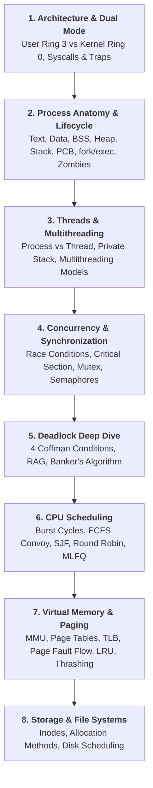

# 🧠 Operating Systems: Core Fundamentals Roadmap

> **Domain**: Operating System Architecture & Classical CS Internals  
> **Tracker Link**: [Return to Master Checklist](../CHECKLIST.md#domain-1-operating-system-core-fundamentals-45-items)  
> **Authoritative References**: *Operating System Concepts* (Silberschatz) | *Modern Operating Systems* (Tanenbaum) | [roadmap.sh/linux](https://roadmap.sh/linux)

---
 
## 🗺️ Visual Curriculum Roadmap



---

## 📚 Detailed Study Modules

### Module 1: OS Architecture & Hardware Protection Modes
1. **The Purpose of an Operating System**: Resource allocation (CPU time, RAM pages, I/O bandwidth) and abstracting messy hardware interfaces into clean programming APIs; preventing catastrophic software bugs from halting hardware.
2. **Dual-Mode Operation (User Mode vs. Kernel Mode)**:
   - **User Mode (Ring 3)**: Unprivileged execution mode where user applications run. Direct hardware and raw physical memory access is prohibited.
   - **Kernel Mode (Ring 0 / Supervisor Mode)**: Privileged execution mode where the OS kernel executes with unrestricted hardware instruction access.
   - **The Hardware Mode Bit**: Stored in the CPU's Program Status Word (PSW). Set to `1` for User Mode and `0` for Kernel Mode.
3. **System Calls (Syscalls) & Software Traps**:
   - A trap is a software-generated interrupt caused by an exceptional condition or an explicit system call instruction (e.g., `syscall` on x86-64, `int 0x80` on 32-bit x86).
   - **Execution Sequence**:
     1. User application places syscall number and arguments in CPU registers.
     2. Application executes `syscall` instruction $\rightarrow$ Hardware switches mode bit to `0` (Kernel Mode) and jumps to the kernel's **Syscall Dispatch Table**.
     3. Kernel executes privileged routine (e.g., `sys_write`), validates pointers, and copies data to kernel buffer.
     4. Kernel executes `sysret` instruction $\rightarrow$ Mode bit resets to `1` (User Mode), resuming application execution.
4. **Kernel Structural Archetypes**:
   - **Monolithic Kernel (Linux)**: Entire OS logic (scheduler, memory manager, VFS, device drivers, network stack) runs inside Ring 0 address space. Delivers maximum performance, but a bug in any driver can panic the entire system.
   - **Microkernel (Mach, seL4, QNX)**: Strips Ring 0 down to minimal primitives: IPC, low-level virtual memory, and basic scheduling. File systems and device drivers run as isolated User Mode daemon processes communicating via message passing.
   - **Hybrid Kernel (Windows NT)**: Combines microkernel message-passing concepts with monolithic performance by executing executive subsystems (I/O, Graphics/GDI) in kernel space.

---

### Module 2: Process Anatomy & Process Lifecycle
1. **Memory Anatomy of a Process**:
   When an executable binary is loaded into virtual memory, it is divided into distinct functional segments:
   - **Text / Code**: Contains compiled machine instructions. Marked read-only to allow multiple process instances to share the same code pages safely.
   - **Data (Initialized)**: Stores global, static, and constant variables explicitly assigned non-zero values in code (e.g., `int count = 10;`).
   - **BSS (Block Started by Symbol - Uninitialized Data)**: Reserves memory for global and static variables not explicitly initialized (e.g., `static char buffer[4096];`). Initialized to zeroes by the kernel on load.
   - **Heap**: Dynamically allocated memory requested at runtime (`malloc()`, `new`). Managed by language runtime allocators; grows upward toward higher memory addresses.
   - **Stack**: Stores execution stack frames, function call parameters, local variables, and return addresses. Grows downward toward lower memory addresses.
   - **Guard Page**: An unmapped virtual memory page between Stack and Heap that triggers a Segmentation Fault (`SIGSEGV`) if the stack overflows.

```text
+-------------------------------------------------------+ High Address (0xFFFFFFFF...)
| Stack (grows downward v)                              |
|   [Local variables, function frames, return address]  |
+-------------------------------------------------------+
|                       |                               |
|                       v                               |
|                                                       |
|                       ^                               |
|                       |                               |
+-------------------------------------------------------+
| Heap (grows upward ^ via malloc/brk)                  |
+-------------------------------------------------------+
| BSS Segment (Uninitialized global & static variables) |
+-------------------------------------------------------+
| Data Segment (Initialized global & static variables)  |
+-------------------------------------------------------+
| Text Segment (Compiled binary machine instructions)   | Low Address (0x00000000...)
+-------------------------------------------------------+
```

2. **Process States (5-State Model)**:
   - **New**: The process is being created and its PCB is being initialized.
   - **Ready**: The process is loaded in memory and waiting for the CPU scheduler to allocate a core.
   - **Running**: Instructions are actively executing on a physical CPU core.
   - **Waiting / Blocked**: The process is suspended waiting for an event or I/O operation (e.g., reading disk, waiting for network socket, sleeping).
   - **Terminated**: The process has finished execution and is awaiting cleanup by its parent.
3. **Process Control Block (PCB)**:
   The kernel's data structure holding everything about a process:
   - Process Identifier: PID and Parent PID (PPID).
   - Process State: Ready, Running, Blocked, etc.
   - Program Counter (PC): Address of the next machine instruction to execute.
   - CPU Registers: Accumulators, index registers, stack pointers, and flags.
   - CPU Scheduling Info: Priority, nice values, pointers to scheduling queues.
   - Memory Management Info: Page table base registers, segment limits.
   - Accounting Information: CPU time consumed, clock limits.
   - I/O Status & Resources: Table of open file descriptors (`stdin: 0`, `stdout: 1`, `stderr: 2`, open sockets, locks).
4. **Process Creation (`fork`, `exec`, `wait`, `exit`)**:
   - `fork()`: Duplicates the calling process. Instead of copying all memory immediately, modern kernels use **Copy-on-Write (CoW)**: pages are marked read-only and shared until either parent or child writes, triggering a page-fault trap that allocates a private duplicate page.
   - `execve()`: Wipes the caller's virtual address space, loads a new binary from disk into the Text/Data segments, resets registers and stack, and begins execution at `main()`.
   - `wait()` / `waitpid()`: Suspends the parent until a child process terminates, reading its exit code (`status`) and allowing the kernel to deallocate the child's PCB.
5. **Zombies vs. Orphans**:
   - **Zombie (`Z`)**: A process that completed execution via `exit()`, but whose parent has not yet called `wait()`. The zombie's memory and open files are released, but its entry in the kernel's process table remains to preserve the exit status.
   - **Orphan**: A child process whose parent died before calling `wait()`. Orphans are immediately adopted by the system's root init process (PID 1, `init` / `systemd`), which continuously calls `wait()` to reap them when they exit.
6. **Context Switching**:
   - The hardware/software sequence that saves the CPU context (registers, PC, stack pointer) of the currently running process into its PCB and restores the saved context from another PCB into hardware registers.
   - **Overhead**: Direct cost (CPU cycles spent saving registers) + Indirect cost (TLB flush and CPU L1/L2/L3 cache misses as the newly scheduled process references different memory addresses).

---

### Module 3: Threads & Multithreading Models
1. **Process vs. Thread (Lightweight Process)**:
   - A **Process** is an independent unit of resource allocation and memory isolation.
   - A **Thread** is the basic unit of CPU execution and scheduling within a process.
   - **What Threads Share in the Same Process**:
     - Virtual Address Space (Code, Data, BSS, Heap).
     - Global variables.
     - Open file descriptors and network sockets.
     - Signal handlers.
   - **What Each Thread Owns Privately**:
     - Unique Thread ID (TID).
     - Private Program Counter (PC).
     - Private Register set.
     - **Private Call Stack** (for local variables and function execution frames).
2. **Concurrency vs. Parallelism**:
   - **Concurrency**: Structuring execution so multiple tasks can make progress over overlapping time periods (interleaving execution via time-slicing on a single CPU core).
   - **Parallelism**: Executing multiple computational tasks simultaneously at the exact same physical instant across multiple distinct CPU cores.
3. **Multithreading Models**:
   - **Many-to-One (User-Level Threads)**: Thread management handled entirely by a user-space library. Kernel is unaware of threads. Very fast context switching (no syscall required), but if any thread makes a blocking system call (like disk I/O), the entire process blocks.
   - **One-to-One (Kernel-Level Threads)**: Every user thread maps directly to an OS kernel thread (Linux NPTL / POSIX `pthreads`, Windows Threads). Allows true multicore parallel execution; blocking syscall in one thread does not block others.
   - **Many-to-Many**: Multiplexes $M$ user threads over $N$ kernel threads ($M \ge N$). Provides fast user-space scheduling with non-blocking kernel concurrency (e.g., Go Goroutine scheduler).

---

### Module 4: Process Synchronization & Concurrency
1. **Race Conditions & Critical Section Problem**:
   - **Race Condition**: A bug where multiple concurrent threads access and manipulate shared data, and the final outcome depends on the non-deterministic order of execution.
   - **Critical Section**: A block of code that accesses shared mutable state (variables, files, linked lists).
   - **The 3 Mandatory Requirements for a Correct Solution**:
     1. **Mutual Exclusion**: If thread $T_i$ is executing in its critical section, no other threads may execute in their critical sections.
     2. **Progress**: If no thread is executing in its critical section and some threads want to enter, only those threads not in their remainder sections can participate in deciding who enters next.
     3. **Bounded Waiting**: There must be a limit on the number of times other threads are allowed to enter their critical sections after a thread has made a request to enter, preventing thread starvation.
2. **Hardware Synchronization Primitives**:
   - Modern CPUs provide atomic instructions executed without interruption:
     - **Test-and-Set**: Atomically reads memory and sets it to true.
     - **Compare-and-Swap (CAS)**: Atomically compares a memory location with an expected value; if equal, swaps it with a new value. Foundation of lock-free data structures.
3. **Synchronization Mechanisms**:
   - **Mutex (Mutual Exclusion Lock)**: A locking mechanism with strict ownership semantics. A thread calls `lock()` before entering the critical section and `unlock()` upon exit. Only the thread holding the lock may release it.
   - **Spinlock**: A lock where waiting threads continuously loop in a CPU busy-wait checking if the lock is free. Ideal for short critical sections where the context switch penalty exceeds the wait duration.
   - **Semaphore (Edsger Dijkstra)**: An integer counter accessed only through two atomic operations:
     - `wait()` / `P()`: Decrements counter. If counter $\le 0$, blocks calling thread.
     - `signal()` / `V()`: Increments counter. Wakes up a blocked thread.
     - **Binary Semaphore**: Counter is 0 or 1 (works like a lock, but has no ownership: thread A can unlock a semaphore locked by thread B).
     - **Counting Semaphore**: Counter initialized to $N$, controlling access to a finite pool of $N$ identical resources.
   - **Condition Variables**: Used in conjunction with a mutex to allow a thread to atomically release the mutex and sleep until signaled that shared state has changed (`wait()`, `signal()`, `broadcast()`).
4. **Classical Synchronization Problems**:
   - **Producer-Consumer (Bounded Buffer)**: Producers add items to a fixed-size queue; consumers remove items. Synchronized using two counting semaphores (`empty` slots and `full` slots) and one binary mutex.
   - **Readers-Writers**: Multiple readers can read simultaneously, but writers require exclusive access. Examines reader-preference starvation of writers vs writer-preference starvation of readers.
   - **Dining Philosophers**: Five philosophers sit around a table with five chopsticks; each philosopher needs both adjacent chopsticks to eat. Classic demonstration of circular wait deadlock and starvation.

---

### Module 5: Deadlock Deep Dive
1. **Deadlock Definition**:
   A situation where a set of processes are blocked permanently because each process holds resources and waits for resources held by other processes in the same set.
2. **The 4 Coffman Conditions (Must all hold simultaneously for Deadlock)**:
   1. **Mutual Exclusion**: At least one resource must be held in a non-shareable mode (only one process can use it at a time).
   2. **Hold and Wait**: A process must currently hold at least one resource and be waiting to acquire additional resources that are currently held by other processes.
   3. **No Preemption**: Resources cannot be forcibly confiscated from a process; they can only be released voluntarily after the process completes its task.
   4. **Circular Wait**: A closed chain of processes exists such that $P_0$ waits for a resource held by $P_1$, $P_1$ waits for $P_2$, ..., and $P_n$ waits for $P_0$.
3. **Resource Allocation Graph (RAG)**:
   - Directed graph with vertices representing Processes ($P$) and Resources ($R$).
   - Request Edge ($P_i \rightarrow R_j$): Process $P_i$ is waiting for Resource $R_j$.
   - Assignment Edge ($R_j \rightarrow P_i$): Resource $R_j$ is allocated to Process $P_i$.
   - **Cycle Theorem**: If a RAG has no cycles, deadlock is impossible. If a cycle exists in a system where every resource has only one instance, deadlock exists with 100% certainty.
4. **Deadlock Handling Strategies**:
   - **Deadlock Ignorance (Ostrich Algorithm)**: Ignore the problem entirely and reboot if deadlock occurs. Used by general-purpose consumer OSs because the cost of constant prevention outweighs the rare occurrence.
   - **Deadlock Prevention**: Invalidate at least one of the 4 Coffman conditions at design time:
     - Invalidate Mutual Exclusion: Make resources shareable (read-only memory).
     - Invalidate Hold and Wait: Require processes to request all resources at initialization, or release all current resources before requesting new ones.
     - Invalidate No Preemption: If process requests an unavailable resource, forcibly preempt all resources it currently holds.
     - **Invalidate Circular Wait**: Impose a strict global numerical ordering on all resources ($R_1 < R_2 < \dots < R_n$) and mandate that processes must request resources strictly in ascending numerical order.
   - **Deadlock Avoidance & Banker's Algorithm (Dijkstra)**:
     - System dynamically inspects every resource request to verify that granting it will leave the system in a **Safe State** (a state where an execution sequence $\langle P_1, P_2, \dots, P_n \rangle$ exists such that each process can satisfy its maximum remaining needs using available resources plus resources released by preceding processes).
     - Matrices tracked: **Available** (vector of free resources), **Max** ($P \times R$ maximum claims), **Allocation** ($P \times R$ currently held), and **Need** ($\text{Max} - \text{Allocation}$).
   - **Deadlock Detection & Recovery**:
     - Construct a **Wait-For Graph** (collapsing resource nodes) and periodically run cycle-detection algorithms (e.g., Tarjan's algorithm $O(V+E)$).
     - Recovery via **Process Termination** (kill all deadlocked processes, or kill one-by-one until cycle breaks) or **Resource Preemption** (checkpoint processes and roll back state).
5. **Deadlock vs. Livelock vs. Starvation**:
   - **Deadlock**: Processes are permanently asleep/blocked waiting for resources that will never be released. Zero CPU consumed.
   - **Livelock**: Processes actively change their execution state in response to each other without making forward progress. Consumes 100% CPU.
   - **Starvation**: A process is ready to run, but perpetually delayed because other processes continuously receive higher priority.

---

### Module 6: CPU Scheduling
1. **Burst Cycles & Preemption**:
   - Process execution consists of alternating **CPU Bursts** (computation) and **I/O Bursts** (disk/network wait).
   - **Non-Preemptive Scheduling**: Once a process gets the CPU, it holds it until it voluntarily yields or blocks for I/O.
   - **Preemptive Scheduling**: The OS kernel can interrupt a running process via hardware timer interrupts and switch CPU to another ready process.
2. **Classical Scheduling Algorithms**:
   - **First-Come, First-Served (FCFS)**: Non-preemptive queue. Simple, but suffers from the **Convoy Effect** (short interactive I/O jobs stuck waiting behind a massive CPU-bound job, cratering CPU/device utilization).
   - **Shortest Job First (SJF & SRTF)**: Assigns CPU to the process with the smallest next CPU burst. Provably yields the lowest theoretical average waiting time. Impossible to implement perfectly in general-purpose OSs because future burst duration cannot be known in advance (approximated via exponential smoothing $\tau_{n+1} = \alpha t_n + (1-\alpha)\tau_n$). Preemptive variant is **Shortest Remaining Time First (SRTF)**.
   - **Priority Scheduling**: Assigns an integer priority to each process. Vulnerable to **Starvation** (low-priority process never runs), solved by **Aging** (gradually increasing a waiting process's priority over time).
   - **Round Robin (RR)**: Preemptive scheduling designed for time-sharing systems. Allocates each process a small unit of CPU time called a **Time Quantum** (typically 10–100ms).
     - If quantum is too large $\rightarrow$ Degrades to FCFS.
     - If quantum is too small $\rightarrow$ CPU spends most of its time executing context switches instead of useful work.
   - **Multilevel Feedback Queue (MLFQ)**: The gold standard for modern operating systems. Multiple priority queues with differing time quanta:
     - New processes enter the highest priority queue with a short quantum.
     - If a process uses its entire quantum without blocking for I/O, it is downgraded to a lower priority queue with a larger quantum.
     - If a process blocks for I/O, it remains at or is promoted to a higher priority queue.
     - Periodically boosts all processes to top queue to prevent starvation.

---

### Module 7: Memory Management & Virtual Memory
1. **Logical vs. Physical Address Space & The MMU**:
   - **Logical (Virtual) Address**: Address generated by the CPU during instruction execution.
   - **Physical Address**: Actual hardware memory location in physical RAM chips.
   - **Memory Management Unit (MMU)**: Hardware component on the CPU that translates every virtual address to a physical address on-the-fly.
2. **Contiguous Allocation & Memory Fragmentation**:
   - **External Fragmentation**: Total free memory space across the system is sufficient to satisfy an allocation request, but it is broken into non-contiguous chunks. Solved by compaction or paging.
   - **Internal Fragmentation**: Allocated memory is larger than the requested payload (e.g., allocating a full 4096-byte page for a 12-byte string).
3. **Paging Architecture**:
   - Physical memory is broken into fixed-size blocks called **Frames** (typically 4096 bytes / 4KB).
   - Logical memory is broken into identical fixed-size blocks called **Pages**.
   - **Page Table**: Per-process table mapping virtual page numbers (VPN) to physical frame numbers (PFN).
   - **Page Table Entry (PTE) Bits**:
     - **Valid/Invalid Bit**: `1` = page is present in physical RAM; `0` = page is on disk/swap or unallocated.
     - **Read/Write/Execute Bits**: Memory access permissions.
     - **Dirty (Modified) Bit**: Set to `1` by hardware whenever a write instruction modifies the page (determines if page must be written back to disk before being replaced).
     - **Reference / Access Bit**: Set to `1` by hardware whenever the page is read or written.
4. **Translation Lookaside Buffer (TLB)**:
   - High-speed associative hardware cache on the CPU chip storing recent virtual-to-physical address mappings.
   - **TLB Hit**: Address translation resolved in sub-nanosecond hardware time.
   - **TLB Miss**: CPU must walk multi-level page tables in physical RAM, causing multiple memory access cycles.
5. **Demand Paging & The Page Fault Lifecycle**:
   Pages are loaded into RAM only when referenced by an instruction.
   **Step-by-Step Page Fault Handling**:
   ```mermaid
   sequenceDiagram
       autonumber
       actor CPU as CPU Instruction
       participant MMU as MMU / Page Table
       participant OS as OS Kernel Page Fault Handler
       participant Disk as Swap / Storage Disk
       participant RAM as Physical RAM Frame

       CPU->>MMU: Reference Virtual Address
       MMU->>MMU: Check PTE Valid Bit (Valid = 0)
       MMU->>OS: Trigger Page Fault Exception (Hardware Trap)
       OS->>OS: Validate address against process PCB memory regions
       OS->>Disk: Issue asynchronous disk read for missing page
       Disk->>RAM: Copy 4KB page bytes into free frame
       OS->>MMU: Update Page Table (PFN = new frame, Valid Bit = 1)
       OS->>CPU: Return from Trap & Restart faulted instruction
   ```
6. **Page Replacement Algorithms**:
   When physical RAM is full and a page fault occurs, an existing victim frame must be evicted to swap.
   - **FIFO**: Evicts oldest loaded page. Suffers from **Belady's Anomaly** (a counter-intuitive phenomenon where increasing the number of physical frames increases the total number of page faults).
   - **Optimal (OPT / MIN)**: Evicts the page that will not be used for the longest period in the future. Impossible to implement in practice; used as a theoretical benchmark.
   - **Least Recently Used (LRU)**: Evicts the page that has not been referenced for the longest past time. High hardware implementation overhead (timestamp or stack required).
   - **Second-Chance (Clock Algorithm)**: Practical approximation of LRU. Operates as a circular queue inspecting the hardware Reference Bit: if `0`, replace; if `1`, clear bit to `0`, advance hand, and give page a second chance.
7. **Thrashing & The Working Set Model**:
   - **Thrashing**: A state where the system spends more time reading and writing pages to swap than executing user instructions. Occurs when physical RAM is overcommitted and processes continuously steal frames from each other.
   - **Working Set**: The set of pages actively referenced by a process during a sliding time window $\Delta$. If $\sum \text{Working Set Sizes} > \text{Total RAM}$, thrashing is mathematically guaranteed.

---

### Module 8: Storage & File Systems
1. **File Concept & Directory Organization**:
   - File attributes (Name, Identifier, Size, Permissions, Timestamps).
   - Hierarchical tree directory structure; hard links (multiple directory entries pointing to the same Inode) vs soft/symbolic links (file containing a path string to another file).
2. **File Allocation Methods**:
   - **Contiguous Allocation**: Blocks allocated sequentially on disk. Excellent read speed, but causes external fragmentation and requires knowing file size in advance.
   - **Linked Allocation**: Each block contains a pointer to the next block. No external fragmentation, but very slow random access and pointer corruption risks.
   - **Indexed Allocation (Inodes)**: Dedicated index block (Inode) contains direct pointers to data blocks, plus single-indirect, double-indirect, and triple-indirect pointers to support massive file sizes.
3. **Disk Scheduling Algorithms**:
   - **FCFS**: Serves requests in arrival order; high seek time.
   - **SSTF (Shortest Seek Time First)**: Selects request closest to current disk head; prone to starvation of distant requests.
   - **SCAN (Elevator Algorithm)**: Head moves in one direction servicing requests until reaching the end of disk, then reverses direction.
   - **C-SCAN (Circular SCAN)**: Head moves in one direction servicing requests; upon reaching the end, immediately jumps back to the beginning without servicing requests on the return trip, providing uniform wait times.

---

## 📚 Tier-1 Canonical References
- *Operating System Concepts* (10th Edition) - Abraham Silberschatz, Peter B. Galvin, Greg Gagne (*The Dinosaur Book*).
- *Modern Operating Systems* (4th Edition) - Andrew S. Tanenbaum, Herbert Bos.
- [Linux Kernel Documentation](https://docs.kernel.org/) - Official Linux Kernel guides and source specs.
- [Microsoft Learn: User Mode and Kernel Mode](https://learn.microsoft.com/en-us/windows-hardware/drivers/gettingstarted/user-mode-and-kernel-mode) - Windows hardware execution rings.
- [Linux Manual Pages](https://man7.org/linux/man-pages/) - POSIX API standards (`fork(2)`, `clone(2)`, `execve(2)`, `pthreads(7)`).
