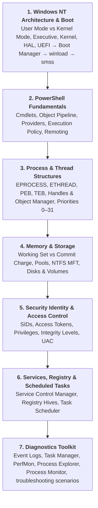

# 🪟 Windows Systems Realization: Architecture & Diagnostics Roadmap

> **Domain**: Windows NT Architecture & Systems Internals  
> **Tracker Link**: [Return to Master Checklist](../CHECKLIST.md#domain-4-operating-system-realization-windows-internals-22-items)  
> **Authoritative References**: [Microsoft Learn: Windows Architecture](https://learn.microsoft.com/en-us/windows-hardware/drivers/gettingstarted/user-mode-and-kernel-mode) | [Microsoft Learn: PowerShell](https://learn.microsoft.com/en-us/powershell/scripting/overview) | [Microsoft Learn: Sysinternals](https://learn.microsoft.com/en-us/sysinternals/) | *Windows Internals* (Russinovich, Solomon, Ionescu)

> **Scope note**: Modules 2, 5 and 6 are the day-to-day administration skills a DevOps engineer needs on every Windows Server or Windows VM. Modules 1, 3 and 4 show how the theory from [os/README.md](../os/README.md) is implemented in Windows NT. Module 7 ties everything together for troubleshooting. Windows networking commands (`ipconfig`, `netstat`, Windows Defender Firewall) are taught in [network/README.md](../network/README.md). Active Directory is out of scope.

---

## 🗺️ Visual Curriculum Roadmap

---

## 📚 Detailed Study Modules

### Module 1: Windows NT Kernel Architecture, Execution Modes & Boot
1. **User Mode (Ring 3) vs. Kernel Mode (Ring 0)**:
   - **User Mode**: Where applications and user-mode subsystems run in isolated private virtual address spaces:
     - Subsystem DLLs: `kernel32.dll`, `user32.dll`, `gdi32.dll` translating Win32 API calls into native system calls (`ntdll.dll`).
     - Subsystem Processes: Session Manager (`smss.exe`), Local Security Authority Subsystem Service (`lsass.exe`), Service Control Manager (`services.exe`).
   - **Kernel Mode**: Privileged components with direct access to hardware and system memory:
     - **Executive**: High-level OS subsystems (Memory Manager, Process and Thread Manager, Security Reference Monitor, I/O Manager, Object Manager).
     - **Kernel**: Low-level scheduling, thread dispatching, interrupt/exception handling, and multiprocessor synchronization.
     - **Hardware Abstraction Layer (HAL)**: Hardware-specific DLL (`hal.dll`) hiding low-level motherboard/CPU chipset differences from the kernel.
     - **Device Drivers**: Filesystem, network, and hardware drivers (`.sys`).
2. **System Call Dispatching (`ntdll.dll` to `ntoskrnl.exe`)**:
   - Applications call high-level Win32 APIs (e.g., `ReadFile()`) in `kernel32.dll`.
   - `kernel32.dll` invokes undocumented native API `NtReadFile()` in `ntdll.dll`.
   - `ntdll.dll` issues CPU `syscall` instruction, switching the CPU to Ring 0 and calling the system service dispatcher in `ntoskrnl.exe`.
3. **The Windows Boot Process**:
   - Boot phases as described by Microsoft Learn: PreBoot (UEFI firmware or BIOS) → Windows Boot Manager (reads the Boot Configuration Data, BCD) → Windows OS Loader (`winload`, loads the kernel and boot-start drivers) → Windows NT OS Kernel initialization.
   - The kernel then starts the Session Manager (`smss.exe`), which starts the session processes that launch `services.exe`, `lsass.exe` and `winlogon.exe`.
   - Inspection: `bcdedit /enum` (elevated), and the boot-time entries in the System event log.

---

### Module 2: PowerShell and Windows Command-Line Fundamentals
1. **PowerShell Fundamentals: Cmdlets & the Object Pipeline**:
   - Two editions: Windows PowerShell 5.1 (built into Windows, `powershell.exe`) and PowerShell 7.x (cross-platform, installed side by side, `pwsh.exe`). Always state which one a command was tested on.
   - Cmdlets use `Verb-Noun` names; discover them with `Get-Command`, `Get-Help`, and inspect output objects with `Get-Member`.
   - The pipeline passes .NET **objects**, not text: `Get-Process | Where-Object CPU -gt 100 | Sort-Object CPU -Descending | Select-Object -First 5`.
   - Providers expose data stores as drives: `C:` (FileSystem), `HKLM:` / `HKCU:` (Registry), `Env:`, `Cert:`.
   - Legacy `cmd.exe` commands still exist; know when you are in which shell.
2. **PowerShell Scripts, Execution Policy & Remoting**:
   - Scripts (`.ps1`), the execution policies (`Restricted`, `AllSigned`, `RemoteSigned`, `Unrestricted`, `Bypass`, `Undefined`) and their scopes (`Get-ExecutionPolicy -List`). Microsoft states the execution policy is not a security system that restricts user actions.
   - Remote administration: WinRM-based PowerShell Remoting (`Enable-PSRemoting`, `Enter-PSSession`, `Invoke-Command`) and SSH-based remoting in PowerShell 7 with OpenSSH for Windows.

---

### Module 3: Windows Process & Thread Architecture
1. **Kernel Data Structures (`EPROCESS` and `ETHREAD`)**:
   - **`EPROCESS` (Executive Process Block)**: The primary kernel data structure representing a process. Holds directory table base (pointer to page tables), process ID (`UniqueProcessId`), token (security credentials), handle table, and virtual memory statistics.
   - **`KPROCESS` (Kernel Process Block)**: Embedded inside `EPROCESS`; stores low-level scheduling parameters (base priority, quantum, thread list head).
   - **`ETHREAD` (Executive Thread Block)**: Kernel data structure representing a single thread. Points to parent `EPROCESS`, thread ID (`Cid`), start address, and access token.
   - **`KTHREAD` (Kernel Thread Block)**: Embedded inside `ETHREAD`; holds scheduling state (priority, thread state: Ready, Standby, Running, Waiting).
2. **User-Space Blocks (`PEB` and `TEB`)**:
   - **PEB (Process Environment Block)**: Allocated in user space for each process. Stores process parameters, image base address, command-line string, environment variables, and list of loaded DLLs (`Ldr`).
   - **TEB (Thread Environment Block)**: Allocated in user space for each thread. Stores thread-local storage (TLS) pointers, Thread ID, and structured exception handling (SEH) frame pointer.
3. **The Windows Object Manager & `HANDLE`s**:
   - Windows treats all system resources (Processes, Threads, Files, Mutexes, Events, Semaphores, Sections/Shared Memory) as kernel **Objects**.
   - User applications cannot access object memory directly; instead, the OS provides an opaque 32/64-bit integer called a **`HANDLE`**.
   - A handle is an index into the process's private kernel Handle Table. Closing handles when finished (`CloseHandle()`) prevents handle leaks.
4. **Process Creation (`CreateProcess`)**:
   - `CreateProcess()` creates a new process and its primary thread; `CreateThread()` adds threads; handle inheritance from parent to child.
   - Compare with Linux `fork()` + `exec()` (one call that loads a new image, instead of copy-then-replace).
5. **Thread Scheduling & Priorities**:
   - Windows schedules **threads**, not processes, preemptively using time slices (quantums).
   - Priority levels `0`–`31`: a thread's base priority comes from its process's priority class plus the thread's relative priority; levels `16`–`31` are the real-time range.
   - Dynamic priority boosts (for example after I/O completion or for the foreground window).
   - Inspection: `Get-Process | Select-Object Name, PriorityClass`, Task Manager "Set priority", Process Explorer thread view.

---

### Module 4: Windows Memory Management & Storage Internals
1. **Working Set vs. Commit Charge (Crucial Windows Metrics)**:
   - **Working Set**: The physical RAM (in bytes) currently allocated to a process:
     - **Private Working Set**: Physical RAM dedicated exclusively to this process (cannot be shared with other processes).
     - **Shareable Working Set**: Physical RAM pages backing loaded DLLs or memory-mapped files that could be shared with other processes.
   - **Commit Charge**: The total virtual memory allocated by the application that the operating system has guaranteed to back with either physical RAM or the paging file (`pagefile.sys`).
   - **Out-of-Memory in Windows**: Occurs when the system reaches its **Commit Limit** (Total RAM + Paging File Size), triggering the Windows "System is low on virtual memory" alert.
2. **Paged Pool vs. Non-Paged Pool**:
   - **Non-Paged Pool**: Kernel memory guaranteed to reside permanently in physical RAM. Used by interrupt service routines (ISRs) and hardware drivers that cannot afford a page fault.
   - **Paged Pool**: Kernel memory that can be safely paged out to `pagefile.sys` when physical memory is scarce.
3. **NTFS Architecture & Permissions**:
   - **Master File Table (MFT)**: Heart of NTFS. Every file and folder on an NTFS volume has at least one 1024-byte record in the MFT describing its attributes, timestamps, and data runs.
   - **Small File Optimization**: If a file is smaller than ~700 bytes, NTFS stores the file data *directly inside* the MFT record ("resident attribute"), requiring zero external cluster lookups.
   - **Access Control Lists (ACLs)**:
     - **DACL (Discretionary Access Control List)**: Identifies which users and groups are granted or denied permissions (Read, Write, Execute).
     - **SACL (System Access Control List)**: Specifies audit logging rules (e.g., generate a Windows Security Event when a file is modified).
   - Viewing and editing ACLs from the command line: `icacls`, `Get-Acl`.
4. **Disks, Partitions & Volumes**:
   - Partition styles (GPT vs MBR), partitions, volumes, drive letters and mount points.
   - Bringing a new data disk online: `Get-Disk` → `Initialize-Disk` → `New-Partition` → `Format-Volume`; `Get-Volume`; `diskpart` and Disk Management (`diskmgmt.msc`) as alternatives.

---

### Module 5: Windows Security Identity and Access Control
1. **Accounts, Groups & Security Identifiers (SIDs)**:
   - Every user, group and computer account is identified by a SID (for example `S-1-5-21-<domain>-<RID>`), not by its name; well-known SIDs such as LocalSystem (`S-1-5-18`) and built-in Administrators (`S-1-5-32-544`).
   - Local accounts and groups (`Get-LocalUser`, `Get-LocalGroupMember Administrators`); service accounts LocalSystem, LocalService, NetworkService.
   - `whoami /user /groups`.
2. **Access Tokens, Privileges, Integrity Levels & UAC**:
   - At logon, Windows creates an access token (user SID, group SIDs, privileges); every process runs with a copy of it. The Security Reference Monitor compares the token with an object's DACL on every access check.
   - Privileges (for example `SeDebugPrivilege`, `SeBackupPrivilege`): `whoami /priv`.
   - Mandatory Integrity Control levels (Low, Medium, High, System).
   - User Account Control (UAC): an administrator normally runs with a filtered standard-user token and elevates ("Run as administrator") to use the full token.

---

### Module 6: Windows Services, Registry and Scheduled Tasks
1. **Windows Services & the Service Control Manager (SCM)**:
   - Services are long-running background processes managed by the SCM (`services.exe`); many share a host process (`svchost.exe`).
   - Startup types (Automatic, Automatic (Delayed Start), Manual, Disabled), the account a service runs as, dependencies, and recovery actions on failure.
   - Commands: `Get-Service`, `Start-Service`, `Stop-Service`, `Restart-Service`, `Set-Service -StartupType`; `sc.exe query` / `sc.exe qc` / `sc.exe config` (type `sc.exe`, because `sc` is an alias for `Set-Content` in Windows PowerShell).
2. **The Windows Registry**:
   - A hierarchical configuration database. Predefined root keys: `HKEY_LOCAL_MACHINE`, `HKEY_CURRENT_USER`, `HKEY_CLASSES_ROOT`, `HKEY_USERS`, `HKEY_CURRENT_CONFIG`.
   - Hives are backed by files on disk (system hives under `%SystemRoot%\System32\config`, per-user `NTUSER.DAT`).
   - Keys and value types (`REG_SZ`, `REG_EXPAND_SZ`, `REG_MULTI_SZ`, `REG_DWORD`, `REG_QWORD`, `REG_BINARY`).
   - Tools: `regedit`, `reg query` / `reg add` / `reg export`, and the PowerShell registry provider (`Get-ItemProperty HKLM:\...`). Export a key before changing it.
3. **Task Scheduler**:
   - Tasks combine triggers (time, startup, logon, event), actions, conditions and the account to run as.
   - Commands: `schtasks /query`, `schtasks /create`, `Get-ScheduledTask`, `Register-ScheduledTask`; task history in the `Microsoft-Windows-TaskScheduler/Operational` event log.
   - Compare with Linux cron and systemd timers.

---

### Module 7: Practical Windows Diagnostics & Performance Toolkit

| Tool | Focus Area | Diagnostic Use Case & Capabilities |
| :--- | :--- | :--- |
| **Event Viewer (`eventvwr.msc`) / `Get-WinEvent`** | Logs / First Place to Look | Windows Logs (Application, Security, Setup, System) and Applications and Services Logs; filter by log, level, provider and Event ID: `Get-WinEvent -FilterHashtable @{LogName='System'; Level=2} -MaxEvents 20`; `wevtutil qe` from `cmd.exe`. |
| **Windows Task Manager** | Overview / Quick Triage | Displays high-level CPU, Memory, Disk, and Network utilization. "Details" tab exposes PID, Status, Working Set, and Commit Size columns. |
| **Resource Monitor (`resmon.exe`)** | Deep Per-Process Resource Attribution | Displays real-time per-process disk read/write throughput (B/s), network connection endpoints, and detailed physical memory layout (Hardware Reserved, In Use, Modified, Standby, Free). |
| **Performance Monitor (`perfmon.exe`)** | Historical Metrics & Counters | Collects and charts high-frequency performance counters: `\Processor(_Total)\% Processor Time`, `\Memory\Available MBytes`, `\Paging File(_Total)\% Usage`. |
| **Sysinternals Process Explorer (`procexp.exe`)** | Deep Process & Handle Inspection | Advanced Task Manager replacement. Displays full parent-child process hierarchy trees, loaded DLLs, memory commit graphs, and allows searching which process holds a file handle lock. |
| **Sysinternals Process Monitor (`procmon.exe`)** | Real-Time I/O Event Logging | High-speed kernel filter driver capturing every filesystem access, registry read/write, process creation, and network socket activity with nanosecond timestamps and call stacks. |

**Troubleshooting Scenarios (combining the tools above)**:
- A service will not start → System log entries from the Service Control Manager, `sc.exe qc <service>` (account, dependencies, binary path).
- High CPU → Task Manager / Process Explorer to find the process, then its threads.
- Memory leak → a process's commit (private bytes) keeps growing in PerfMon or Process Explorer.
- Handle leak → the Handles column keeps growing.
- "The file is in use" → Process Explorer *Find Handle or DLL*.
- An application fails silently → Process Monitor filtered on the process, looking for `ACCESS DENIED` or `NAME NOT FOUND` results.

---

## 📚 Tier-1 Canonical References
- [Microsoft Learn: User Mode and Kernel Mode](https://learn.microsoft.com/en-us/windows-hardware/drivers/gettingstarted/user-mode-and-kernel-mode) - Architectural separation of execution modes.
- [Microsoft Learn: Advanced troubleshooting for Windows boot problems](https://learn.microsoft.com/en-us/troubleshoot/windows-client/performance/windows-boot-issues-troubleshooting) - The boot phases from PreBoot to the kernel.
- [Microsoft Learn: Virtual Address Spaces](https://learn.microsoft.com/en-us/windows-hardware/drivers/gettingstarted/virtual-address-spaces) - Official guide to 32-bit and 64-bit Windows virtual memory.
- [Microsoft Learn: about_Pipelines](https://learn.microsoft.com/en-us/powershell/module/microsoft.powershell.core/about/about_pipelines) - How PowerShell passes objects through the pipeline.
- [Microsoft Learn: Differences between Windows PowerShell 5.1 and PowerShell 7.x](https://learn.microsoft.com/en-us/powershell/scripting/whats-new/differences-from-windows-powershell) - Edition and version differences.
- [Microsoft Learn: about_Execution_Policies](https://learn.microsoft.com/en-us/powershell/module/microsoft.powershell.core/about/about_execution_policies) - Execution policies and scopes.
- [Microsoft Learn: Scheduling Priorities](https://learn.microsoft.com/en-us/windows/win32/procthread/scheduling-priorities) - Priority classes, levels, and base priority.
- [Microsoft Learn: Security Identifiers](https://learn.microsoft.com/en-us/windows/win32/secauthz/security-identifiers) - SID structure and use.
- [Microsoft Learn: Access Tokens](https://learn.microsoft.com/en-us/windows/win32/secauthz/access-tokens) - Contents and role of access tokens.
- [Microsoft Learn: How User Account Control works](https://learn.microsoft.com/en-us/windows/security/application-security/application-control/user-account-control/how-it-works) - Filtered tokens and elevation.
- [Microsoft Learn: Service Control Manager](https://learn.microsoft.com/en-us/windows/win32/services/service-control-manager) - How services are installed, started, and controlled.
- [Microsoft Learn: Registry Hives](https://learn.microsoft.com/en-us/windows/win32/sysinfo/registry-hives) - Hives and their backing files.
- [Microsoft Learn: Task Scheduler](https://learn.microsoft.com/en-us/windows/win32/taskschd/task-scheduler-start-page) - Tasks, triggers, and actions.
- [Microsoft Learn: Get-WinEvent](https://learn.microsoft.com/en-us/powershell/module/microsoft.powershell.diagnostics/get-winevent) - Querying event logs from PowerShell.
- [Microsoft Learn: Windows Sysinternals](https://learn.microsoft.com/en-us/sysinternals/) - Canonical manuals for Process Explorer, Process Monitor, and core diagnostic tools.
- *Windows Internals* (Part 1 & Part 2, 7th Edition) - Mark Russinovich, David A. Solomon, Alex Ionescu (Microsoft Press).
