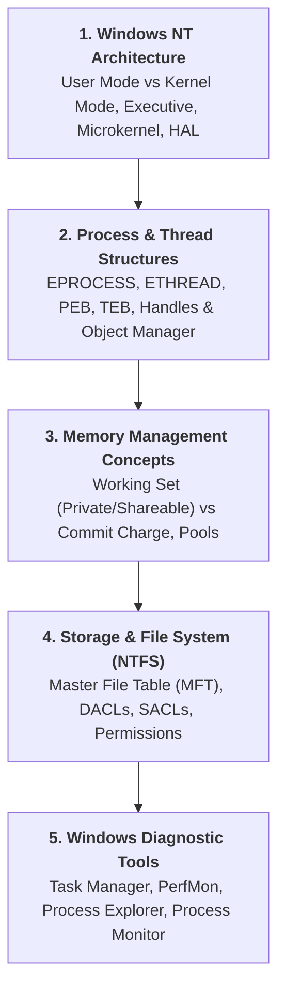

# 🪟 Windows Systems Realization: Architecture & Diagnostics Roadmap

> **Domain**: Windows NT Architecture & Systems Internals  
> **Tracker Link**: [Return to Master Checklist](../CHECKLIST.md#domain-4-operating-system-realization-windows-internals-10-items)  
> **Authoritative References**: [Microsoft Learn: Windows Architecture](https://learn.microsoft.com/en-us/windows-hardware/drivers/gettingstarted/user-mode-and-kernel-mode) | [Microsoft Learn: Sysinternals](https://learn.microsoft.com/en-us/sysinternals/) | *Windows Internals* (Russinovich, Solomon, Ionescu)

---

## 🗺️ Visual Curriculum Roadmap

---

## 📚 Detailed Study Modules

### Module 1: Windows NT Kernel Architecture & Execution Modes
1. **User Mode (Ring 3) vs. Kernel Mode (Ring 0)**:
   - **User Mode**: Where applications and user-mode subsystems run in isolated private virtual address spaces:
     - Subsystem DLLs: `kernel32.dll`, `user32.dll`, `gdi32.dll` translating Win32 API calls into native system calls (`ntdll.dll`).
     - Subsystem Processes: Session Manager (`smss.exe`), Local Security Authority Subsystem Service (`lsass.exe`), Service Control Manager (`services.exe`).
   - **Kernel Mode**: Privileged components with direct access to hardware and system memory:
     - **Executive**: High-level OS subsystems (Memory Manager, Process and Thread Manager, Security Reference Monitor, I/O Manager, Object Manager).
     - **Kernel**: Low-level scheduling, thread dispatching, interrupt/exception handling, and multiprocessor synchronization.
     - **Hardware Abstraction Layer (HAL)**: Hardware-specific DLL (`hal.dll`) hiding low-level motherboard/CPU chipset differences from the kernel.
     - **Device Drivers**: Filesystem, network, and hardware drivers (`.sys`).
2. **System Call Dispatching (`ntdll.dll` to `ntoskrnl.exe`)**:
   - Applications call high-level Win32 APIs (e.g., `ReadFile()`) in `kernel32.dll`.
   - `kernel32.dll` invokes undocumented native API `NtReadFile()` in `ntdll.dll`.
   - `ntdll.dll` issues CPU `syscall` instruction, switching the CPU to Ring 0 and calling the system service dispatcher in `ntoskrnl.exe`.

---

### Module 2: Windows Process & Thread Architecture
1. **Kernel Data Structures (`EPROCESS` and `ETHREAD`)**:
   - **`EPROCESS` (Executive Process Block)**: The primary kernel data structure representing a process. Holds directory table base (pointer to page tables), process ID (`UniqueProcessId`), token (security credentials), handle table, and virtual memory statistics.
   - **`KPROCESS` (Kernel Process Block)**: Embedded inside `EPROCESS`; stores low-level scheduling parameters (base priority, quantum, thread list head).
   - **`ETHREAD` (Executive Thread Block)**: Kernel data structure representing a single thread. Points to parent `EPROCESS`, thread ID (`Cid`), start address, and access token.
   - **`KTHREAD` (Kernel Thread Block)**: Embedded inside `ETHREAD`; holds scheduling state (priority, thread state: Ready, Standby, Running, Waiting).
2. **User-Space Blocks (`PEB` and `TEB`)**:
   - **PEB (Process Environment Block)**: Allocated in user space for each process. Stores process parameters, image base address, command-line string, environment variables, and list of loaded DLLs (`Ldr`).
   - **TEB (Thread Environment Block)**: Allocated in user space for each thread. Stores thread-local storage (TLS) pointers, Thread ID, and structured exception handling (SEH) frame pointer.
3. **The Windows Object Manager & `HANDLE`s**:
   - Windows treats all system resources (Processes, Threads, Files, Mutexes, Events, Semaphores, Sections/Shared Memory) as kernel **Objects**.
   - User applications cannot access object memory directly; instead, the OS provides an opaque 32/64-bit integer called a **`HANDLE`**.
   - A handle is an index into the process's private kernel Handle Table. Closing handles when finished (`CloseHandle()`) prevents handle leaks.

---

### Module 3: Windows Memory Management & Storage Internals
1. **Working Set vs. Commit Charge (Crucial Windows Metrics)**:
   - **Working Set**: The physical RAM (in bytes) currently allocated to a process:
     - **Private Working Set**: Physical RAM dedicated exclusively to this process (cannot be shared with other processes).
     - **Shareable Working Set**: Physical RAM pages backing loaded DLLs or memory-mapped files that could be shared with other processes.
   - **Commit Charge**: The total virtual memory allocated by the application that the operating system has guaranteed to back with either physical RAM or the paging file (`pagefile.sys`).
   - **Out-of-Memory in Windows**: Occurs when the system reaches its **Commit Limit** (Total RAM + Paging File Size), triggering the Windows "System is low on virtual memory" alert.
2. **Paged Pool vs. Non-Paged Pool**:
   - **Non-Paged Pool**: Kernel memory guaranteed to reside permanently in physical RAM. Used by interrupt service routines (ISRs) and hardware drivers that cannot afford a page fault.
   - **Paged Pool**: Kernel memory that can be safely paged out to `pagefile.sys` when physical memory is scarce.
3. **NTFS Architecture & Permissions**:
   - **Master File Table (MFT)**: Heart of NTFS. Every file and folder on an NTFS volume has at least one 1024-byte record in the MFT describing its attributes, timestamps, and data runs.
   - **Small File Optimization**: If a file is smaller than ~700 bytes, NTFS stores the file data *directly inside* the MFT record ("resident attribute"), requiring zero external cluster lookups.
   - **Access Control Lists (ACLs)**:
     - **DACL (Discretionary Access Control List)**: Identifies which users and groups are granted or denied permissions (Read, Write, Execute).
     - **SACL (System Access Control List)**: Specifies audit logging rules (e.g., generate a Windows Security Event when a file is modified).

---

### Module 4: Practical Windows Diagnostics & Performance Toolkit

| Tool | Focus Area | Diagnostic Use Case & Capabilities |
| :--- | :--- | :--- |
| **Windows Task Manager** | Overview / Quick Triage | Displays high-level CPU, Memory, Disk, and Network utilization. "Details" tab exposes PID, Status, Working Set, and Commit Size columns. |
| **Resource Monitor (`resmon.exe`)** | Deep Per-Process Resource Attribution | Displays real-time per-process disk read/write throughput (B/s), network connection endpoints, and detailed physical memory layout (Hardware Reserved, In Use, Modified, Standby, Free). |
| **Performance Monitor (`perfmon.exe`)** | Historical Metrics & Counters | Collects and charts high-frequency performance counters: `\Processor(_Total)\% Processor Time`, `\Memory\Available MBytes`, `\Paging File(_Total)\% Usage`. |
| **Sysinternals Process Explorer (`procexp.exe`)** | Deep Process & Handle Inspection | Advanced Task Manager replacement. Displays full parent-child process hierarchy trees, loaded DLLs, memory commit graphs, and allows searching which process holds a file handle lock. |
| **Sysinternals Process Monitor (`procmon.exe`)** | Real-Time I/O Event Logging | High-speed kernel filter driver capturing every filesystem access, registry read/write, process creation, and network socket activity with nanosecond timestamps and call stacks. |

---

## 📚 Tier-1 Canonical References
- [Microsoft Learn: User Mode and Kernel Mode](https://learn.microsoft.com/en-us/windows-hardware/drivers/gettingstarted/user-mode-and-kernel-mode) - Architectural separation of execution modes.
- [Microsoft Learn: Virtual Address Spaces](https://learn.microsoft.com/en-us/windows-hardware/drivers/gettingstarted/virtual-address-spaces) - Official guide to 32-bit and 64-bit Windows virtual memory.
- [Microsoft Learn: Windows Sysinternals](https://learn.microsoft.com/en-us/sysinternals/) - Canonical manuals for Process Explorer, Process Monitor, and core diagnostic tools.
- *Windows Internals* (Part 1 & Part 2, 7th Edition) - Mark Russinovich, David A. Solomon, Alex Ionescu (Microsoft Press).
