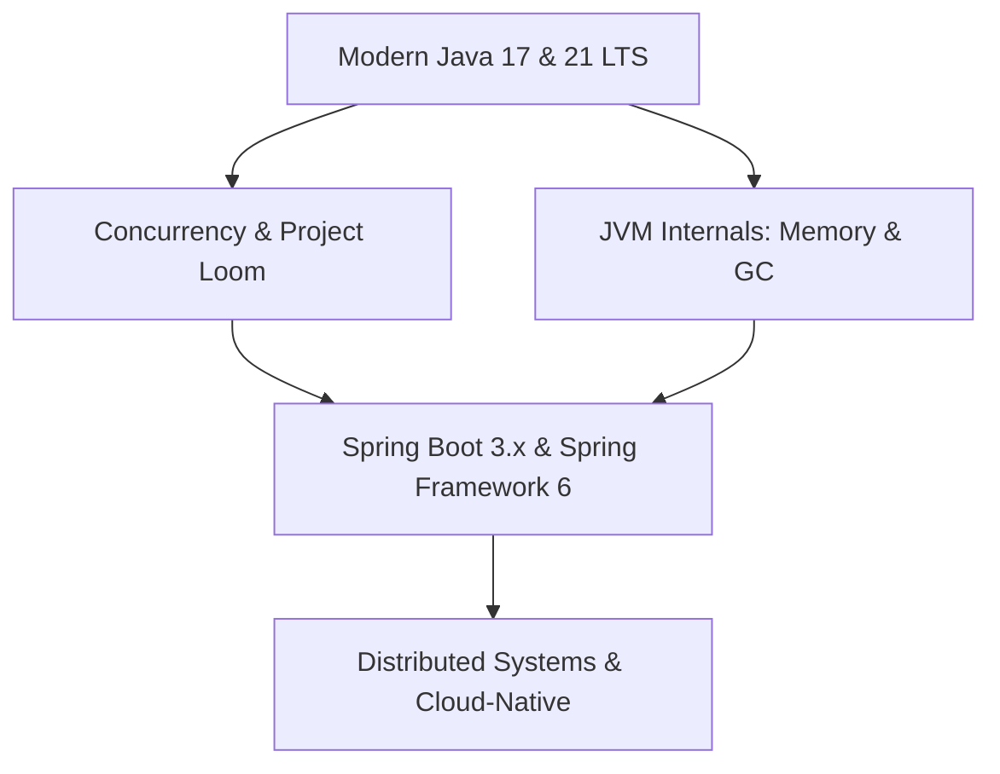

# Java & Backend Engineering Learning Track

Kho lưu trữ kiến thức, phân tích chuyên sâu mã nguồn, JVM internals và hệ sinh thái Spring Boot.

---

## 🗺️ Lộ Trình Học Tập (Curriculum Roadmap)

### Phân Hệ 1: Java Hiện Đại (Modern Java Language Features)
- **Vị trí**: `java/01-core-java/`
- **Nội dung**: Java 17/21 LTS, `record`, `sealed` classes, Pattern Matching for `switch` / `instanceof`, Text Blocks, Sequenced Collections, Modern Stream API idioms.
- **Tài liệu chính thức**: [Oracle Java SE 21 Language Specs](https://docs.oracle.com/en/java/javase/21/language/)

### Phân Hệ 2: Đa Luồng & Project Loom (Concurrency & Loom)
- **Vị trí**: `java/02-jvm-concurrency/`
- **Nội dung**: Virtual Threads (`Thread.ofVirtual()`), Structured Concurrency, Scoped Values, Thread pool tuning, CompletableFuture, Concurrent Data Structures, Java Memory Model (JMM, volatile, happens-before).
- **Tài liệu chính thức**: [JEP 444: Virtual Threads](https://openjdk.org/jeps/444), [Java Concurrency Guide](https://docs.oracle.com/en/java/javase/21/core/virtual-threads.html)

### Phân Hệ 3: Cơ Chế Hoạt Động JVM & Tối Ưu (JVM Internals)
- **Nội dung**: JVM Memory Layout (Heap Eden/Survivor/Tenured, Metaspace, Stack), Garbage Collectors (G1 GC, Generational ZGC), JIT Compilation, ClassLoader, JDK Flight Recorder (JFR).
- **Tài liệu chính thức**: [HotSpot Virtual Machine Garbage Collection Tuning Guide](https://docs.oracle.com/en/java/javase/21/gctuning/)

### Phân Hệ 4: Hệ Sinh Thái Spring Boot (Enterprise Spring Boot 3.x)
- **Vị trí**: `java/03-spring-boot/`
- **Nội dung**: Spring Boot 3.x, Spring Framework 6 (`jakarta.*`), Spring Data JPA / Hibernate 6 internals (N+1 queries, fetch plans, caching), Spring Security 6 (OAuth2, JWT, SecurityFilterChain), Spring Cloud & Microservices.
- **Tài liệu chính thức**: [Spring Boot Reference Documentation](https://docs.spring.io/spring-boot/docs/current/reference/html/)

### Phân Hệ 5: Bài Tập Thực Hành (Hands-on Labs)
- **Vị trí**: `java/labs/`
- Các mini-project, bài kiểm tra benchmark JMH, unit & integration test với JUnit 5, Mockito và Testcontainers.

---

## 📚 Nguồn Học Chính Thống (Official References)
- [Oracle Java SE Documentation](https://docs.oracle.com/en/java/javase/)
- [OpenJDK Official Website & JEPs](https://openjdk.org/)
- [Spring Framework & Spring Boot Documentation](https://docs.spring.io/)
- [Jakarta EE Specifications](https://jakarta.ee/specifications/)
