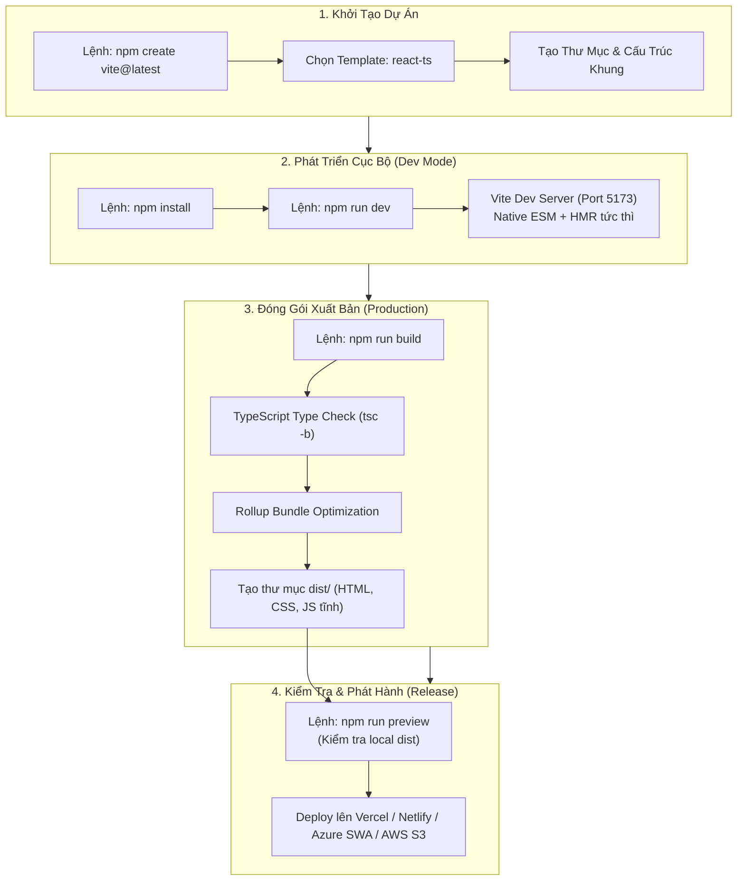

# Scaffold and Run a React + Vite Project

> **Khóa học**: Modern Frontend Engineering (React + Vite)  
> **Phân nhóm**: Domain 1: Vite and Modern Web Tooling  
> **Chủ đề**: 1_1 Project Initialization and Workflow  
> **Trạng thái**: [ ] Đang học  
> **Checklist đối chiếu**: [CHECKLIST](../../CHECKLIST.md)

---

## 1. Khái Niệm Cốt Lõi & Bản Chất Kỹ Thuật (Core Technical Deep Dive)

Trong hệ sinh thái Frontend hiện đại, **Create React App (CRA)** đã chính thức bị React Team dừng khuyến nghị (deprecated). Thay vào đó, **Vite** trở thành công cụ nền tảng tiêu chuẩn để khởi tạo ứng dụng React Single Page Application (SPA) nhờ tốc độ khởi động tức thì và cấu trúc hiện đại.

### 1.1 Cơ Chế Tạo Dự Án (Scaffolding)
Lệnh khởi tạo chính thức từ Vite:
```bash
# Sử dụng npm
npm create vite@latest my-react-app -- --template react-ts

# Hoặc sử dụng pnpm (khuyến nghị cho tốc độ tối ưu)
pnpm create vite my-react-app --template react-ts

# Hoặc sử dụng bun
bun create vite my-react-app --template react-ts
```

> [!NOTE]
> **Lưu ý về cú pháp `npm create`**:
> Dấu `--` bổ sung ở giữa là bắt buộc khi dùng `npm` để truyền tham số `--template react-ts` tới trình thực thi scaffolding bên dưới (`create-vite`), tránh bị npm nuốt mất flag.

### 1.2 Các Template React Phổ Biến
Vite cung cấp sẵn 4 template React chính thức:
- `react`: React với JavaScript thuần (sử dụng plugin `@vitejs/plugin-react` với Babel).
- `react-ts`: React với TypeScript (khuyến nghị cho dự án chuyên nghiệp).
- `react-swc`: React với JavaScript nhưng dùng **SWC** (compiler viết bằng Rust) thay thế Babel để tăng tốc chuyển đổi JSX.
- `react-swc-ts`: React với TypeScript và SWC.

### 1.3 Vòng Đời Lệnh Thực Thi (Scripts Lifecycle)
Sau khi khởi tạo, tệp `package.json` định nghĩa 4 scripts cốt lõi:

| Lệnh | Công cụ ngầm | Mục đích | Bản chất kỹ thuật |
| :--- | :--- | :--- | :--- |
| `npm run dev` | Vite Dev Server + `esbuild` | Phát triển cục bộ | Chạy server HTTP cục bộ tại cổng `5173`. Không gom file (no bundling), phục vụ native ESM trực tiếp khi trình duyệt request. Bật WebSocket HMR. |
| `npm run build` | `tsc` + `Rollup` | Đóng gói xuất bản | Chạy trình kiểm tra kiểu TypeScript (`tsc -b`), sau đó dùng `Rollup` gom mã nguồn, tree-shaking, minification, băm tên file (`hash`) ra thư mục `dist/`. |
| `npm run preview` | Vite Preview Server | Kiểm thử bản build | Khởi động server tĩnh cục bộ phục vụ trực tiếp các file trong `dist/`. Giúp kiểm tra hoạt động production thực tế trước khi deploy lên hosting. |
| `npm run lint` | ESLint | Kiểm tra mã nguồn | Rà soát lỗi cú pháp, quy tắc React Hooks (`eslint-plugin-react-hooks`). |

---

## 2. Ví Dụ Đời Sống Thực Tế Dễ Hiểu (Intuitive Real-World Analogy)

Hãy hình dung quy trình xây dựng và vận hành một **Quán Cà Phê Hiện Đại**:

1. **`npm create vite` (Giai đoạn Dựng Quầy)**:
   - Bạn đặt một module quầy pha chế tiền chế được thiết kế chuẩn mực: có sẵn bồn rửa (`index.html`), máy pha cà phê (`vite.config.ts`) và quầy phục vụ mẫu (`App.tsx`). Bạn không cần tự đi đúc từng viên gạch.
2. **`npm run dev` (Chế độ Thử Nghiệm Món Mới)**:
   - Khách hàng (Trình duyệt) vào gọi món gì thì Barista mới xay hạt và pha đúng ly đó (On-demand Native ESM). Bạn đổi công thức si-rô, ly nước đổi vị ngay trước mắt khách mà không cần đóng cửa quán để dọn dẹp lại từ đầu (HMR).
3. **`npm run build` (Đóng Chai Hàng Loạt Chuẩn Công Nghiệp)**:
   - Khi công thức đã hoàn hảo, bạn đưa vào dây chuyền đóng chai tiệt trùng, dán nhãn mã vạch, xếp vào thùng gọn gàng (thư mục `dist/`) để sẵn sàng xuất khẩu lên xe tải (Cloud Hosting/CDN).
4. **`npm run preview` (Uống Thử Chai Thành Phẩm)**:
   - Bạn mở một chai đã đóng thùng ra uống thử xem hương vị có chuẩn y hệt như lúc pha tại quầy hay không, đảm bảo không có lỗi phát sinh trước khi giao cho đối tác.

---

## 3. Sơ Đồ Kiến Trúc & Hình Ảnh Trực Quan (Mermaid & Official Visual Media)

### 3.1 Vòng Đời Dự Án React + Vite Từ Khởi Tạo Đến Xuất Bản


### 3.2 Cơ Chế Native ESM Trong Lúc `npm run dev`
Khi chạy `npm run dev`, Vite không đóng gói toàn bộ dự án thành một file JS khổng lồ mà chỉ serve file theo yêu cầu của trình duyệt:


---

## 4. Hướng Dẫn Thực Hành & Code Mẫu (Hands-on CLI & Configuration)

### Bước 1: Khởi tạo và cài đặt dự án
Mở terminal và thực thi các câu lệnh sau:

```bash
# 1. Khởi tạo dự án tên là "my-learning-app" với template React TypeScript
npm create vite@latest my-learning-app -- --template react-ts

# 2. Di chuyển vào thư mục dự án
cd my-learning-app

# 3. Cài đặt toàn bộ các gói thư viện
npm install

# 4. Khởi chạy máy chủ phát triển
npm run dev
```

Sau khi chạy `npm run dev`, terminal sẽ hiển thị:
```text
  VITE v6.x.x  ready in 180 ms

  ➜  Local:   http://localhost:5173/
  ➜  Network: use --host to expose
  ➜  press h + enter to show help
```

### Bước 2: Tệp `package.json` chuẩn sau khởi tạo
```json
{
  "name": "my-learning-app",
  "private": true,
  "version": "0.0.0",
  "type": "module",
  "scripts": {
    "dev": "vite",
    "build": "tsc -b && vite build",
    "lint": "eslint .",
    "preview": "vite preview"
  },
  "dependencies": {
    "react": "^19.0.0",
    "react-dom": "^19.0.0"
  },
  "devDependencies": {
    "@types/react": "^19.0.0",
    "@types/react-dom": "^19.0.0",
    "@vitejs/plugin-react": "^4.3.0",
    "eslint": "^9.0.0",
    "typescript": "~5.7.0",
    "vite": "^6.0.0"
  }
}
```

### Bước 3: Cấu hình cổng và mở mạng LAN (Tùy chọn)
Nếu muốn mở cho điện thoại hoặc thiết bị khác trong cùng mạng Wi-Fi truy cập, hoặc đổi cổng thành `3000`, chỉnh sửa `vite.config.ts`:

```ts
import { defineConfig } from 'vite';
import react from '@vitejs/plugin-react';

// https://vite.dev/config/
export default defineConfig({
  plugins: [react()],
  server: {
    port: 3000,      // Đổi cổng từ 5173 thành 3000
    host: true,       // Lắng nghe trên toàn bộ địa chỉ IP mạng nội bộ (0.0.0.0)
    open: true,       // Tự động mở trình duyệt khi dev server khởi động
  },
});
```

---

## 📚 Nguồn Tài Liệu Chính Thống (Tier-1 Official References)
- [Vite Guide: Getting Started](https://vite.dev/guide/) - Hướng dẫn khởi tạo và các lệnh chính thức của Vite.
- [React Official: Start a New React Project](https://react.dev/learn/start-a-new-react-project) - Tài liệu React khuyến nghị sử dụng Vite / modern frameworks.
