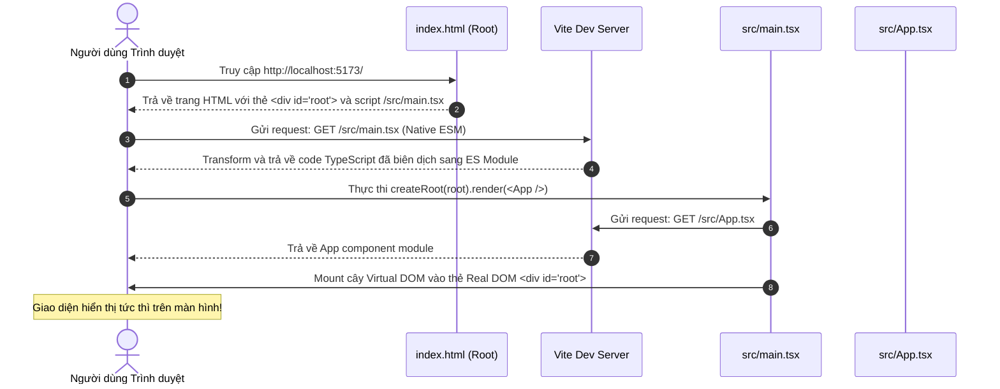

# Project Anatomy and Root index.html

> **Khóa học**: Modern Frontend Engineering (React + Vite)  
> **Phân nhóm**: Domain 1: Vite and Modern Web Tooling  
> **Chủ đề**: 1_1 Project Initialization and Workflow  
> **Trạng thái**: [ ] Đang học  
> **Checklist đối chiếu**: [CHECKLIST](../../CHECKLIST.md)

---

## 1. Khái Niệm Cốt Lõi & Bản Chất Kỹ Thuật (Core Technical Deep Dive)

Một trong những khác biệt kiến trúc lớn nhất giữa **Vite** và các công cụ đóng gói truyền thống (Webpack, Create React App) nằm ở cách tổ chức cấu trúc dự án và vị trí của tệp `index.html`.

### 1.1 Giải Phẫu Thư Mục Chuẩn Của Dự Án React + Vite
```text
my-react-app/
├── index.html              # Entry point cốt lõi của toàn bộ ứng dụng (nằm ở ROOT)
├── package.json            # Khai báo dependencies, scripts (dev, build, preview)
├── tsconfig.json           # Cấu hình TypeScript tổng quát
├── tsconfig.app.json       # Cấu hình TypeScript cho mã nguồn trong src/
├── tsconfig.node.json      # Cấu hình TypeScript cho các tệp cấu hình Node (vite.config.ts)
├── vite.config.ts          # Tệp cấu hình chính của Vite và các Plugins
├── public/                 # Chứa tài nguyên tĩnh không cần xử lý (favicon, robots.txt)
└── src/                    # Toàn bộ mã nguồn ứng dụng React
    ├── main.tsx            # Điểm bắt đầu của React, mount Virtual DOM vào #root
    ├── App.tsx             # Component gốc (Root Component) của cây React
    ├── App.css             # CSS cho Component App
    ├── index.css           # CSS toàn cục (Global reset, Typography, Tailwind/Variables)
    ├── assets/             # Hình ảnh, icons được import trực tiếp trong code
    └── vite-env.d.ts       # Khai báo kiểu TypeScript cho Vite client (import.meta.env)
```

### 1.2 Tại Sao `index.html` Lại Nằm Ở Thư Mục Gốc (Root)?

| Tiêu chí | Create React App / Webpack | Vite Tooling |
| :--- | :--- | :--- |
| **Vị trí `index.html`** | Nằm trong `public/index.html` | Nằm ngay tại thư mục gốc `index.html` |
| **Vai trò** | Chỉ là file template HTML thụ động. Webpack tự động inject các thẻ `<script>` đã đóng gói vào cuối trang. | **Là điểm nhập mã nguồn (Source Code Entry Point)** của cả ứng dụng. |
| **Thẻ Script** | Trình duyệt không biết file nguồn ở đâu cho đến khi Webpack biên dịch xong. | Chứa trực tiếp: `<script type="module" src="/src/main.tsx"></script>`. Trình duyệt đọc trực tiếp thẻ này và bắt đầu kéo module native ESM. |
| **URL phân giải** | Phải dùng cú pháp biến môi trường `%PUBLIC_URL%/favicon.ico`. | Đường dẫn tĩnh tương đối hoặc tuyệt đối tự nhiên: `/vite.svg`. |

### 1.3 `src/main.tsx` - Cầu Nối React Với DOM Trình Duyệt
Tệp `main.tsx` thực hiện đúng một nhiệm vụ cốt lõi: Kết nối ứng dụng React với thẻ `<div id="root"></div>` trong `index.html`:

```tsx
import { StrictMode } from 'react';
import { createRoot } from 'react-dom/client';
import './index.css';
import App from './App.tsx';

// 1. Tìm phần tử DOM thực tế có id="root"
const rootElement = document.getElementById('root');

if (!rootElement) {
  throw new Error('Không tìm thấy phần tử root trong index.html');
}

// 2. Tạo React Root và Render Component gốc
createRoot(rootElement).render(
  <StrictMode>
    <App />
  </StrictMode>
);
```

- **`createRoot` (React 18/19)**: Thay thế cho `ReactDOM.render` cũ, kích hoạt kiến trúc Concurrent Mode của React.
- **`<StrictMode>`**: Chế độ nghiêm ngặt giúp phát hiện tác dụng phụ (side-effects). Trong môi trường Dev (`npm run dev`), `StrictMode` sẽ **chạy render và effect 2 lần** để rà soát rò rỉ bộ nhớ hoặc hàm không thuần khiết.

---

## 2. Ví Dụ Đời Sống Thực Tế Dễ Hiểu (Intuitive Real-World Analogy)

Hãy so sánh cấu trúc này với **Tòa Soạn Báo & Bài Báo Trang Bìa**:

1. **`index.html` chính là Bìa Trang Nhất**:
   - Khách mua báo mở tờ báo ra là thấy ngay trang bìa (`index.html`). Trên trang bìa có một mục tiêu đề lớn: *"Xem phóng sự chi tiết tại Trang 3"* (`<script type="module" src="/src/main.tsx">`). Khách lật thẳng tới trang 3 theo hướng dẫn mà không cần người bán báo phải đọc thuộc toàn bộ cuốn báo trước mặt khách.
2. **`<div id="root">` là Khung Đặt Ảnh Chính**:
   - Bìa báo đã chừa sẵn một khung trống hoàn hảo (`#root`). Họa sĩ React (`main.tsx`) chỉ việc mang bức tranh hoàn chỉnh (`<App />`) đặt gọn gàng vào đúng khung đó.
3. **`public/` vs `src/assets/`**:
   - `public/`: Tờ rơi quảng cáo kẹp thêm ngoài sạp báo - ai lấy thì lấy, không ai kiểm tra chính tả (tài nguyên giữ nguyên gốc).
   - `src/assets/`: Ảnh chụp phóng viên nộp cho tòa soạn - được biên tập viên chỉnh sáng, nén dung lượng, đổi tên bài bản trước khi in (được Vite tối ưu hóa và gắn mã băm).

---

## 3. Sơ Đồ Kiến Trúc & Luồng Khởi Động Ứng Dụng (Architecture Diagram)



---

## 4. Code Mẫu Trực Quan & Giải Phẫu Các Tệp Cốt Lõi

### Tệp 1: `index.html`
```html
<!doctype html>
<html lang="vi">
  <head>
    <meta charset="UTF-8" />
    <link rel="icon" type="image/svg+xml" href="/vite.svg" />
    <meta name="viewport" content="width=device-width, initial-scale=1.0" />
    <title>Dự Án Học Tập React + Vite</title>
  </head>
  <body>
    <!-- Điểm neo duy nhất để React gắn kết toàn bộ giao diện -->
    <div id="root"></div>

    <!-- Điểm nhập xuất phát của toàn bộ mã nguồn -->
    <script type="module" src="/src/main.tsx"></script>
  </body>
</html>
```

### Tệp 2: `src/App.tsx` (Root Component Mẫu)
```tsx
import React, { useState } from 'react';
import './App.css';

export const App: React.FC = () => {
  const [count, setCount] = useState<number>(0);

  return (
    <div className="app-container">
      <h1>Chào Mừng Đến Với React + Vite!</h1>
      <p>Ứng dụng đã khởi chạy thành công qua Native ESM.</p>
      <div className="card">
        <button onClick={() => setCount((prev) => prev + 1)}>
          Số lần click: {count}
        </button>
      </div>
      <p className="hint">
        Chỉnh sửa <code>src/App.tsx</code> và lưu lại để thấy HMR cập nhật tức thì.
      </p>
    </div>
  );
};

export default App;
```

---

## 📚 Nguồn Tài Liệu Chính Thống (Tier-1 Official References)
- [Vite Guide: Index.html and Source Root](https://vite.dev/guide/#index-html-and-project-root) - Tài liệu giải thích lý do `index.html` nằm ở thư mục gốc.
- [React Docs: createRoot](https://react.dev/reference/react-dom/client/createRoot) - Tài liệu chính thức về cơ chế khởi tạo Root của React DOM.
