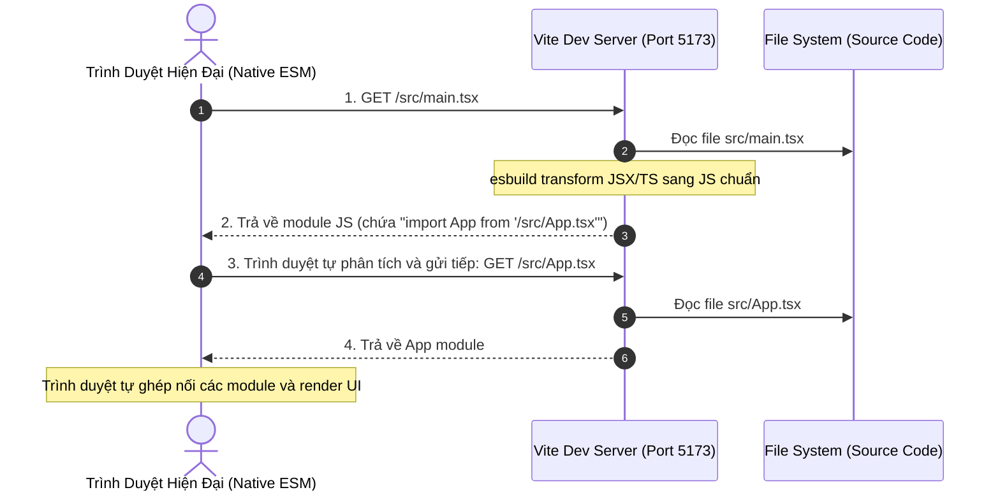

# How Vite Uses Native ESM

> **Khóa học**: Modern Frontend Engineering (React + Vite)  
> **Phân nhóm**: Domain 1: Vite and Modern Web Tooling  
> **Chủ đề**: 1_2 Vite Architecture & Native ESM  
> **Trạng thái**: [ ] Đang học  
> **Checklist đối chiếu**: [CHECKLIST](../../CHECKLIST.md)

---

## 1. Khái Niệm Cốt Lõi & Bản Chất Kỹ Thuật (Core Technical Deep Dive)

Trước khi Vite xuất hiện, các công cụ đóng gói (bundlers) như Webpack, Rollup hay Parcel là giải pháp bắt buộc để chạy ứng dụng web. Tuy nhiên, khi quy mô ứng dụng phình to lên hàng trăm hoặc hàng nghìn module, thời gian khởi động môi trường phát triển (Dev Server) trở thành "nỗi ác mộng" (thường mất từ 30 giây đến vài phút).

### 1.1 Vấn Đề Cốt Lõi Của Bundler Truyền Thống
Để phục vụ một trang web local, bundler truyền thống phải thực hiện chu trình:
1. Quét toàn bộ cây phụ thuộc (dependency graph) từ tệp entry point.
2. Biên dịch (transpile) toàn bộ mã nguồn của **tất cả** các tệp trong dự án.
3. Đóng gói (bundle) toàn bộ mã nguồn thành một hoặc vài tệp bundle lớn nằm trong bộ nhớ RAM.
4. Mới bắt đầu khởi động Dev Server và cho phép trình duyệt truy cập.

> **Độ phức tạp thuật toán**: Thời gian khởi động là $O(N)$ tỷ lệ thuận với số lượng module trong dự án. Càng nhiều file, server khởi động càng chậm.

### 1.2 Cuộc Cách Mạng Native ES Modules (Native ESM)
Kể từ đặc tả ES2015 (ES6), tất cả các trình duyệt hiện đại (Chrome, Firefox, Safari, Edge) đều đã hỗ trợ **Native ES Modules**:
- Trình duyệt tự hiểu cú pháp `import` và `export` gốc.
- Khi gặp thẻ `<script type="module" src="/src/main.tsx">`, trình duyệt sẽ tự động phân tích cú pháp và tự mình gửi các request HTTP để kéo từng module phụ thuộc về khi cần.

### 1.3 Cơ Chế "On-Demand" Của Vite
Vite tận dụng triệt để khả năng Native ESM của trình duyệt để đảo ngược hoàn toàn quy trình:
1. **Khởi Động Tức Thì (Cold Start Trong Vài Mili-giây)**: Vite chia mã nguồn thành 2 phần:
   - **Dependencies (Thư viện bên thứ ba - React, Lodash...)**: Được pre-bundle trước bằng `esbuild` (viết bằng ngôn ngữ Go, siêu tốc).
   - **Source Code (Mã nguồn do lập trình viên viết)**: Vite **hoàn toàn không đóng gói trước** (No bundling). Dev server khởi động ngay lập tức ($O(1)$).
2. **Biên Dịch Theo Yêu Cầu (On-Demand Transformation)**:
   - Khi bạn truy cập trang Home, trình duyệt chỉ gửi yêu cầu tải các component hiển thị trên trang Home.
   - Vite đón nhận request HTTP đó, chỉ biên dịch đúng tệp đó sang JS chuẩn và trả về ngay lập tức. Các màn hình khác chưa được người dùng click tới sẽ không bị biên dịch, tiết kiệm 100% tài nguyên CPU.
3. **Bộ Nhớ Đệm HTTP Cực Đoan (Aggressive HTTP Caching)**:
   - **Dependencies**: Được gán header `Cache-Control: max-age=31536000,immutable` (trình duyệt lưu vào cache vĩnh viễn, không request lại lần 2).
   - **Source Code**: Được gán mã phản hồi HTTP `304 Not Modified` qua `ETag` (chỉ re-fetch khi file thực sự thay đổi).

---

## 2. Ví Dụ Đời Sống Thực Tế Dễ Hiểu (Intuitive Real-World Analogy)

Hãy so sánh hai phong cách phục vụ ẩm thực:

1. **Mô Hình Tiệc Cưới Truyền Thống (Traditional Bundler)**:
   - Nhà hàng bắt buộc phải nấu chín toàn bộ 50 món ăn trong thực đơn, sắp sẵn lên 100 bàn tiệc thì mới mở cổng cho khách bước vào nhà hàng. Dù khách mới vào chỉ muốn uống một cốc nước lọc, cả gian bếp vẫn phải làm việc cật lực trong 2 tiếng trước đó.
2. **Mô Hình Băng Chuyền Sushi A-La-Carte (Vite Native ESM)**:
   - Nhà hàng mở toang cửa đón khách ngay lập tức trong 1 giây. Khách ngồi vào ghế và gọi món "Cá hồi nướng", đầu bếp ở quầy mới bắt đầu nướng đúng đĩa cá hồi đó và đặt lên băng chuyền đưa cho khách. Các món khác trong menu chưa ai gọi thì nguyên liệu vẫn nằm nguyên trong tủ lạnh!

---

## 3. Sơ Đồ Kiến Trúc & Hình Ảnh Trực Quan (Mermaid & Official Visual Media)

### 3.1 So Sánh Cơ Chế Hoạt Động

#### A. Bundler-Based Dev Server (Webpack)
Toàn bộ mã nguồn phải được crawl và đóng gói trước khi server sẵn sàng:


#### B. Vite Native ESM Dev Server
Server khởi động tức thì, trình duyệt tự gửi HTTP request kéo từng file ESM khi cần:


### 3.2 Luồng Tương Tác HTTP Chi Tiết Trong Vite


---

## 4. Code Mẫu Thực Tế & Quan Sát Qua Network Tab

### 4.1 Khảo Sát Thẻ Script Trong `index.html`
Trình duyệt nhận diện native module nhờ thuộc tính `type="module"`:

```html
<!DOCTYPE html>
<html lang="vi">
  <head>
    <meta charset="UTF-8" />
    <title>Khảo Sát Native ESM</title>
  </head>
  <body>
    <div id="root"></div>

    <!-- Trình duyệt sẽ phát tín hiệu GET /src/main.tsx với header 'Accept: */*' -->
    <script type="module" src="/src/main.tsx"></script>
  </body>
</html>
```

### 4.2 Mã Nguồn Trình Duyệt Nhận Được (Đã Được Vite Transform)
Khi bạn mở DevTools (F12) -> Tab **Network**, bạn sẽ thấy phản hồi của tệp `main.tsx` không phải là file bundle lớn mà là một ES module sạch sẽ:

```javascript
// Phản hồi từ http://localhost:5173/src/main.tsx
import { createHotContext as __vite__createHotContext } from "/@vite/client";
import.meta.hot = __vite__createHotContext("/src/main.tsx");

import { StrictMode } from "/node_modules/.vite/deps/react.js?v=a1b2c3d4";
import { createRoot } from "/node_modules/.vite/deps/react-dom_client.js?v=a1b2c3d4";
import "/src/index.css";
import App from "/src/App.tsx";

createRoot(document.getElementById("root")).render(
  <StrictMode>
    <App />
  </StrictMode>
);
```

> [!TIP]
> **Điểm mấu chốt**:
> - Các import từ thư viện thứ 3 (`react`, `react-dom`) được Vite chuyển đổi từ bare import (`import React from 'react'`) thành đường dẫn hợp lệ của trình duyệt (`/node_modules/.vite/deps/react.js`).
> - Tệp `App.tsx` được giữ nguyên dạng `import App from "/src/App.tsx"` để trình duyệt tiếp tục gửi một request riêng biệt lấy `App.tsx`.

---

## 📚 Nguồn Tài Liệu Chính Thống (Tier-1 Official References)
- [Vite Guide: Why Vite?](https://vite.dev/guide/why.html) - Phân tích chi tiết sự chậm chạp của Bundler và giải pháp Native ESM của Vite.
- [MDN Web Docs: JavaScript modules](https://developer.mozilla.org/en-US/docs/Web/JavaScript/Guide/Modules) - Tiêu chuẩn kỹ thuật của Native ES Modules trên trình duyệt.
