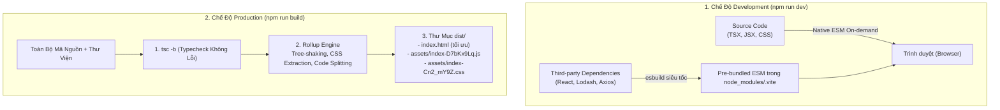

# Dev Server vs Production Build

> **Khóa học**: Modern Frontend Engineering (React + Vite)  
> **Phân nhóm**: Domain 1: Vite and Modern Web Tooling  
> **Chủ đề**: 1_2 Vite Architecture & Native ESM  
> **Trạng thái**: [ ] Đang học  
> **Checklist đối chiếu**: [CHECKLIST](../../CHECKLIST.md)

---

## 1. Khái Niệm Cốt Lõi & Bản Chất Kỹ Thuật (Core Technical Deep Dive)

Một trong những thiết kế thông minh nhất của Vite là **Chiến lược Động cơ Kép (Dual-Engine Architecture)**: Sử dụng các công cụ khác nhau cho hai môi trường có mục tiêu hoàn toàn trái ngược nhau: **Môi trường Phát triển (Development)** và **Môi trường Xuất bản (Production)**.

### 1.1 Bảng So Sánh Hai Môi Trường

| Tiêu chí | Môi Trường Phát Triển (`npm run dev`) | Môi Trường Xuất Bản (`npm run build`) |
| :--- | :--- | :--- |
| **Mục tiêu tối thượng** | **Tốc độ phản hồi cực nhanh** cho lập trình viên (Cold start < 300ms, HMR tức thì). | **Dung lượng tệp nhỏ nhất, hiệu năng mạng tối ưu nhất** cho người dùng cuối. |
| **Động cơ thực thi** | `esbuild` (Viết bằng ngôn ngữ Go) + Native ESM. | `Rollup` (Trình đóng gói module chuẩn hóa) + `tsc`. |
| **Đóng gói (Bundling)** | **Không đóng gói mã nguồn** (Unbundled). Mỗi file là một HTTP request riêng biệt. | **Đóng gói tối ưu (Bundled)** thành các chunk tĩnh trong thư mục `dist/`. |
| **Tên tệp** | Giữ nguyên đường dẫn gốc (e.g. `/src/App.tsx`). | Gắn mã băm nội dung (e.g. `assets/index-D7bKx9Lq.js`) để cache busting. |
| **Tree-shaking** | Tối thiểu (chỉ pre-bundle deps). | **Tree-shaking triệt để**: Cắt bỏ hoàn toàn mã nguồn không được sử dụng. |

---

### 1.2 Tại Sao Vite Không Dùng `esbuild` Cho Cả Bản Build Production?
Nhiều lập trình viên đặt câu hỏi: *"Nếu `esbuild` nhanh gấp 10-100 lần Rollup/Webpack, tại sao Vite không dùng `esbuild` để build production?"*

Đội ngũ phát triển Vite đưa ra câu trả lời chính thức dựa trên 3 rào cản kỹ thuật:
1. **Khả Năng Tách Nhỏ Code (Advanced Code-Splitting)**: Rollup có thuật toán phân tích đồ thị phụ thuộc cực kỳ tinh vi, giúp chia nhỏ các chunk dùng chung một cách tối ưu, tránh tải trùng lặp thư viện. `esbuild` hiện vẫn đang hoàn thiện tính năng này.
2. **Tách CSS Theo Từng Chunk (CSS Code-Splitting)**: Rollup cho phép tự động trích xuất CSS gắn liền với từng dynamic import (trang nào dùng CSS nào thì chỉ tải CSS đó khi chuyển trang).
3. **Tính Ổn Định & Hệ Sinh Thái Plugin**: Rollup có hệ sinh thái plugin lâu đời, hỗ trợ can thiệp sâu vào trừu tượng cây cú pháp (AST) mà `esbuild` chưa thể thay thế hoàn toàn.

> [!NOTE]
> **Tương lai của Vite**: Đội ngũ Vite đang phát triển **Rolldown** (một trình đóng gói tương thích 100% với Rollup API nhưng được viết hoàn toàn bằng **Rust**). Khi Rolldown trưởng thành, Vite sẽ thống nhất một động cơ duy nhất siêu tốc cho cả Dev và Production.

---

### 1.3 Chu Trình Thực Thi Của `npm run build`
Khi bạn gõ lệnh `npm run build`, các bước sau diễn ra tuần tự:
1. **Kiểm tra kiểu TypeScript (`tsc -b`)**:
   - `tsc` chỉ thực hiện kiểm tra lỗi kiểu dữ liệu (Type-checking) mà không xuất tệp JS (`noEmit`). Điều này ngăn chặn lỗi logic trước khi đóng gói.
2. **Biên dịch và Gom cụm (`Rollup`)**:
   - Quét từ `index.html` làm gốc.
   - Nhận diện các `import()` động để tách thành các file chunk độc lập.
   - Tự động nén và mã hóa base64 các hình ảnh nhỏ hơn 4KB.
3. **Tạo mã băm chống bộ nhớ đệm cũ (Content Hashing)**:
   - File kết quả có dạng `[name]-[hash].js`. Nếu nội dung file không đổi giữa các lần build, hash giữ nguyên (trình duyệt của người dùng tiếp tục dùng cache cũ).

---

## 2. Ví Dụ Đời Sống Thực Tế Dễ Hiểu (Intuitive Real-World Analogy)

Hãy hình dung sự khác biệt giữa **Xe Đua F1 Chạy Thử** và **Đoàn Xe Tải Container Chở Hàng Đi Quốc Tế**:

1. **Môi Trường Dev (`esbuild` + Native ESM) - Xe Đua F1**:
   - Trên đường chạy thử tại nhà máy, xe đua không cần lắp gương chiếu hậu, không cần gắn thùng chở hàng, tháo hết ghế phụ để xe nhẹ nhất và tăng tốc tức thì (vài mili-giây). Mục tiêu duy nhất là kỹ sư đạp ga là xe vọt đi ngay.
2. **Môi Trường Production (`Rollup`) - Đoàn Xe Container Logistics**:
   - Khi chuẩn bị xuất khẩu hàng hóa xuyên đại dương, bạn không thể dùng xe F1. Bạn phải dùng xe tải chuyên dụng: hàng hóa được đóng kiện carton tiêu chuẩn, hút chân không để bớt cồng kềnh (Minification/Tree-shaking), dán mã QR niêm phong chống tráo hàng (Content Hash), xếp từng kiện theo từng cảng đích (Code-splitting). Dù mất 10-20 giây để đóng hàng, chuyến đi biển dài ngày sẽ an toàn tuyệt đối và tiết kiệm xăng nhất!

---

## 3. Sơ Đồ Kiến Trúc Động Cơ Kép (Dual-Engine Diagram)



---

## 4. Code Mẫu Cấu Hình Tùy Biến Rollup Cho Production

Trong thực tế, khi dự án lớn dần, tệp `index.js` có thể vượt quá ngưỡng cảnh báo 500KB. Ta có thể cấu hình `manualChunks` trong `vite.config.ts` để Rollup tách riêng thư viện `react` và các gói vendor thành tệp riêng:

### Tệp `vite.config.ts`:
```ts
import { defineConfig } from 'vite';
import react from '@vitejs/plugin-react';

export default defineConfig({
  plugins: [react()],
  build: {
    outDir: 'dist',                // Thư mục đích đầu ra
    sourcemap: false,              // Tắt sourcemap ở production để bảo mật mã nguồn
    chunkSizeWarningLimit: 600,    // Nâng ngưỡng cảnh báo kích thước chunk lên 600KB
    rollupOptions: {
      output: {
        // Tách riêng các thư viện lớn của bên thứ ba thành vendor chunk
        manualChunks(id) {
          if (id.includes('node_modules')) {
            if (id.includes('react') || id.includes('react-dom')) {
              return 'react-core-vendor';
            }
            return 'vendor'; // Các thư viện còn lại gom vào vendor.js
          }
        },
      },
    },
  },
});
```

### Kết Quả Đầu Ra Trong `dist/` Sau Khi Build:
```text
dist/
├── index.html
└── assets/
    ├── react-core-vendor-Bk9X11zQ.js   # Chứa React & ReactDOM (khoảng 140KB)
    ├── vendor-Cp90Lm2a.js              # Chứa các thư viện khác
    ├── index-D9b1Az4X.js               # Chỉ chứa code logic của ứng dụng bạn viết
    └── index-D9b1Az4X.css              # Toàn bộ CSS đã được nén tối đa
```

> [!TIP]
> **Lợi ích thực tế**: Khi bạn thay đổi code logic trong `App.tsx`, chỉ file `index-[new-hash].js` bị thay đổi tên. Khách hàng quay lại website sẽ không phải tải lại `react-core-vendor` vì trình duyệt đã cache file đó vĩnh viễn!

---

## 📚 Nguồn Tài Liệu Chính Thống (Tier-1 Official References)
- [Vite Guide: Why Not Bundle with esbuild?](https://vite.dev/guide/why.html#why-not-bundle-with-esbuild) - Phân tích chính thức lý do kiến trúc động cơ kép của Vite.
- [Vite Guide: Building for Production](https://vite.dev/guide/build.html) - Hướng dẫn tối ưu hóa bản build với Rollup.
