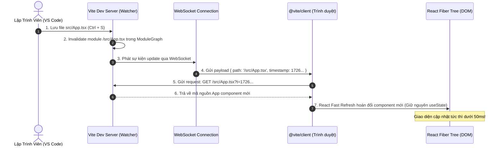

# Hot Module Replacement (HMR)

> **Khóa học**: Modern Frontend Engineering (React + Vite)  
> **Phân nhóm**: Domain 1: Vite and Modern Web Tooling  
> **Chủ đề**: 1_2 Vite Architecture & Native ESM  
> **Trạng thái**: [ ] Đang học  
> **Checklist đối chiếu**: [CHECKLIST](../../CHECKLIST.md)

---

## 1. Khái Niệm Cốt Lõi & Bản Chất Kỹ Thuật (Core Technical Deep Dive)

**Hot Module Replacement (HMR - Thay thế Module Nóng)** là công nghệ cho phép cập nhật, thêm hoặc xóa các module trong ứng dụng web đang chạy trên trình duyệt ngay khi bạn vừa lưu tệp code, thỏa mãn hai điều kiện sống còn:
1. **Không tải lại toàn bộ trang web (No full-page reload)**: Tránh chớp trắng màn hình và không phải tải lại toàn bộ tài nguyên tĩnh.
2. **Bảo toàn trạng thái ứng dụng (State Preservation)**: Giữ nguyên dữ liệu trong `useState`, các ô input người dùng đang gõ dở, vị trí cuộn trang (scroll position), hay trạng thái đóng/mở của modal.

---

### 1.1 Sự Chậm Chạp Của HMR Trong Bundler Truyền Thống
Trong các công cụ như Webpack, khi bạn sửa đổi một dòng code trong `Button.tsx`:
- Webpack phải phân tích lại toàn bộ đồ thị phụ thuộc của chunk chứa nút bấm đó.
- Webpack biên dịch và đóng gói lại toàn bộ chunk thành file JS mới trong bộ nhớ.
- Khi ứng dụng đạt quy mô hàng nghìn module, thời gian HMR có thể kéo dài từ ** vài giây đến chục giây**.

### 1.2 Kiến Trúc HMR Siêu Tốc Của Vite ($O(1)$)
Thời gian HMR trong Vite luôn duy trì **dưới 50 mili-giây**, bất kể ứng dụng của bạn có 10 component hay 10.000 component:

1. **Đồ Thị Module Trong Bộ Nhớ (In-Memory Module Graph)**:
   - Vite server duy trì một đồ thị mạng lưới liên kết giữa các module đã được trình duyệt yêu cầu.
2. **Theo Dõi Thay Đổi Tệp (File System Watcher)**:
   - Trình theo dõi tệp (`chokidar`) phát hiện bạn vừa nhấn `Ctrl + S` lưu tệp `src/App.tsx`.
3. **Phạm Vi Ảnh Hưởng Cực Tiểu (Precise Boundary Invalidation)**:
   - Vite chỉ đánh dấu vô hiệu hóa (invalidate) đúng tệp `App.tsx` và các module trực tiếp import nó, hoàn toàn không chạm tới 9.999 module còn lại.
4. **Thông Điệp WebSocket Tinh Gọn**:
   - Vite gửi một gói tin JSON siêu nhẹ qua kết nối WebSocket nội bộ (`ws://localhost:5173`) tới trình duyệt:
     ```json
     {
       "type": "update",
       "updates": [
         {
           "type": "js-update",
           "path": "/src/App.tsx",
           "acceptedPath": "/src/App.tsx",
           "timestamp": 1726880000123
         }
       ]
     }
     ```
5. **Kéo Module Mới Với Truy Vấn Dấu Thời Gian (Timestamp Query)**:
   - Client runtime (`/@vite/client`) trên trình duyệt nhận tin nhắn, thực thi lệnh kéo đúng module mới:
     `import('/src/App.tsx?t=1726880000123')`.
6. **Kết Hợp React Fast Refresh**:
   - Plugin `@vitejs/plugin-react` tích hợp sẵn thuật toán **React Fast Refresh** của Facebook: Thay thế định nghĩa hàm của component mới vào cây React Fiber mà **không unmount**, giữ nguyên 100% giá trị trong các hook `useState` và `useRef`!

---

## 2. Ví Dụ Đời Sống Thực Tế Dễ Hiểu (Intuitive Real-World Analogy)

Hãy so sánh việc sửa code với việc **Sửa Chữa Trong Một Căn Biệt Thự Đang Mở Tiệc**:

1. **Reload Toàn Trang Kiểu Cũ (Full Reload)**:
   - Một chiếc bóng đèn ở phòng khách bị đứt dây tóc. Ban quản lý quyết định: Dập cầu dao tổng của toàn khu nhà, mời tất cả 100 khách dự tiệc bước ra ngoài cổng, xây lại căn nhà từ đầu, rồi mời khách vào lại từ cửa chính. Khách đang ăn dở đĩa bò bít-tết thì bị mất sạch đồ ăn (Mất hết State!).
2. **Hot Module Replacement (HMR) Của Vite**:
   - Kỹ sư điện nhẹ nhàng cầm một chiếc bóng đèn mới tinh, bước vào phòng khách, vặn tháo bóng cũ và lắp bóng mới vào đúng đui đèn trong 3 giây. Phòng khách sáng bừng với ánh sáng mới, trong khi khách dự tiệc vẫn đang thoải mái trò chuyện và thưởng thức món ăn mà không hề bị gián đoạn (State được giữ nguyên vẹn).

---

## 3. Sơ Đồ Kiến Trúc & Đo Lường Hiệu Năng (Mermaid & Benchmark)

### 3.1 Luồng Xử Lý HMR Qua WebSocket


### 3.2 Tốc Độ HMR Của Vite So Với Các Thế Hệ Công Cụ
Biểu đồ đo lường chính thức từ Vite cho thấy thời gian cập nhật HMR gần như tức thời và không bị suy giảm theo thời gian:


---

## 4. Code Mẫu Trực Quan & Thử Nghiệm Giữ Trạng Thái (Hands-on Verification)

Hãy tạo hoặc mở tệp `src/App.tsx` để tự mình kiểm chứng cơ chế giữ trạng thái của HMR:

```tsx
import React, { useState } from 'react';

export const App: React.FC = () => {
  // Trạng thái 1: Bộ đếm số lần click
  const [count, setCount] = useState<number>(0);
  
  // Trạng thái 2: Text đang gõ dở trong ô input
  const [text, setText] = useState<string>('');

  return (
    <div style={{ padding: '2rem', fontFamily: 'sans-serif' }}>
      <h2>Thử Nghiệm Vite HMR & React Fast Refresh</h2>
      
      {/* 1. Thử click nút này lên giá trị 10 */}
      <div style={{ marginBottom: '1rem' }}>
        <button 
          onClick={() => setCount((prev) => prev + 1)}
          style={{ padding: '8px 16px', background: '#4f46e5', color: '#fff', borderRadius: '4px' }}
        >
          Số lần click hiện tại: {count}
        </button>
      </div>

      {/* 2. Thử nhập một đoạn văn bản dài vào đây */}
      <div style={{ marginBottom: '1rem' }}>
        <input
          type="text"
          value={text}
          onChange={(e) => setText(e.target.value)}
          placeholder="Nhập ghi chú tại đây..."
          style={{ padding: '8px', width: '300px' }}
        />
      </div>

      {/* 3. BÂY GIỜ: Hãy vào code sửa text bên dưới từ "Phiên bản 1" thành "Phiên bản 2 (Đã đổi)" rồi bấm Ctrl+S */}
      <p style={{ color: '#059669', fontWeight: 'bold' }}>
        Trạng thái hiển thị: Phiên bản 1 (Gốc)
      </p>
    </div>
  );
};

export default App;
```

### Các Bước Quan Sát:
1. Mở ứng dụng trên trình duyệt: `http://localhost:5173`.
2. Click nút để `count` tăng lên `10`.
3. Gõ chữ `"Xin chào Vite HMR"` vào ô input.
4. Quay lại editor, đổi dòng chữ `"Phiên bản 1 (Gốc)"` thành `"Phiên bản 2 (Siêu tốc!)"`, đổi màu nút bấm sang màu cam (`#ea580c`) rồi nhấn `Ctrl + S`.
5. Nhìn sang trình duyệt: Dòng chữ và màu nút đổi ngay lập tức, trong khi **`count` vẫn là `10` và ô input vẫn giữ nguyên `"Xin chào Vite HMR"`**!

---

## 📚 Nguồn Tài Liệu Chính Thống (Tier-1 Official References)
- [Vite Guide: Hot Module Replacement](https://vite.dev/guide/features.html#hot-module-replacement) - Cơ chế HMR API và kiến trúc cốt lõi trong Vite.
- [React Fast Refresh Documentation](https://github.com/facebook/react/tree/main/packages/react-refresh) - Tài liệu cơ chế bảo toàn state của React Team.
