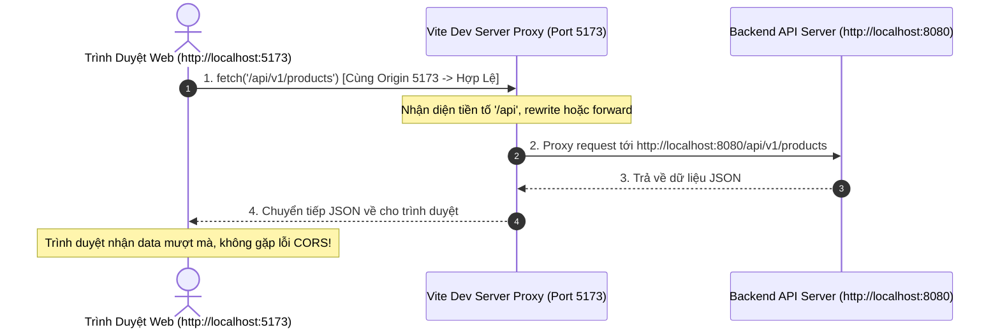

# Vite Configuration Deep Dive

> **Khóa học**: Modern Frontend Engineering (React + Vite)  
> **Phân nhóm**: Domain 1: Vite and Modern Web Tooling  
> **Chủ đề**: 1_3 Configuration and Asset Handling  
> **Trạng thái**: [ ] Đang học  
> **Checklist đối chiếu**: [CHECKLIST](../../CHECKLIST.md)

---

## 1. Khái Niệm Cốt Lõi & Bản Chất Kỹ Thuật (Core Technical Deep Dive)

Tệp `vite.config.ts` là trung tâm điều khiển toàn bộ hành vi của Vite từ lúc khởi chạy máy chủ phát triển (Dev Server), biên dịch mã nguồn, đến khi đóng gói xuất bản (Production Build).

### 1.1 Hàm Trợ Giúp `defineConfig`
Để kích hoạt tính năng tự động gợi ý code (IntelliSense) và kiểm tra lỗi kiểu dữ liệu nghiêm ngặt trong TypeScript mà không cần định kiểu thủ công, Vite cung cấp hàm `defineConfig`:

```ts
import { defineConfig } from 'vite';

export default defineConfig({
  // Toàn bộ các thuộc tính tại đây sẽ được TypeScript gợi ý chính xác 100%
});
```

### 1.2 Cấu Hình Theo Điều Kiện Môi Trường (Conditional Config)
Nếu bạn cần cấu hình khác biệt khi chạy lệnh `npm run dev` (`command === 'serve'`) so với khi chạy `npm run build` (`command === 'build'`), `defineConfig` có thể nhận vào một hàm:

```ts
export default defineConfig(({ command, mode }) => {
  if (command === 'serve') {
    return {
      // Cấu hình chỉ áp dụng cho chế độ Dev
    };
  } else {
    return {
      // Cấu hình chỉ áp dụng cho chế độ Build
    };
  }
});
```

---

### 1.3 Thiết Lập Đường Dẫn Viết Tắt (Path Aliases)
Trong các dự án lớn, việc viết đường dẫn tương đối nhiều tầng như `import Button from '../../../../components/Button'` rất dễ gây nhầm lẫn và khó refactor. Vite cho phép định nghĩa **Path Alias** (thường là `@/` đại diện cho thư mục `src/`):

1. **Trong `vite.config.ts`**:
   ```ts
   import path from 'node:path';
   // ...
   resolve: {
     alias: {
       '@': path.resolve(__dirname, './src'),
     },
   },
   ```
2. **Trong `tsconfig.app.json` (Để TypeScript hiểu được alias `@/`)**:
   ```json
   {
     "compilerOptions": {
       "baseUrl": ".",
       "paths": {
         "@/*": ["src/*"]
       }
     }
   }
   ```
Nhờ đó, bạn có thể import sạch sẽ ở bất kỳ đâu: `import Button from '@/components/Button'`.

---

### 1.4 Giải Quyết Lỗi CORS Với Reverse Proxy (`server.proxy`)
Trong lúc phát triển, Frontend chạy ở `http://localhost:5173`, trong khi Backend (Java Spring Boot, Express, NestJS...) thường chạy ở cổng khác như `http://localhost:8080`. Khi Frontend gọi trực tiếp tới Backend, trình duyệt sẽ chặn request do vi phạm chính sách **CORS (Cross-Origin Resource Sharing)**.

Vite Dev Server tích hợp sẵn một **Reverse Proxy**:
- Trình duyệt gửi request cùng nguồn tới `http://localhost:5173/api/users`.
- Vite server đứng ở giữa đón nhận request này và âm thầm chuyển tiếp (forward) sang `http://localhost:8080/api/users`.
- Vì giao tiếp giữa Vite server và Backend server là giao tiếp Server-to-Server, **CORS hoàn toàn bị vô hiệu hóa**!

---

## 2. Ví Dụ Đời Sống Thực Tế Dễ Hiểu (Intuitive Real-World Analogy)

Hãy hình dung `vite.config.ts` như **Buồng Lái Trung Tâm Của Máy Bay Chở Khách**:

1. **`defineConfig`**: Giống như màn hình hiển thị HUD hiện đại của phi công - mọi nút bấm, thông số áp suất, tốc độ gió đều có chỉ dẫn rõ ràng, bấm nhầm nút là hệ thống cảnh báo đỏ ngay (TypeScript autocomplete & type-safety).
2. **Path Alias `@/`**: Giống như mã định danh sân bay IATA (chỉ cần gõ `SGN` là hệ thống tự hiểu là Sân bay Tân Sơn Nhất, không ai phải gõ tọa độ địa lý dài 20 con số phức tạp).
3. **`server.proxy`**: Giống như **Đại sứ quán ủy quyền**: Công dân Việt Nam (Trình duyệt tại port 5173) muốn làm việc với cơ quan hành chính nước ngoài (Backend tại port 8080). Thay vì tự bay sang nước ngoài bị rào cản visa (CORS chặn), công dân chỉ cần nộp hồ sơ tại Đại sứ quán đặt ngay trong nước (Vite Proxy). Đại sứ quán sẽ dùng đường chuyển phát ngoại giao đưa thẳng hồ sơ tới cơ quan đích an toàn 100%!

---

## 3. Sơ Đồ Kiến Trúc Cơ Chế Reverse Proxy Trong Vite



---

## 4. Code Mẫu `vite.config.ts` Chuẩn Dự Án Doanh Nghiệp

Dưới đây là một tệp `vite.config.ts` hoàn chỉnh, chuẩn hóa cho dự án React + TypeScript có kết nối Backend:

```ts
import { defineConfig } from 'vite';
import react from '@vitejs/plugin-react';
import path from 'node:path';

// https://vite.dev/config/
export default defineConfig({
  // 1. Plugins
  plugins: [
    react({
      // Tùy chọn cấu hình Babel nếu có
    }),
  ],

  // 2. Định nghĩa Alias rút gọn đường dẫn
  resolve: {
    alias: {
      '@': path.resolve(__dirname, './src'),
    },
  },

  // 3. Cấu hình máy chủ phát triển cục bộ
  server: {
    port: 3000,          // Chạy ở cổng 3000
    open: true,          // Tự động mở trình duyệt khi server sẵn sàng
    host: true,          // Lắng nghe trên mọi IP nội bộ (0.0.0.0) để test trên mobile
    
    // Cấu hình Proxy vượt rào cản CORS
    proxy: {
      '/api': {
        target: 'http://localhost:8080', // Địa chỉ máy chủ Backend (Spring Boot / Node)
        changeOrigin: true,              // Cần thiết để đổi header 'Host' thành địa chỉ target
        secure: false,                   // Bỏ qua kiểm tra chứng chỉ SSL nếu backend dùng self-signed cert
        rewrite: (path) => path,         // Có thể dùng: (path) => path.replace(/^\/api/, '') nếu backend không có tiền tố /api
      },
    },
  },

  // 4. Cấu hình đóng gói xuất bản Production
  build: {
    outDir: 'dist',
    sourcemap: false,
    chunkSizeWarningLimit: 600,
  },
});
```

---

## 📚 Nguồn Tài Liệu Chính Thống (Tier-1 Official References)
- [Vite Guide: Configuring Vite](https://vite.dev/config/) - Tài liệu cấu hình tổng thể của Vite.
- [Vite Server Options: server.proxy](https://vite.dev/config/server-options.html#server-proxy) - Hướng dẫn chi tiết cấu hình Proxy giải quyết CORS.
