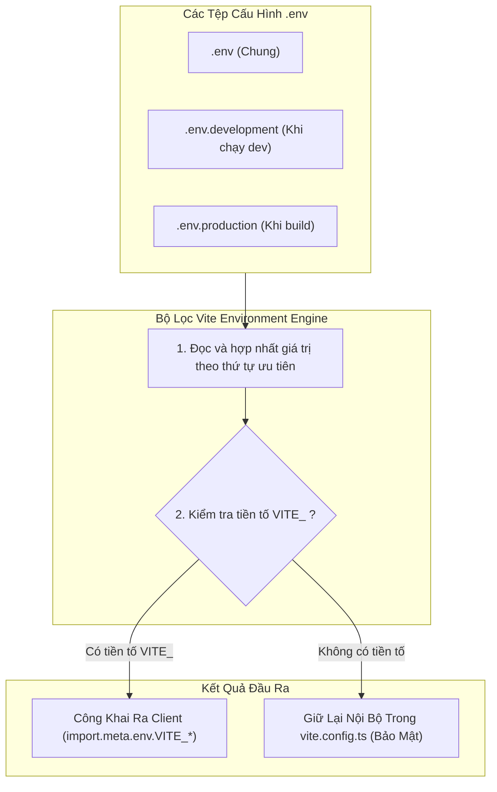

# Environment Variables

> **Khóa học**: Modern Frontend Engineering (React + Vite)  
> **Phân nhóm**: Domain 1: Vite and Modern Web Tooling  
> **Chủ đề**: 1_3 Configuration and Asset Handling  
> **Trạng thái**: [ ] Đang học  
> **Checklist đối chiếu**: [CHECKLIST](../../CHECKLIST.md)

---

## 1. Khái Niệm Cốt Lõi & Bản Chất Kỹ Thuật (Core Technical Deep Dive)

Trong quá trình phát triển phần mềm, ứng dụng luôn cần chạy trên nhiều môi trường khác nhau: **Development** (máy lập trình viên), **Staging** (máy chủ kiểm thử), và **Production** (máy chủ thực tế). Quản lý biến môi trường an toàn là yếu tố sống còn để cấu hình endpoint API, secret key và tính năng theo từng môi trường.

### 1.1 Khác Biệt Giữa `process.env` và `import.meta.env`
- Trong các công cụ kiểu cũ (Create React App/Webpack), biến môi trường được truy cập qua `process.env.REACT_APP_*`. Tuy nhiên, `process` là một đối tượng toàn cục của môi trường **Node.js**, hoàn toàn không tồn tại trong môi trường Native ESM của trình duyệt.
- Vite tuân thủ tiêu chuẩn web hiện đại và cung cấp biến môi trường qua đối tượng **`import.meta.env`**.

---

### 1.2 Nguyên Tắc Bảo Mật Cốt Lõi: Tiền Tố `VITE_`
Mã nguồn Frontend (JavaScript/CSS/HTML) sau khi tải về sẽ nằm hoàn toàn trên trình duyệt của người dùng. Bất kỳ ai cũng có thể mở F12 hoặc Network tab để đọc được nội dung mã nguồn.

> [!CAUTION]
> **Quy Tắc Bảo Mật Bất Di Bất Dịch**:
> - Vite **chỉ công khai** các biến môi trường có tiền tố bắt đầu bằng **`VITE_`** ra ngoài trình duyệt (ví dụ: `VITE_API_URL`, `VITE_APP_NAME`).
> - Bất kỳ biến môi trường nào **không có tiền tố `VITE_`** (ví dụ: `DATABASE_PASSWORD`, `STRIPE_SECRET_KEY`, `JWT_SECRET`) sẽ **bị chặn tuyệt đối** và không bao giờ bị đưa vào bản build của client. Điều này ngăn chặn 100% nguy cơ rò rỉ khóa bí mật của hệ thống.

---

### 1.3 Các Biến Môi Trường Có Sẵn Trong Vite
Vite tự động tiêm sẵn 5 biến hữu ích vào `import.meta.env`:

| Biến | Kiểu dữ liệu | Ý nghĩa |
| :--- | :--- | :--- |
| `import.meta.env.MODE` | `string` | Tên chế độ hiện tại (`development` hoặc `production`). |
| `import.meta.env.BASE_URL` | `string` | Đường dẫn cơ sở phục vụ ứng dụng (mặc định là `/`). |
| `import.meta.env.PROD` | `boolean` | `true` nếu ứng dụng đang chạy ở môi trường Production. |
| `import.meta.env.DEV` | `boolean` | `true` nếu ứng dụng đang chạy ở môi trường Development (`npm run dev`). |
| `import.meta.env.SSR` | `boolean` | `true` nếu ứng dụng đang được render ở phía máy chủ (Server-Side Rendering). |

---

### 1.4 Thứ Tự Ưu Tiên Của Các Tệp `.env`
Khi tải biến môi trường, Vite quét các tệp `.env` theo thứ tự ưu tiên từ cao xuống thấp (tệp trên sẽ ghi đè tệp dưới):

```text
1. .env.[mode].local   # Ưu tiên cao nhất (Cục bộ cho từng mode, không commit git)
2. .env.[mode]         # Ví dụ: .env.development hoặc .env.production
3. .env.local          # Cục bộ cho mọi mode (Thường dùng cho máy cá nhân, không commit git)
4. .env                # Ưu tiên thấp nhất (Chứa giá trị mặc định chung cho mọi mode)
```

---

## 2. Ví Dụ Đời Sống Thực Tế Dễ Hiểu (Intuitive Real-World Analogy)

Hãy so sánh cơ chế biến môi trường với **Thẻ Nhân Viên & Hồ Sơ Tuyệt Mật Trong Ngân Hàng**:

1. **Biến Không Có Tiền Tố `VITE_` (Hồ Sơ Mật Trong Két Sắt)**:
   - Mật khẩu mở kho tiền, mã giải mã két sắt là thông tin nội bộ của ban giám đốc (Server Backend). Không một nhân viên nào được phép in các con số này ra giấy dán lên áo để đi ra ngoài sảnh đón tiếp khách hàng.
2. **Biến Có Tiền Tố `VITE_` (Bảng Tên & Biển Chỉ Dẫn Công Khai)**:
   - Tên ngân hàng, số điện thoại hotline, địa chỉ quầy giao dịch là thông tin công khai. Nhân viên dán biển tên `VITE_HOTLINE` lên ngực áo để khách hàng (Trình duyệt) nhìn thấy và liên hệ làm việc.

---

## 3. Sơ Đồ Cơ Chế Nạp & Lọc Biến Môi Trường (Filtering Pipeline)



---

## 4. Hướng Dẫn Thực Hành & Cấu Hình TypeScript Gợi Ý Thông Minh

### Bước 1: Tạo tệp `.env` cho Development và Production

**Tệp `.env.development`** (dành cho `npm run dev`):
```ini
# Endpoint Backend Local
VITE_API_URL=http://localhost:8080/api/v1
VITE_APP_TITLE=Cổng Học Tập Frontend (Bản Thử Nghiệm)
VITE_ENABLE_ANALYTICS=false

# Biến bí mật (chỉ dùng trong vite.config.ts, KHÔNG lọt ra client)
BACKEND_SECRET_KEY=dev_secret_key_12345
```

**Tệp `.env.production`** (dành cho `npm run build`):
```ini
# Endpoint Backend Thực Tế
VITE_API_URL=https://api.myproductiondomain.com/api/v1
VITE_APP_TITLE=Cổng Học Tập Frontend
VITE_ENABLE_ANALYTICS=true
```

---

### Bước 2: Bật Gợi Ý Tự Động Trong TypeScript (`src/vite-env.d.ts`)
Theo mặc định, `import.meta.env.VITE_API_URL` sẽ có kiểu `any` hoặc `string | undefined`. Để có gợi ý code chuẩn mực, mở tệp `src/vite-env.d.ts` và khai báo:

```ts
/// <reference types="vite/client" />

interface ImportMetaEnv {
  readonly VITE_API_URL: string;
  readonly VITE_APP_TITLE: string;
  readonly VITE_ENABLE_ANALYTICS: string;
}

interface ImportMeta {
  readonly env: ImportMetaEnv;
}
```

---

### Bước 3: Sử Dụng Trong React Component
```tsx
import React from 'react';

export const ApiConfigBanner: React.FC = () => {
  // Lấy các biến môi trường trực tiếp từ import.meta.env
  const apiUrl = import.meta.env.VITE_API_URL;
  const appTitle = import.meta.env.VITE_APP_TITLE;
  const isDev = import.meta.env.DEV;

  return (
    <div className="p-4 bg-gray-100 rounded border">
      <h3 className="font-bold text-lg">{appTitle}</h3>
      <p>Kết nối tới máy chủ: <code>{apiUrl}</code></p>
      {isDev && (
        <span className="inline-block mt-2 px-2 py-1 text-xs bg-amber-200 text-amber-900 rounded font-semibold">
          Đang chạy trong môi trường DEVELOPMENT
        </span>
      )}
    </div>
  );
};
```

---

## 📚 Nguồn Tài Liệu Chính Thống (Tier-1 Official References)
- [Vite Guide: Env Variables and Modes](https://vite.dev/guide/env-and-mode.html) - Tài liệu chính thức về biến môi trường và chế độ hoạt động trong Vite.
- [MDN Web Docs: import.meta](https://developer.mozilla.org/en-US/docs/Web/JavaScript/Reference/Operators/import.meta) - Đặc tả kỹ thuật về đối tượng `import.meta` trong JavaScript.
