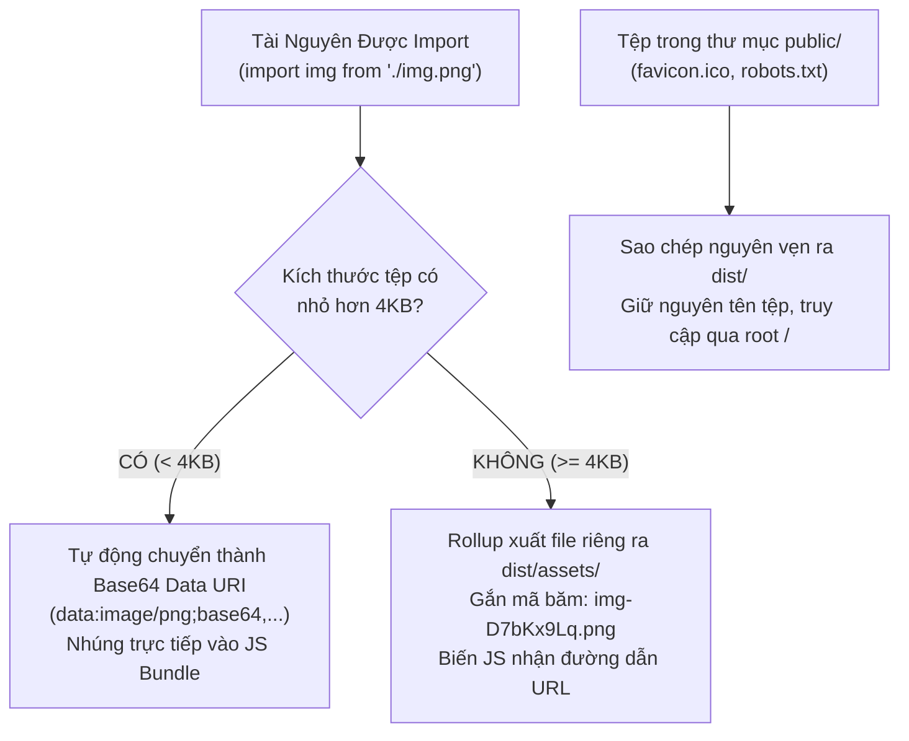

# Static Asset Handling and CSS

> **Khóa học**: Modern Frontend Engineering (React + Vite)  
> **Phân nhóm**: Domain 1: Vite and Modern Web Tooling  
> **Chủ đề**: 1_3 Configuration and Asset Handling  
> **Trạng thái**: [ ] Đang học  
> **Checklist đối chiếu**: [CHECKLIST](../../CHECKLIST.md)

---

## 1. Khái Niệm Cốt Lõi & Bản Chất Kỹ Thuật (Core Technical Deep Dive)

Trong phát triển Frontend, việc quản lý tài nguyên tĩnh (Static Assets - hình ảnh, fonts, SVG) và định kiểu giao diện (CSS, CSS Modules, Sass) là công việc diễn ra hàng ngày. Vite loại bỏ hoàn toàn các loader phức tạp của Webpack (như `file-loader`, `url-loader`, `css-loader`, `style-loader`) và tích hợp sẵn cơ chế xử lý thông minh, tối ưu hóa kích thước tự động.

---

### 1.1 Xử Lý Tài Nguyên Tĩnh (Static Assets)

#### A. Import Tài Nguyên Dưới Dạng URL
Khi bạn import một hình ảnh trong code JavaScript/TypeScript:
```tsx
import logoUrl from './assets/react-logo.png';
```
- Trong chế độ Dev: `logoUrl` sẽ là đường dẫn cục bộ `/src/assets/react-logo.png`.
- Trong chế độ Build Production: Rollup sẽ xuất file ảnh vào `dist/assets/react-logo-Bk9X11zQ.png` (có gắn mã hash) và biến `logoUrl` sẽ chứa đường dẫn CDN/tĩnh chính xác.

#### B. Cơ Chế Tự Động Inline Base64 (`assetsInlineLimit`)
Vite có ngưỡng mặc định là **4096 bytes (4KB)**:
- Nếu file ảnh/phông chữ có kích thước **nhỏ hơn 4KB**: Vite sẽ tự động chuyển đổi file đó thành chuỗi **Base64 Data URI** (`data:image/png;base64,...`) và nhúng trực tiếp vào tệp JS.
- **Lợi ích**: Giảm thiểu tối đa số lượng HTTP request riêng lẻ đến máy chủ cho các icon nhỏ, giúp trang web hiển thị tức thì.
- Nếu muốn thay đổi ngưỡng này (ví dụ tăng lên 8KB hoặc tắt hẳn về 0), bạn cấu hình `build.assetsInlineLimit` trong `vite.config.ts`.

#### C. Các Hậu Tố Import Đặc Biệt (Special Query Suffixes)
Vite hỗ trợ các tham số truy vấn ngay trên đường dẫn import:
- **`?url`**: Bắt buộc trả về URL công khai, ngay cả khi file nhỏ hơn 4KB:
  ```ts
  import iconUrl from './icon.svg?url';
  ```
- **`?raw`**: Đọc toàn bộ nội dung tệp dưới dạng **chuỗi văn bản thuần (String)**:
  ```ts
  import svgContent from './icon.svg?raw'; // svgContent sẽ là chuỗi "<svg>...</svg>"
  ```
- **`?worker`**: Tách và đóng gói tệp thành một Web Worker chạy độc lập trên background thread:
  ```ts
  import Worker from './heavyTask.js?worker';
  const worker = new Worker();
  ```

#### D. Khi Nào Nên Dùng Thư Mục `public/`?
Thư mục `public/` ở gốc dự án là nơi lưu trữ các tệp:
- Không bao giờ được import trong mã nguồn (mã nguồn không gọi `import`).
- Bắt buộc phải giữ nguyên chính xác tên tệp mà không được gắn mã hash.
- **Ví dụ**: `robots.txt`, `favicon.ico`, `sitemap.xml`, hình ảnh Open Graph cố định (`og-image.png`).
- Truy cập trực tiếp từ root: Tệp `public/favicon.ico` được gọi qua `<link href="/favicon.ico" />`.

---

### 1.2 Xử Lý CSS Trong Vite

#### A. Nhập CSS Trực Tiếp (Zero-Config CSS)
Bạn có thể import trực tiếp bất kỳ tệp `.css` nào:
```tsx
import './styles.css';
```
Vite tự động thêm CSS vào thẻ `<style>` trong lúc Dev và trích xuất thành tệp CSS nén tối đa trong lúc Build. HMR của CSS diễn ra cực kỳ mượt mà, **không bao giờ làm reload trang**.

#### B. CSS Modules (Phạm Vi Cục Bộ Tránh Trùng Lặp Tên Class)
Bất kỳ tệp CSS nào kết thúc bằng `.module.css` đều được coi là một **CSS Module**:
- Vite tự động mã hóa tên class thành chuỗi duy nhất: `.button` -> `_button_1x2y3_4`.
- Giúp loại bỏ 100% rủi ro đè style giữa các component khác nhau trong dự án lớn.

#### C. Tiền Xử Lý CSS (Sass / SCSS / Less)
Vite hỗ trợ Sass và Less ngay từ đầu mà không cần cấu hình plugin:
```bash
npm install -D sass
```
Sau khi cài đặt, bạn có thể tạo và import ngay các tệp `.scss` hoặc `.module.scss` mà không cần chỉnh sửa bất kỳ dòng nào trong `vite.config.ts`.

---

## 2. Ví Dụ Đời Sống Thực Tế Dễ Hiểu (Intuitive Real-World Analogy)

Hãy so sánh quy trình xử lý tài nguyên với **Quy Trình Giao Nhận Hàng Logistics**:

1. **Ảnh Nhỏ Dưới 4KB (Base64 Inlining) - Nhét Túi Áo**:
   - Khi bạn mua một chiếc vé xem phim hoặc một cây kẹo mút (icon nhỏ), bạn nhét thẳng vào túi áo mang về (nhúng chuỗi base64 vào JS). Không ai đi thuê một chiếc xe tải riêng để chở từng chiếc kẹo về nhà (tránh tạo thêm 1 HTTP request).
2. **Ảnh Lớn Trên 4KB (Asset URL) - Thuê Xe Vận Chuyển**:
   - Khi bạn mua một bộ sofa hoặc chiếc tivi (ảnh banner chất lượng cao), món hàng phải được bọc xốp cẩn thận, dán tem mã vạch truy xuất nguồn gốc (mã Hash), và chở bằng chuyến xe riêng (HTTP request riêng).
3. **Thư Mục `public/` - Biển Tên Tòa Nhà**:
   - Biển số nhà, tên tòa nhà (`robots.txt`, `favicon.ico`) phải được gắn cố định tại cổng số 1. Dù tòa nhà có nâng cấp hay sửa đổi nội thất, khách tìm tới vẫn luôn thấy biển số nhà ở vị trí cố định đó mà không bị đổi tên.
4. **CSS Modules - Chìa Khóa Căn Hộ Riêng Biệt**:
   - Trong một tòa chung cư 1000 căn hộ, phòng nào cũng có "Cửa Ra Vào" (class `.door`). Nhờ CSS Modules, cửa căn hộ 101 có mã khóa `door_101`, cửa căn hộ 205 có mã `door_205`. Người ở phòng 101 đổi màu cửa sang màu xanh sẽ không bao giờ làm cửa của phòng 205 bị đổi màu theo!

---

## 3. Sơ Đồ Xử Lý Tài Nguyên Tĩnh Trong Vite



---

## 4. Code Mẫu Thực Tế: Ứng Dụng CSS Modules & Asset Suffixes

### Tệp 1: CSS Module `src/components/Card.module.css`
```css
/* Tên class nguyên bản trong source code */
.cardContainer {
  padding: 1.5rem;
  border-radius: 8px;
  background-color: #ffffff;
  box-shadow: 0 4px 6px -1px rgba(0, 0, 0, 0.1);
  border: 1px solid #e5e7eb;
}

.title {
  color: #1f2937;
  font-size: 1.25rem;
  font-weight: 700;
  margin-bottom: 0.5rem;
}

.actionButton {
  background-color: #3b82f6;
  color: #ffffff;
  padding: 0.5rem 1rem;
  border-radius: 4px;
  border: none;
  cursor: pointer;
}

.actionButton:hover {
  background-color: #2563eb;
}
```

### Tệp 2: Component Sử Dụng Asset & CSS Module `src/components/Card.tsx`
```tsx
import React from 'react';
// 1. Import CSS Module (styles sẽ là object chứa các class đã băm tên)
import styles from './Card.module.css';

// 2. Import hình ảnh thông thường (nhận chuỗi URL hoặc base64)
import reactLogo from '../assets/react.svg';

// 3. Import thô nội dung SVG dưới dạng chuỗi HTML thuần
import rawSvgIcon from '../assets/react.svg?raw';

interface CardProps {
  title: string;
  description: string;
}

export const Card: React.FC<CardProps> = ({ title, description }) => {
  return (
    // Sử dụng class đã được scoped an toàn qua styles.cardContainer
    <div className={styles.cardContainer}>
      <div style={{ display: 'flex', alignItems: 'center', gap: '10px' }}>
        {/* Render ảnh qua thẻ  thông thường */}
        
        
        <h3 className={styles.title}>{title}</h3>
      </div>

      <p style={{ color: '#4b5563', margin: '1rem 0' }}>{description}</p>

      {/* Render icon từ chuỗi raw SVG */}
      <div 
        dangerouslySetInnerHTML={{ __html: rawSvgIcon }} 
        style={{ width: '24px', height: '24px', display: 'inline-block' }}
      />

      <button className={styles.actionButton}>
        Tìm Hiểu Thêm
      </button>
    </div>
  );
};
```

---

## 📚 Nguồn Tài Liệu Chính Thống (Tier-1 Official References)
- [Vite Guide: Static Asset Handling](https://vite.dev/guide/assets.html) - Toàn bộ các quy tắc và cú pháp xử lý tài nguyên tĩnh trong Vite.
- [Vite Guide: CSS Features](https://vite.dev/guide/features.html#css) - Hướng dẫn CSS Modules, Pre-processors và PostCSS.
