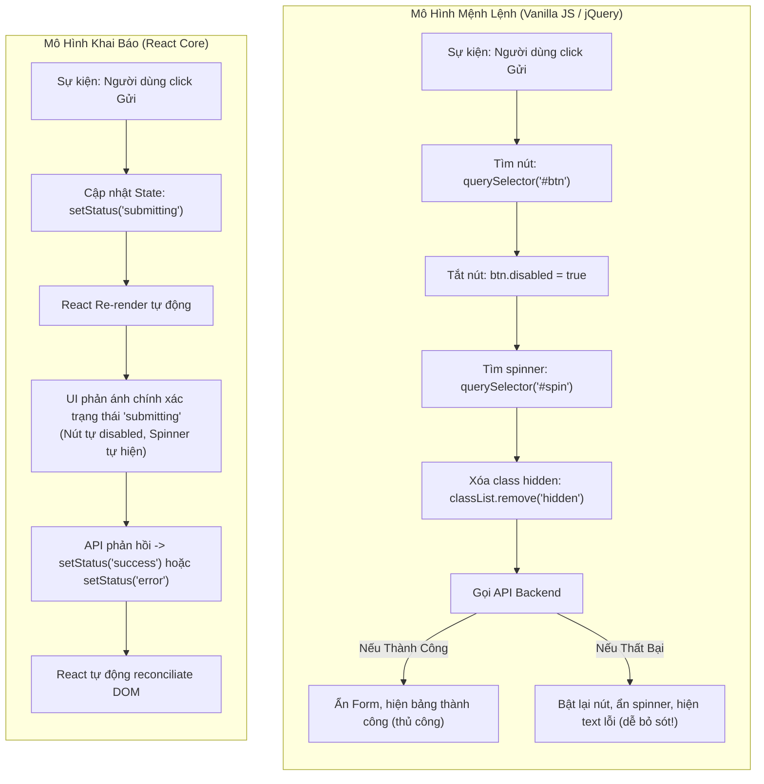

# Declarative UI vs Imperative DOM

> **Khóa học**: Modern Frontend Engineering (React + Vite)  
> **Phân nhóm**: Domain 2: React Core and Component Mental Model  
> **Chủ đề**: 2_1 Mental Model Transformation  
> **Trạng thái**: [x] Đã hoàn thành  
> **Checklist đối chiếu**: [CHECKLIST](../../CHECKLIST.md)

---

## 1. Khái Niệm Cốt Lõi & Bản Chất Kỹ Thuật (Core Technical Deep Dive)

Sự chuyển dịch quan trọng nhất khi bước từ lập trình web truyền thống (Vanilla JavaScript, jQuery) sang **React** không nằm ở cú pháp hay thư viện, mà nằm ở **Sự thay đổi mô hình tư duy (Mental Model Transformation)**: Từ **Lập trình Mệnh lệnh (Imperative Programming)** sang **Lập trình Khai báo (Declarative Programming)**.

### 1.1 Lập Trình Mệnh Lệnh (Imperative DOM Manipulation) Kiểu Cũ
Trong mô hình mệnh lệnh truyền thống, lập trình viên phải tự tay điều khiển từng bước cụ thể để thay đổi giao diện trình duyệt:
1. Tìm phần tử trong cây DOM: `document.getElementById('submit-btn')`.
2. Lắng nghe sự kiện người dùng: `btn.addEventListener('click', ...)`.
3. Kiểm tra các điều kiện logic phức tạp.
4. Thủ công can thiệp vào các thuộc tính, class hoặc style:
   - `btn.disabled = true;`
   - `spinner.classList.remove('hidden');`
   - `errorMsg.style.display = 'none';`

#### Vấn đề cốt tử của mô hình Mệnh lệnh (The Spaghetti State Problem):
- **Bùng nổ trạng thái tổ hợp (Combinatorial Explosion)**: Một biểu mẫu có 4 trạng thái (Trống, Đang nhập, Đang gửi, Lỗi). Khi giao diện ngày càng phức tạp với hàng chục nút bấm, ô nhập và thông báo, số lượng đường dẫn cập nhật giao diện tăng theo cấp số nhân ($2^n$).
- **Mâu thuẫn trạng thái (Impossible States)**: Lập trình viên rất dễ quên tắt spinner khi có lỗi, dẫn đến tình trạng vừa hiển thị thông báo lỗi vừa hiển thị xoay loading.
- **Mất đồng bộ giữa Dữ liệu và DOM (Desynchronization)**: Dữ liệu biến trong JavaScript một đằng, nhưng thuộc tính hiển thị trên màn hình lại một nẻo do bỏ sót một câu lệnh cập nhật DOM.

---

### 1.2 Lập Trình Khai Báo (Declarative UI) Trong React: $UI = f(State)$
React tiếp cận bài toán theo một góc nhìn toán học thanh lịch:
$$\text{Giao Diện (UI)} = f(\text{Trạng Thái (State)})$$

- Bạn **không chỉ dẫn trình duyệt từng bước thay đổi DOM** như thế nào.
- Thay vào đó, bạn chỉ cần **mô tả giao diện sẽ trông như thế nào tương ứng với từng trạng thái cụ thể** của ứng dụng.
- Khi dữ liệu (State) thay đổi, React sẽ tự động tính toán sự khác biệt (Diffing) và cập nhật cây DOM một cách tối ưu nhất.

#### 5 Bước Tư Duy Khai Báo Theo Chuẩn React Docs:
1. **Xác định các trạng thái thị giác (Visual States)**: Liệt kê tất cả trạng thái mà người dùng có thể thấy (`empty`, `typing`, `submitting`, `success`, `error`).
2. **Xác định điều gì kích hoạt chuyển đổi trạng thái**:
   - Tác động từ con người (Human Inputs): Gõ phím, click chuột, chọn dropdown.
   - Tác động từ máy tính (Computer Inputs): Phản hồi từ API mạng, bộ đếm thời gian timeout, lỗi tải ảnh.
3. **Mô hình hóa trạng thái trong bộ nhớ với `useState`**: Chọn cấu trúc dữ liệu tối giản nhất.
4. **Loại bỏ các trạng thái dư thừa hoặc mâu thuẫn**: Không tạo các biến boolean có thể xung đột nhau (ví dụ: vừa `isSubmitting = true` vừa `isSuccess = true`).
5. **Gắn các hàm xử lý sự kiện (Event Handlers) để cập nhật State**: Handler chỉ có một nhiệm vụ duy nhất là cập nhật State, không được chạm vào DOM.

---

## 2. Ví Dụ Đời Sống Thực Tế Dễ Hiểu (Intuitive Real-World Analogy)

### Chỉ Đường Cho Tài Xế Taxi vs Đặt Xe Qua Ứng Dụng Bản Đồ

1. **Lập Trình Mệnh Lệnh (Imperative) - Ngồi Taxi Truyền Thống**:
   - Bạn ngồi sau xe và phải liên tục quan sát đường để chỉ đạo tài xế từng hành động: *"Đi thẳng 200m nữa... Giảm tốc độ... Bật xi-nhan trái... Rẽ vào ngõ nhỏ... Dừng lại trước cửa số 10"*.
   - Nếu bạn lơ đãng quên nhắc tài xế rẽ ở ngã tư, xe sẽ chạy lạc đường ngay lập tức. Đây chính là cách bạn viết Vanilla JS để thêm/xóa class CSS và ẩn/hiện thẻ `<div>`.

2. **Lập Trình Khai Báo (Declarative) - Ứng Dụng Grab / Google Maps**:
   - Bạn chỉ cần mở ứng dụng và khai báo mục tiêu duy nhất: **"Tôi muốn đến Sân bay Quốc tế Nội Bài"**.
   - Bạn không cần quan tâm xe đạp ga bao nhiêu vòng/phút hay rẽ qua bao nhiêu giao lộ. Hệ thống vệ tinh GPS và thuật toán định tuyến tự động tìm đường đi tối ưu nhất để đưa bạn đến đích.
   - Nếu có đoạn đường tắc (State thay đổi), hệ thống tự động vẽ lại lộ trình mới mà bạn không cần phải tính toán lại từng mét đường. Đây chính là cách React cập nhật giao diện từ State.

---

## 3. Sơ Đồ Kiến Trúc & Hình Ảnh Trực Quan (Mermaid & Official Visual Media)

### 3.1 Minh Họa Chính Thức Từ React.dev

| Lập Trình Mệnh Lệnh (Thao Tác DOM Thủ Công) | Lập Trình Khai Báo (UI Là Hàm Của State) |
| :---: | :---: |
|  |  |
| *Lập trình viên tự can thiệp thủ công vào từng node DOM* | *Lập trình viên chỉ đổi State, React tự động phản chiếu ra UI* |

---

### 3.2 Sơ Đồ So Sánh Luồng Xử Lý (Flow Comparison)



---

## 4. Code Mẫu Trực Quan & Giải Thích Từng Dòng (Clean, Runnable Sample Code)

Dưới đây là một ví dụ thực tế hoàn chỉnh bằng TypeScript: **Form Trả Lời Câu Hỏi (Quiz Form)**. Chúng ta sẽ cùng xem cách tư duy khai báo loại bỏ hoàn toàn các lỗi xung đột trạng thái.

### Tệp `QuizFeedbackForm.tsx`:
```tsx
import React, { useState, ChangeEvent, FormEvent } from 'react';

// 1. Định nghĩa các trạng thái thị giác rõ ràng bằng Union Type
// Tránh việc tạo nhiều biến boolean rời rạc (isSubmitting, isSuccess, isError)
type FormStatus = 'typing' | 'submitting' | 'success';

interface QuizFormProps {
  questionTitle?: string;
  correctAnswer?: string;
}

export const QuizFeedbackForm: React.FC<QuizFormProps> = ({
  questionTitle = 'Thủ đô của Việt Nam là gì?',
  correctAnswer = 'hà nội',
}) => {
  // 2. Quản lý trạng thái bằng State tối giản
  const [answer, setAnswer] = useState<string>('');
  const [error, setError] = useState<string | null>(null);
  const [status, setStatus] = useState<FormStatus>('typing');

  // Quan sát quá trình Re-render của React trong Console F12
  console.log(`[RENDER] QuizFeedbackForm đang render với status = "${status}", answer = "${answer}"`);

  // Trạng thái thị giác thành công: Hiển thị ngay UI chúc mừng
  if (status === 'success') {
    return (
      <div className="p-6 bg-green-50 border border-green-300 rounded-lg text-center">
        <h3 className="text-xl font-bold text-green-700">Chính xác tuyệt vời! 🎉</h3>
        <p className="mt-2 text-green-600">Thủ đô của Việt Nam chính là Hà Nội.</p>
        <button
          onClick={() => {
            setStatus('typing');
            setAnswer('');
            setError(null);
          }}
          className="mt-4 px-4 py-2 bg-green-600 text-white rounded hover:bg-green-700 transition"
        >
          Làm lại câu hỏi
        </button>
      </div>
    );
  }

  // 3. Hàm xử lý sự kiện (Event Handlers)
  const handleInputChange = (e: ChangeEvent<HTMLTextAreaElement>) => {
    // Khi người dùng gõ, nếu đang có lỗi thì xóa lỗi đi
    if (error !== null) {
      setError(null);
    }
    setAnswer(e.target.value);
  };

  const handleSubmit = async (e: FormEvent<HTMLFormElement>) => {
    e.preventDefault();

    // Kích hoạt trạng thái submitting (Trigger Render)
    setStatus('submitting');
    console.log('[ACTION] Bắt đầu kiểm tra câu trả lời...');

    try {
      // Giả lập cuộc gọi API bất đồng bộ sau 1.5 giây
      await new Promise((resolve, reject) => {
        setTimeout(() => {
          const isCorrect = answer.trim().toLowerCase() === correctAnswer.toLowerCase();
          if (isCorrect) {
            resolve(true);
          } else {
            reject(new Error('Câu trả lời chưa chính xác, hãy thử lại!'));
          }
        }, 1500);
      });

      // Nếu thành công: Cập nhật status thành 'success'
      setStatus('success');
    } catch (err: unknown) {
      // Nếu thất bại: Chuyển lại về trạng thái 'typing' và gán thông báo lỗi
      setStatus('typing');
      if (err instanceof Error) {
        setError(err.message);
      } else {
        setError('Đã xảy ra lỗi không xác định.');
      }
    }
  };

  // 4. Khai báo giao diện (Declarative UI Return)
  // Giao diện tự động vô hiệu hóa (disabled) khi ô nhập trống hoặc đang gửi
  const isInputEmpty = answer.trim().length === 0;
  const isSubmitting = status === 'submitting';

  return (
    <div className="max-w-md mx-auto p-6 bg-white border border-gray-200 rounded-xl shadow-md">
      <h2 className="text-lg font-semibold text-gray-800 mb-2">{questionTitle}</h2>
      <p className="text-sm text-gray-500 mb-4">
        Hãy gõ câu trả lời của bạn vào ô dưới đây và bấm Gửi.
      </p>

      <form onSubmit={handleSubmit} className="space-y-4">
        <div>
          <textarea
            value={answer}
            onChange={handleInputChange}
            disabled={isSubmitting}
            placeholder="Nhập câu trả lời..."
            rows={3}
            className="w-full p-3 border rounded-lg focus:ring-2 focus:ring-blue-500 focus:outline-none disabled:bg-gray-100 disabled:text-gray-400"
          />
        </div>

        {/* Khai báo lỗi hiển thị có điều kiện */}
        {error !== null && (
          <div className="p-3 bg-red-50 border border-red-200 text-red-700 text-sm rounded-lg">
            ⚠️ {error}
          </div>
        )}

        <button
          type="submit"
          disabled={isInputEmpty || isSubmitting}
          className="w-full py-2.5 px-4 bg-blue-600 text-white font-medium rounded-lg hover:bg-blue-700 transition disabled:opacity-50 disabled:cursor-not-allowed flex justify-center items-center gap-2"
        >
          {isSubmitting && (
            <span className="inline-block w-4 h-4 border-2 border-white border-t-transparent rounded-full animate-spin" />
          )}
          {isSubmitting ? 'Đang kiểm tra...' : 'Gửi câu trả lời'}
        </button>
      </form>
    </div>
  );
};
```

### Điểm Sáng Trong Thiết Kế:
1. **Không có bất kỳ dòng lệnh nào gọi `document.querySelector` hay `element.classList`**. Toàn bộ giao diện (từ việc hiển thị vòng quay loading, vô hiệu hóa nút bấm, tới việc chuyển sang màn hình thành công) đều được suy ra trực tiếp từ biến `status`, `answer` và `error`.
2. **Không thể xảy ra trạng thái mâu thuẫn**: Vì `status` là một union type (`'typing' | 'submitting' | 'success'`), ứng dụng của bạn không bao giờ rơi vào nghịch lý vừa đang submitting vừa hiển thị giao diện success.

---

## 📚 Nguồn Tài Liệu Chính Thống (Tier-1 Official References)
- [React Learn: Reacting to Input with State](https://react.dev/learn/reacting-to-input-with-state) - Hướng dẫn chính thức về tư duy xây dựng UI khai báo với State.
- [React Learn: Thinking in React](https://react.dev/learn/thinking-in-react) - 5 bước chuẩn hóa để phân tách component và mô hình hóa dữ liệu trong React.
