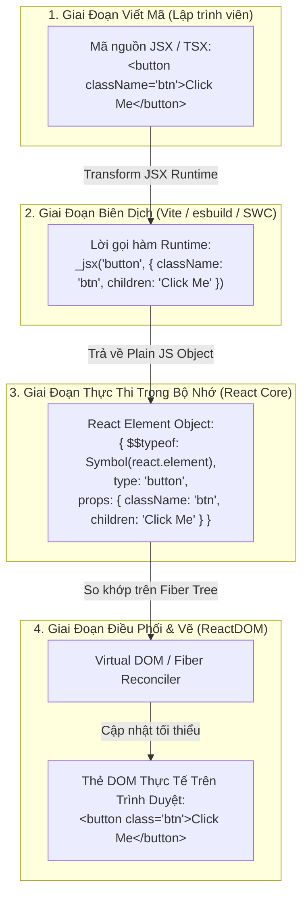

# JSX and TSX Under the Hood

> **Khóa học**: Modern Frontend Engineering (React + Vite)  
> **Phân nhóm**: Domain 2: React Core and Component Mental Model  
> **Chủ đề**: 2_1 Mental Model Transformation  
> **Trạng thái**: [x] Đã hoàn thành  
> **Checklist đối chiếu**: [CHECKLIST](../../CHECKLIST.md)

---

## 1. Khái Niệm Cốt Lõi & Bản Chất Kỹ Thuật (Core Technical Deep Dive)

Rất nhiều lập trình viên mới tiếp cận React thường lầm tưởng rằng: *"JSX là mã HTML được viết bên trong JavaScript"*. Đây là một hiểu lầm tai hại.

Về mặt bản chất:
> **JSX (JavaScript XML)** và **TSX (TypeScript XML)** là **cú pháp mở rộng (Syntax Extension)** của JavaScript. JSX không hề được trình duyệt hiểu trực tiếp. Trước khi chạy trên trình duyệt, trình biên dịch (như `esbuild` hoặc `SWC` trong Vite) sẽ chuyển đổi toàn bộ cú pháp JSX thành **các hàm JavaScript thông thường** nhằm tạo ra các **đối tượng JavaScript thuần túy (Plain JavaScript Objects)** được gọi là **React Elements**.

---

### 1.1 Cơ Chế Biên Dịch: Cũ (Legacy) vs Mới (Modern JSX Transform)

#### A. Cơ Chế Cũ (React < 17): `React.createElement`
Trước phiên bản React 17, mỗi thẻ JSX đều được Babel chuyển đổi thành lời gọi hàm `React.createElement`:
```tsx
// Bạn viết:
const element = <h1 className="title">Xin chào!</h1>;

// Trình biên dịch chuyển đổi thành:
const element = React.createElement('h1', { className: 'title' }, 'Xin chào!');
```
*Nhược điểm*: Bạn luôn bắt buộc phải viết `import React from 'react'` ở đầu mọi tệp, ngay cả khi không dùng bất kỳ biến nào tên là `React`.

#### B. Cơ Chế Hiện Đại (React 17, 18, 19 + Vite): `react/jsx-runtime`
Từ React 17 trở đi và mặc định trong Vite (`@vitejs/plugin-react`), trình biên dịch sử dụng **New JSX Transform**:
```tsx
// Bạn viết:
export const App = () => <h1 className="title">Xin chào!</h1>;

// Vite (esbuild/SWC) tự động chèn và biến đổi thành:
import { jsx as _jsx } from 'react/jsx-runtime';

export const App = () => _jsx('h1', { className: 'title', children: 'Xin chào!' });
```
*Lợi ích*:
- Không cần `import React from 'react'` chỉ để dùng JSX.
- Giảm dung lượng bundle và tối ưu hóa hiệu năng tạo đối tượng bộ nhớ.

---

### 1.2 Giải Phẫu React Element (Anatomy of a React Element)
Khi hàm `_jsx` thực thi, nó trả về một đối tượng JavaScript có cấu trúc như sau:

```javascript
{
  $$typeof: Symbol.for('react.transitional.element'), // hoặc Symbol.for('react.element')
  type: 'h1',
  key: null,
  ref: null,
  props: {
    className: 'title',
    children: 'Xin chào!'
  },
  _owner: null
}
```

> [!IMPORTANT]
> **Tại sao có thuộc tính `$$typeof: Symbol.for(...)`?**  
> Đây là cơ chế bảo mật tối quan trọng giúp React chống lại tấn công **Cross-Site Scripting (XSS)**. Nếu máy chủ backend bị lỗ hổng và kẻ tấn công gửi về một đoạn mã JSON giả mạo React Element để ép trình duyệt render mã độc, React sẽ từ chối render đối tượng đó. Bởi vì **chuẩn JSON không thể chứa kiểu dữ liệu `Symbol`**, React kiểm tra `$$typeof !== Symbol.for(...)` và chặn đứng mã độc ngay lập tức!

---

### 1.3 3 Quy Tắc Bắt Buộc Của JSX và Lý Do Kỹ Thuật

1. **Bắt buộc phải có một thẻ cha duy nhất (hoặc React Fragment `<>...</>`)**:
   - *Lý do*: Trong JavaScript, một hàm không thể trả về hai giá trị cùng lúc trừ khi được bọc trong một mảng hoặc một đối tượng (`return a, b;` không hợp lệ). Vì JSX biến thành `_jsx()`, bạn phải trả về một đối tượng duy nhất đại diện cho gốc của nhánh cây.
2. **Đóng toàn bộ các thẻ (``, `<br />`, `<input />`)**:
   - *Lý do*: HTML truyền thống có các thẻ rỗng (void tags) không cần đóng thẻ. Nhưng JSX tuân thủ nghiêm ngặt cú pháp XML để trình phân tích cú pháp (parser) xây dựng cây cú pháp trừu tượng (AST) một cách chính xác, không mơ hồ.
3. **Sử dụng camelCase cho hầu hết thuộc tính (`className`, `htmlFor`, `onClick`)**:
   - *Lý do*: Các thuộc tính trong JSX trở thành các khóa (keys) của JavaScript Object `props`. Từ khóa `class` và `for` là từ khóa dành riêng (reserved keywords) trong ngôn ngữ JavaScript, do đó React sử dụng `className` và `htmlFor` tương ứng với thuộc tính DOM tiêu chuẩn.

---

### 1.4 Dấu Ngoặc Nhọn `{}`: Cửa Sổ Mở Vào JavaScript
Bên trong JSX, dấu ngoặc nhọn `{}` đóng vai trò là một cánh cổng cho phép bạn thực thi mã JavaScript trực tiếp:
- **Chỉ chấp nhận Biểu thức (Expressions)**: Bất kỳ mã nào tính toán ra một giá trị đều được chấp nhận (ví dụ: biến, phép toán `2 + 2`, gọi hàm `formatName()`, toán tử ba ngôi `isLoggedIn ? <User /> : <Login />`, hàm `.map()`).
- **Không chấp nhận Câu lệnh (Statements)**: Bạn không thể đặt `if (...)`, `for (...)`, hoặc `switch (...)` trực tiếp bên trong `{}`, bởi vì câu lệnh không tự sinh ra một giá trị trả về cho `props.children`.

---

## 2. Ví Dụ Đời Sống Thực Tế Dễ Hiểu (Intuitive Real-World Analogy)

### Bản Vẽ Thiết Kế Kỹ Thuật Số (CAD Blueprint) vs Tòa Nhà Bê Tông Thật

Hãy tưởng tượng bạn là một kiến trúc sư xây dựng:

1. **Thẻ Real DOM (Tòa nhà bê tông cốt thép)**:
   - Một phần tử DOM thực tế trong trình duyệt cực kỳ nặng nề. Một thẻ `<div>` thông thường chứa hàng trăm thuộc tính, phương thức, vị trí tính toán tọa độ và bộ lắng nghe sự kiện. Việc đập đi xây lại một tòa nhà bê tông mỗi khi có người đổi màu sơn tường là điều vô cùng tốn kém và chậm chạp.
2. **JSX / React Element (Bản vẽ CAD kỹ thuật số dạng JSON)**:
   - JSX chỉ là bản thiết kế trên máy tính. Nó cực kỳ nhẹ (chỉ gồm một vài dòng văn bản mô tả: `loại: "tường", màu: "xanh", chiều_cao: 3m`).
   - Bạn có thể nhân bản 10.000 bản vẽ kỹ thuật trong chớp mắt mà không tốn một hạt cát hay một viên gạch nào.
   - Khi chủ nhà đổi ý (State thay đổi), bạn chỉ cần vẽ lại bản thiết kế mới, đặt bản thiết kế mới đè lên bản cũ xem có gì khác biệt (Diffing), và chỉ yêu cầu thợ xây sửa đúng bức tường cần sơn (Commit to Real DOM).

---

## 3. Sơ Đồ Kiến Trúc & Biên Dịch (Compilation Pipeline)



---

## 4. Code Mẫu Trực Quan & Giải Thích Từng Dòng (Clean, Runnable Sample Code)

Dưới đây là một component hoàn chỉnh minh họa sự tương đương giữa cú pháp JSX và đối tượng React Element bên dưới, đồng thời in trực tiếp cấu trúc nội tại ra màn hình và Console.

### Tệp `JsxUnderTheHood.tsx`:
```tsx
import React, { useState } from 'react';

// 1. Interface định nghĩa thuộc tính thẻ thông tin
interface UserCardProps {
  username: string;
  role: 'Admin' | 'Member';
  avatarUrl?: string;
}

export const JsxUnderTheHood: React.FC = () => {
  const [showRawObject, setShowRawObject] = useState<boolean>(false);

  // Tạo một phần tử JSX thông thường
  const profileElement = (
    <div className="user-card-wrapper border p-4 rounded-lg bg-gray-50">
      <h3 className="text-lg font-bold text-blue-600">Nguyễn Văn An</h3>
      <p className="text-sm text-gray-600">Vai trò: Quản trị viên</p>
    </div>
  );

  // Quan sát cấu trúc của React Element thực tế trong console
  console.log('[DEBUG] Bản chất React Element của JSX:', profileElement);
  console.log('[DEBUG] Type của element:', profileElement.type);
  console.log('[DEBUG] Props của element:', profileElement.props);

  // Dữ liệu danh sách người dùng để minh họa biểu thức lặp trong JSX
  const users: UserCardProps[] = [
    { username: 'Lê Hoàng Minh', role: 'Admin' },
    { username: 'Trần Thị Mai', role: 'Member' },
    { username: 'Phạm Quang Huy', role: 'Member' },
  ];

  return (
    <div className="max-w-2xl mx-auto p-6 bg-white border border-gray-200 rounded-xl shadow-md space-y-6">
      <div>
        <h2 className="text-xl font-bold text-gray-800">
          Minh Họa Bản Chất JSX & React Element
        </h2>
        <p className="text-sm text-gray-500 mt-1">
          Mở tab F12 Console để thấy đối tượng JS thuần túy mà JSX tạo ra bên dưới.
        </p>
      </div>

      {/* Hiển thị phần tử JSX */}
      <div>
        <h4 className="text-sm font-semibold uppercase text-gray-400 mb-2">
          Giao diện được render từ JSX:
        </h4>
        {profileElement}
      </div>

      {/* Nút bấm chuyển đổi xem cấu trúc JSON của React Element */}
      <button
        onClick={() => setShowRawObject((prev) => !prev)}
        className="px-4 py-2 bg-indigo-600 text-white rounded-lg hover:bg-indigo-700 transition text-sm font-medium"
      >
        {showRawObject ? 'Ẩn đối tượng JS gốc' : 'Soi chi tiết React Element Object'}
      </button>

      {/* Hiển thị chi tiết đối tượng React Element bên dưới */}
      {showRawObject && (
        <div className="p-4 bg-slate-900 text-green-400 font-mono text-xs rounded-lg overflow-x-auto">
          <p className="text-gray-400 mb-2">// Đây chính là những gì JSX biến thành trong bộ nhớ:</p>
          <pre>
            {JSON.stringify(
              {
                type: profileElement.type,
                key: profileElement.key,
                props: {
                  className: profileElement.props.className,
                  childrenCount: React.Children.count(profileElement.props.children),
                },
                typeofSymbol: 'Symbol(react.transitional.element) / Symbol(react.element)',
              },
              null,
              2
            )}
          </pre>
        </div>
      )}

      {/* Minh họa Biểu thức JS bên trong {} */}
      <div className="border-t pt-4">
        <h4 className="text-sm font-semibold uppercase text-gray-400 mb-3">
          Sử dụng biểu thức JavaScript map() bên trong dấu ngoặc nhọn:
        </h4>
        <ul className="space-y-2">
          {users.map((user) => (
            <li
              key={user.username}
              className="flex justify-between items-center p-3 border rounded-lg bg-gray-50"
            >
              <span className="font-medium text-gray-700">{user.username}</span>
              <span
                className={`text-xs px-2.5 py-1 rounded-full font-semibold ${
                  user.role === 'Admin'
                    ? 'bg-purple-100 text-purple-700'
                    : 'bg-blue-100 text-blue-700'
                }`}
              >
                {user.role}
              </span>
            </li>
          ))}
        </ul>
      </div>
    </div>
  );
};
```

---

## 📚 Nguồn Tài Liệu Chính Thống (Tier-1 Official References)
- [React Learn: Writing Markup with JSX](https://react.dev/learn/writing-markup-with-jsx) - Các quy tắc cơ bản của cú pháp JSX từ tài liệu chính thức React.
- [React Learn: JavaScript in JSX with Curly Braces](https://react.dev/learn/javascript-in-jsx-with-curly-braces) - Cách nhúng các biểu thức JavaScript vào bên trong JSX.
- [React Blog: Introducing the New JSX Transform](https://legacy.reactjs.org/blog/2020/09/22/introducing-the-new-jsx-transform.html) - Giải thích chi tiết sự ra đời của `react/jsx-runtime` thay thế cho `React.createElement`.
