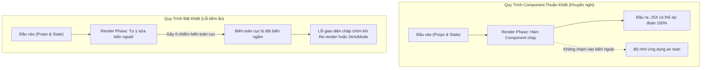

# Pure Components

> **Khóa học**: Modern Frontend Engineering (React + Vite)  
> **Phân nhóm**: Domain 2: React Core and Component Mental Model  
> **Chủ đề**: 2_1 Mental Model Transformation  
> **Trạng thái**: [x] Đã hoàn thành  
> **Checklist đối chiếu**: [CHECKLIST](../../CHECKLIST.md)

---

## 1. Khái Niệm Cốt Lõi & Bản Chất Kỹ Thuật (Core Technical Deep Dive)

Trong khoa học máy tính và lập trình hàm (Functional Programming), **Hàm thuần khiết (Pure Function)** là nền móng cốt lõi để xây dựng các hệ thống phần mềm đáng tin cậy và có thể dự đoán được.

Một hàm được gọi là thuần khiết khi đáp ứng trọn vẹn 2 điều kiện tiên quyết:
1. **Chỉ lo việc của mình (Minds its own business)**: Hàm không hề thay đổi bất kỳ biến, đối tượng hay trạng thái nào đã tồn tại trước khi hàm được gọi.
2. **Cùng đầu vào $\rightarrow$ Luôn ra cùng một đầu ra (Same inputs, same output)**: Với cùng một danh sách tham số truyền vào, hàm sẽ luôn luôn trả về cùng một kết quả duy nhất, không phụ thuộc vào thời gian, thứ tự gọi hay trạng thái ngầm.

```typescript
// Hàm thuần khiết: Cùng x luôn ra cùng kết quả, không làm đổi cái gì bên ngoài
function double(x: number): number {
  return x * 2;
}

// Hàm bất khiết (Impure): Làm thay đổi biến toàn cục bên ngoài
let count = 0;
function impureIncrement(): number {
  count++; // Tác dụng phụ (Side effect) làm ô nhiễm biến bên ngoài!
  return count;
}
```

---

### 1.1 Nguyên Tắc Vàng Của React: Components Must Be Pure!
> **React được thiết kế xoay quanh khái niệm này**: Mọi component React mà bạn viết đều phải là **hàm thuần khiết trong pha Render**.

Điều này có nghĩa là khi React thực thi hàm component của bạn để tính toán JSX:
- **Đầu vào**: `props`, `state`, `context`.
- **Đầu ra**: Cây đối tượng JSX (Virtual DOM).
- **Hành vi**: Trong quá trình chạy từ dòng đầu tiên đến câu lệnh `return` của component, bạn **tuyệt đối không được gây ra bất kỳ tác dụng phụ (Side Effect) nào** làm thay đổi thế giới bên ngoài (như sửa biến toàn cục, ghi đè đối tượng truyền từ prop, hoặc gọi API `fetch` trực tiếp trong thân hàm).

---

### 1.2 Tại Sao React Bắt Buộc Component Phải Thuần Khiết?
1. **Khả Năng Chạy Đồng Thời (Concurrent Rendering trong React 18/19)**:
   - React có thể tạm dừng việc render một component nếu có tác vụ ưu tiên cao hơn (ví dụ: người dùng gõ phím), sau đó hủy bỏ hoặc chạy lại lượt render đó trong nền. Nếu hàm component không thuần khiết và làm biến đổi biến bên ngoài, việc render dở dang sẽ làm hỏng dữ liệu của toàn bộ ứng dụng.
2. **Tối Ưu Hóa & Bộ Nhớ Đệm (Memoization & Caching)**:
   - Nếu component là thuần khiết, React có thể an toàn bỏ qua việc render lại (`React.memo`) nếu các props đầu vào không thay đổi, vì React chắc chắn 100% đầu ra JSX sẽ giống hệt lần trước.
3. **Hiệu Năng Máy Chủ (Server Components & Streaming)**:
   - Trên server, các component thuần khiết có thể render song song và stream về client một cách an toàn mà không sợ tranh chấp tài nguyên bộ nhớ (race condition).

---

### 1.3 Bí Mật Đằng Sau Việc React Chạy Hàm Hai Lần (`React.StrictMode`)
Khi bạn phát triển dự án với Vite (`<React.StrictMode>` trong `main.tsx`), bạn sẽ nhận thấy mọi lệnh `console.log` trong thân component đều được in ra **2 lần liên tiếp**.

> [!IMPORTANT]
> **Đây là tính năng chủ đích của React (Double Invocation)**!  
> Trong môi trường Development, React cố tình gọi component của bạn **2 lần liên tục** cho mỗi lần render để kiểm tra tính thuần khiết:
> - Nếu component của bạn **thuần khiết**: Lần chạy thứ 1 và lần chạy thứ 2 trả về kết quả hoàn toàn giống nhau, giao diện không có gì thay đổi.
> - Nếu component của bạn **bất khiết (Impure)** (ví dụ: tự ý tăng một biến đếm toàn cục `guestCount++`): Lần chạy thứ hai sẽ làm tăng biến đếm lên gấp đôi, khiến giao diện hiển thị sai số liệu ngay lập tức. Nhờ đó bạn sẽ phát hiện lỗi tức thì trước khi đẩy lên Production!

---

### 1.4 Đột Biến Cục Bộ (Local Mutation) Được Phép 100%
Nhiều lập trình viên lo lắng không biết có được tạo biến và vòng lặp trong component hay không. Quy tắc thuần khiết chỉ cấm bạn thay đổi những thứ **đã tồn tại trước khi hàm được gọi**.

Việc thay đổi các biến **được tạo ra bên trong chính lượt render đó** hoàn toàn an toàn:
```tsx
export const TeaGathering: React.FC = () => {
  // Hoàn toàn hợp lệ! Mảng cups được tạo mới bên trong hàm này
  const cups = [];
  for (let i = 1; i <= 3; i++) {
    cups.push(<li key={i}>Tách trà số #{i}</li>);
  }
  return <ul>{cups}</ul>;
};
```

---

## 2. Ví Dụ Đời Sống Thực Tế Dễ Hiểu (Intuitive Real-World Analogy)

### Công Thức Pha Trà Chuẩn Mực (The Tea Recipe)

Hãy tưởng tượng bạn mở một tiệm trà truyền thống:

1. **Công thức pha trà thuần khiết (Pure Recipe)**:
   - Công thức ghi rõ: *"1 gói trà lài + 200ml nước sôi ở 85°C $\rightarrow$ 1 tách trà lài thơm ngon"*.
   - Cho dù bạn pha 100 tách trà cho 100 người khách khác nhau, miễn là bạn giữ đúng tỷ lệ đầu vào, hương vị của 100 tách trà đều đồng nhất như một.
2. **Người pha trà bất khiết (Impure Barista with Side Effects)**:
   - Trong lúc đang pha trà cho bàn số 5, người pha trà lại tiện tay bốc một miếng bánh từ đĩa của bàn số 1 ăn dở, hoặc tự ý đổ thêm đường vào cốc trà của bàn số 2.
   - Hành vi này gọi là **Tác Dụng Phụ (Side Effect)** làm ảnh hưởng đến tài nguyên của người khác ngoài phạm vi cốc trà đang pha. Quán trà sẽ rơi vào tình trạng hỗn loạn và khách hàng khiếu nại ngay lập tức!

---

## 3. Sơ Đồ Kiến Trúc & Hình Ảnh Trực Quan (Mermaid & Official Visual Media)

### 3.1 Minh Họa Chính Thức Từ React.dev

| Công Thức Pha Trà Thuần Khiết (Pure Component Recipe) |
| :---: |
|  |
| *Cùng nguyên liệu đầu vào (Props) luôn luôn tạo ra cùng một tách trà (JSX), không làm bẩn môi trường xung quanh* |

---

### 3.2 Sơ Đồ Đối Chiếu: Pure vs Impure Trong React



---

## 4. Code Mẫu Trực Quan & Giải Thích Từng Dòng (Clean, Runnable Sample Code)

Dưới đây là một ví dụ đối chiếu trực tiếp giữa **Component Bất Khiết** (gặp lỗi nghiêm trọng khi bật `StrictMode`) và **Component Thuần Khiết** đúng chuẩn React.

### Tệp `PureVsImpureComponent.tsx`:
```tsx
import React, { useState } from 'react';

// ========================================================
// ❌ CÁCH VIẾT SAI: Component Bất Khiết (Impure)
// Sử dụng biến toàn cục nằm ngoài phạm vi component
// ========================================================
let globalGuestCounter = 0;

interface ImpureCupProps {
  label: string;
}

const ImpureCup: React.FC<ImpureCupProps> = ({ label }) => {
  // SAI LẦM: Làm biến đổi biến toàn cục bên ngoài trong pha Render!
  globalGuestCounter = globalGuestCounter + 1;

  console.log(`[IMPURE RENDER] Cup "${label}" render với guestCounter = ${globalGuestCounter}`);

  return (
    <div className="p-3 bg-red-50 border border-red-200 rounded-md text-red-700 text-sm">
      ☕ {label} - Phục vụ khách số: <strong>#{globalGuestCounter}</strong>
    </div>
  );
};

// ========================================================
// ✅ CÁCH VIẾT ĐÚNG: Component Thuần Khiết (Pure)
// Nhận toàn bộ dữ liệu cần thiết qua Props
// ========================================================
interface PureCupProps {
  guestNumber: number;
  label: string;
}

const PureCup: React.FC<PureCupProps> = ({ guestNumber, label }) => {
  // ĐÚNG: Chỉ tính toán dựa trên Props truyền vào, không sửa đổi bất kỳ thứ gì bên ngoài
  console.log(`[PURE RENDER] Cup "${label}" render với guestNumber = ${guestNumber}`);

  return (
    <div className="p-3 bg-green-50 border border-green-200 rounded-md text-green-700 text-sm">
      🍵 {label} - Phục vụ khách số: <strong>#{guestNumber}</strong>
    </div>
  );
};

// ========================================================
// Component Bọc Ngoài Để Khảo Sát
// ========================================================
export const PureComponentsDemo: React.FC = () => {
  const [reRenderTrigger, setReRenderTrigger] = useState<number>(0);

  // Reset lại biến toàn cục trước khi render (chỉ nhằm mục đích thử nghiệm demo)
  globalGuestCounter = 0;

  return (
    <div className="max-w-2xl mx-auto p-6 bg-white border border-gray-200 rounded-xl shadow-md space-y-6">
      <div>
        <h2 className="text-xl font-bold text-gray-800">
          Khảo Sát Tính Thuần Khiết (Pure Components)
        </h2>
        <p className="text-sm text-gray-500 mt-1">
          Bấm nút Re-render và quan sát: Cách viết sai sẽ bị nhảy số lộn xộn khi React StrictMode kích hoạt.
        </p>
      </div>

      <button
        onClick={() => setReRenderTrigger((prev) => prev + 1)}
        className="px-4 py-2 bg-blue-600 text-white text-sm font-medium rounded-lg hover:bg-blue-700 transition"
      >
        Kích hoạt Re-render (Lần: {reRenderTrigger})
      </button>

      {/* Khu vực minh họa lỗi của Component Bất Khiết */}
      <div className="border p-4 rounded-lg bg-gray-50 space-y-3">
        <h4 className="text-sm font-semibold text-red-600 uppercase">
          ❌ Cách Viết Sai (Đột Biến Biến Ngoài):
        </h4>
        <p className="text-xs text-gray-500">
          Nếu bật React.StrictMode, các số thứ tự dưới đây sẽ bị nhảy cóc thành #2, #4, #6 thay vì #1, #2, #3!
        </p>
        <div className="space-y-2">
          <ImpureCup label="Tách trà A" />
          <ImpureCup label="Tách trà B" />
          <ImpureCup label="Tách trà C" />
        </div>
      </div>

      {/* Khu vực minh họa Component Thuần Khiết Chuẩn Mực */}
      <div className="border p-4 rounded-lg bg-gray-50 space-y-3">
        <h4 className="text-sm font-semibold text-green-600 uppercase">
          ✅ Cách Viết Đúng (Nhận Số Thứ Tự Qua Props):
        </h4>
        <p className="text-xs text-gray-500">
          Dù component có bị render lại bao nhiêu lần, kết quả luôn luôn ổn định và chính xác 100%.
        </p>
        <div className="space-y-2">
          <PureCup guestNumber={1} label="Tách trà lài" />
          <PureCup guestNumber={2} label="Tách trà sen" />
          <PureCup guestNumber={3} label="Tách trà ô long" />
        </div>
      </div>
    </div>
  );
};
```

---

## 5. Tác Dụng Phụ Được Phép Ở Đâu? (Where Side Effects Belong)

Nếu trong pha render không được phép gây side effect, thì ứng dụng thay đổi màn hình, gửi API hoặc lưu LocalStorage ở đâu?
React phân định rõ ràng 2 vị trí được phép chứa Side Effects:

1. **Bộ Xử Lý Sự Kiện (Event Handlers)**:
   - Các hàm như `handleClick`, `handleSubmit`. Chúng chỉ chạy khi người dùng thực hiện một hành động cụ thể (click chuột, submit form). Lúc này quá trình render đã hoàn tất, không sợ làm hỏng render pipeline.
2. **Hook `useEffect`**:
   - Khi bạn bắt buộc phải đồng bộ hóa dữ liệu với hệ thống bên ngoài (API, WebSocket, LocalStorage) ngay sau khi render, bạn đặt logic đó vào `useEffect`. React chỉ chạy `useEffect` **sau khi đã Commit toàn bộ thay đổi lên DOM thật**.

---

## 📚 Nguồn Tài Liệu Chính Thống (Tier-1 Official References)
- [React Learn: Keeping Components Pure](https://react.dev/learn/keeping-components-pure) - Hướng dẫn nền tảng của React về việc giữ cho component thuần khiết.
- [React Reference: StrictMode](https://react.dev/reference/react/StrictMode) - Cơ chế Double Invocation phát hiện tác dụng phụ ngầm trong quá trình phát triển.
