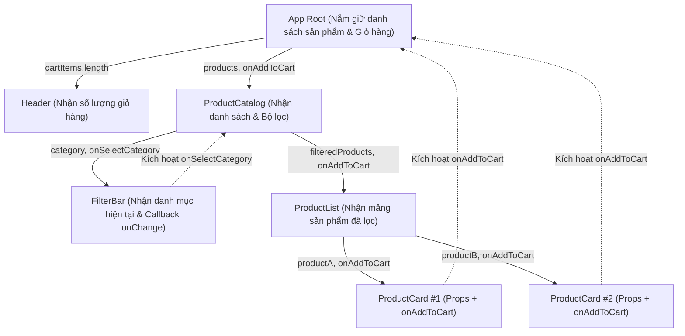

# Component Hierarchy and Props

> **Khóa học**: Modern Frontend Engineering (React + Vite)  
> **Phân nhóm**: Domain 2: React Core and Component Mental Model  
> **Chủ đề**: 2_2 Component Architecture and Composition  
> **Trạng thái**: [x] Đã hoàn thành  
> **Checklist đối chiếu**: [CHECKLIST](../../CHECKLIST.md)

---

## 1. Khái Niệm Cốt Lõi & Bản Chất Kỹ Thuật (Core Technical Deep Dive)

Trong kiến trúc React, ứng dụng được cấu thành từ **Cây phân cấp các Component (Component Tree Hierarchy)**. Một ứng dụng lớn không bao giờ được viết thành một file khổng lồ, mà được bẻ nhỏ thành các khối độc lập, có thể tái sử dụng và ghép nối linh hoạt với nhau.

Phương tiện duy nhất để các component trong cây phân cấp giao tiếp và truyền dữ liệu cho nhau từ trên xuống dưới chính là **Props (Properties)**.

---

### 1.1 Luồng Dữ Liệu Một Chiều (Unidirectional Data Flow)
Nguyên lý kiến trúc nền tảng của React là **Top-Down / Unidirectional Data Flow**:
- Dữ liệu luôn chảy **từ trên xuống dưới**, từ component cha (Parent) truyền sang component con (Child).
- Component con chỉ nhận dữ liệu và hiển thị, nó không hề biết nguồn gốc của dữ liệu đó đến từ `useState`, `useContext`, tính toán nội bộ hay gọi API của cha.
- **Tính Bất Biến Của Props (Props Are Read-Only / Immutable)**:
  - Khi một component con nhận `props`, nó **tuyệt đối không được phép sửa đổi** các thuộc tính trong `props` (ví dụ: `props.user.name = 'New'` là vi phạm nghiêm trọng).
  - *Lý do kỹ thuật*: Nếu component con tự ý sửa đối tượng `props`, nó sẽ làm thay đổi vùng nhớ của component cha mà không thông qua hàm setter của State. Điều này khiến cơ chế so sánh của React Reconciler bị tê liệt, giao diện không được cập nhật hoặc phát sinh các lỗi ngầm không thể truy vết.

---

### 1.2 Giao Tiếp Ngược Từ Con Lên Cha Qua Callback (Inverse Data Flow)
Nếu Props chỉ chảy một chiều từ trên xuống dưới, làm thế nào để component con báo cho cha biết khi người dùng click vào một nút bấm hoặc nhập dữ liệu?

> **Giải pháp chuẩn mực**: Component cha truyền một **hàm xử lý (Callback Function)** xuống cho con thông qua Props. Khi có sự kiện phát sinh, component con chỉ cần gọi hàm callback này để thông báo cho cha. Khi đó, cha sẽ cập nhật State của mình và truyền Props mới xuống lại cho con.

```mermaid
flowchart TD
    Parent["Component Cha (Nắm giữ State)"]
    Child["Component Con (Nhận Props)"]

    Parent -->|1. Truyền dữ liệu qua Props (Chảy xuống)| Child
    Child -->|2. Kích hoạt Callback Function (Báo cáo lên)| Parent
```

---

### 1.3 Khai Báo Props Chuẩn Với TypeScript & Các Kỹ Thuật Nâng Cao

#### A. Định Nghĩa Interface & Destructuring Kèm Giá Trị Mặc Định
```tsx
interface ProductCardProps {
  id: string;
  name: string;
  price: number;
  isAvailable?: boolean;       // Thuộc tính tùy chọn (optional)
  onAddToCart: (id: string) => void; // Callback function
}

export const ProductCard: React.FC<ProductCardProps> = ({
  id,
  name,
  price,
  isAvailable = true,          // Gán giá trị mặc định nếu cha không truyền
  onAddToCart,
}) => {
  // ...
};
```

#### B. Chuyển Tiếp Thuộc Tính (Prop Forwarding / Spread Props)
Khi xây dựng các component nguyên tử dùng chung (Button, Input, Card), ta thường muốn component nhận tất cả các thuộc tính HTML tiêu chuẩn (`onClick`, `disabled`, `className`, `aria-label`) mà không cần khai báo lại từng cái một:
```tsx
import React, { ComponentPropsWithoutRef } from 'react';

// Kế thừa toàn bộ thuộc tính tiêu chuẩn của thẻ button HTML
interface PrimaryButtonProps extends ComponentPropsWithoutRef<'button'> {
  isLoading?: boolean;
}

export const PrimaryButton: React.FC<PrimaryButtonProps> = ({
  isLoading = false,
  children,
  className = '',
  disabled,
  ...restProps // Gom toàn bộ props còn lại (onClick, type, aria-*, id...)
}) => {
  return (
    <button
      disabled={disabled || isLoading}
      className={`px-4 py-2 font-medium rounded-lg ${className}`}
      {...restProps} // Trải toàn bộ props chuẩn vào thẻ button DOM
    >
      {isLoading ? 'Đang xử lý...' : children}
    </button>
  );
};
```

> [!CAUTION]
> **Cảnh báo khi dùng Spread Props (`{...props}`)**: Không nên lạm dụng trải props một cách bừa bãi trong các business component. Nó có thể vô tình chuyển các props thừa không hợp lệ vào thẻ DOM, làm mất tính minh bạch của code và gây khó khăn khi tái cấu trúc.

---

## 2. Ví Dụ Đời Sống Thực Tế Dễ Hiểu (Intuitive Real-World Analogy)

### Thác Nước Tự Nhiên & Hợp Đồng Pháp Lý

1. **Thác nước tự nhiên (Top-down Waterfall)**:
   - Nước từ trên đỉnh núi cao luôn chảy dồn xuống các hồ chứa trung gian rồi đổ ra suối nhỏ ở chân núi. Nước không bao giờ có thể tự chảy ngược lên đỉnh núi.
   - Nếu bạn muốn thay đổi dòng nước ở suối nhỏ, bạn phải điều chỉnh van nước ở trạm bơm đầu nguồn trên đỉnh núi (State ở Component Cha). Khi trạm đầu nguồn xả nước theo cách mới, cả thác nước bên dưới sẽ tự động thay đổi theo.

2. **Hợp đồng pháp lý (Read-Only Props) & Công văn đề xuất (Callbacks)**:
   - Giám đốc công ty (Parent) giao cho bạn (Child) một bản hợp đồng ghi rõ các điều khoản dự án (`props`).
   - Bản hợp đồng này đã được đóng dấu niêm phong. Bạn **không được tự ý lấy bút xóa để sửa các con số** trên hợp đồng.
   - Nếu bạn thấy kinh phí dự án không đủ, bạn phải soạn một **Công văn đề xuất** gửi lên bàn giám đốc (gọi hàm `onBudgetAdjustmentRequest()`). Giám đốc xem xét đề xuất, nếu phê duyệt sẽ ký một bản hợp đồng mới (re-render với props mới) và trao lại cho bạn!

---

## 3. Sơ Đồ Cây Phân Cấp & Luồng Truyền Dữ Liệu (Hierarchy Diagram)



---

## 4. Code Mẫu Trực Quan & Giải Thích Từng Dòng (Clean, Runnable Sample Code)

Dưới đây là một hệ thống phân cấp hoàn chỉnh gồm 3 tầng component viết bằng TypeScript:
1. `ProductInventoryApp` (Cha cao nhất nắm giữ State).
2. `ProductFilter` (Con điều khiển bộ lọc).
3. `ProductCard` (Con hiển thị chi tiết sản phẩm và gửi callback khi thêm vào giỏ).

### Tệp `ProductHierarchyDemo.tsx`:
```tsx
import React, { useState } from 'react';

// 1. Interfaces định nghĩa dữ liệu và Props
interface Product {
  id: string;
  name: string;
  price: number;
  category: 'Tech' | 'Home';
}

interface ProductCardProps {
  product: Product;
  onAddToCart: (productId: string) => void;
}

interface FilterProps {
  activeCategory: string;
  onSelectCategory: (category: string) => void;
}

// 2. Component Con Cấp 1: Hiển thị từng thẻ sản phẩm
const ProductCard: React.FC<ProductCardProps> = ({ product, onAddToCart }) => {
  console.log(`[RENDER] ProductCard rendered: ${product.name}`);

  return (
    <div className="p-4 border rounded-xl bg-white shadow-sm flex flex-col justify-between hover:shadow-md transition">
      <div>
        <span className="text-xs px-2 py-0.5 bg-blue-50 text-blue-600 rounded font-medium">
          {product.category}
        </span>
        <h4 className="font-semibold text-gray-800 text-base mt-2">{product.name}</h4>
        <p className="text-gray-600 text-sm mt-1">{product.price.toLocaleString('vi-VN')} đ</p>
      </div>

      {/* Gọi callback function truyền từ cha xuống khi người dùng click */}
      <button
        onClick={() => onAddToCart(product.id)}
        className="mt-4 w-full py-2 bg-slate-900 text-white text-xs font-semibold rounded-lg hover:bg-slate-800 transition"
      >
        + Thêm vào giỏ
      </button>
    </div>
  );
};

// 3. Component Con Cấp 2: Bộ lọc danh mục
const FilterBar: React.FC<FilterProps> = ({ activeCategory, onSelectCategory }) => {
  const categories = ['Tất cả', 'Tech', 'Home'];

  return (
    <div className="flex gap-2">
      {categories.map((cat) => (
        <button
          key={cat}
          onClick={() => onSelectCategory(cat)}
          className={`px-3 py-1.5 rounded-lg text-xs font-medium transition ${
            activeCategory === cat
              ? 'bg-blue-600 text-white'
              : 'bg-gray-100 text-gray-600 hover:bg-gray-200'
          }`}
        >
          {cat}
        </button>
      ))}
    </div>
  );
};

// 4. Component Cha Cao Nhất: Quản lý State tập trung
export const ProductInventoryApp: React.FC = () => {
  const [selectedCategory, setSelectedCategory] = useState<string>('Tất cả');
  const [cart, setCart] = useState<string[]>([]);

  // Dữ liệu sản phẩm mẫu
  const initialProducts: Product[] = [
    { id: 'p1', name: 'Bàn phím cơ Không Dây', price: 1850000, category: 'Tech' },
    { id: 'p2', name: 'Chuột Công Thái Học', price: 1200000, category: 'Tech' },
    { id: 'p3', name: 'Đèn Bàn Chống Cận', price: 650000, category: 'Home' },
    { id: 'p4', name: 'Bình Giữ Nhiệt Cao Cấp', price: 420000, category: 'Home' },
  ];

  // Callback nhận thông báo từ ProductCard con
  const handleAddToCart = (productId: string) => {
    console.log(`[ACTION] Nhận sự kiện thêm sản phẩm id: ${productId} từ Component Con`);
    setCart((prev) => [...prev, productId]);
  };

  // Tính toán danh sách sản phẩm hiển thị dựa trên bộ lọc
  const filteredProducts =
    selectedCategory === 'Tất cả'
      ? initialProducts
      : initialProducts.filter((p) => p.category === selectedCategory);

  return (
    <div className="max-w-3xl mx-auto p-6 bg-white border border-gray-200 rounded-2xl shadow-sm space-y-6">
      {/* Tiêu đề và tổng kết giỏ hàng */}
      <div className="flex justify-between items-center border-b pb-4">
        <div>
          <h2 className="text-xl font-bold text-gray-800">Cửa Hàng Công Nghệ & Tiện Ích</h2>
          <p className="text-xs text-gray-500">Minh họa luồng Props một chiều và Callbacks</p>
        </div>
        <div className="px-3 py-1.5 bg-amber-50 border border-amber-200 rounded-lg text-amber-700 text-xs font-semibold">
          🛒 Giỏ hàng: {cart.length} món
        </div>
      </div>

      {/* Truyền Props và Callback xuống FilterBar */}
      <FilterBar
        activeCategory={selectedCategory}
        onSelectCategory={(cat) => setSelectedCategory(cat)}
      />

      {/* Truyền danh sách sản phẩm và Callback xuống danh sách thẻ con */}
      <div className="grid grid-cols-1 sm:grid-cols-2 gap-4">
        {filteredProducts.map((product) => (
          <ProductCard
            key={product.id}
            product={product}
            onAddToCart={handleAddToCart}
          />
        ))}
      </div>
    </div>
  );
};
```

---

## 📚 Nguồn Tài Liệu Chính Thống (Tier-1 Official References)
- [React Learn: Passing Props to a Component](https://react.dev/learn/passing-props-to-a-component) - Hướng dẫn chính thức về cách truyền và sử dụng Props trong React.
- [React Learn: Thinking in React](https://react.dev/learn/thinking-in-react) - Xây dựng ứng dụng mẫu phân tách dữ liệu và phân cấp component chuẩn mực.
