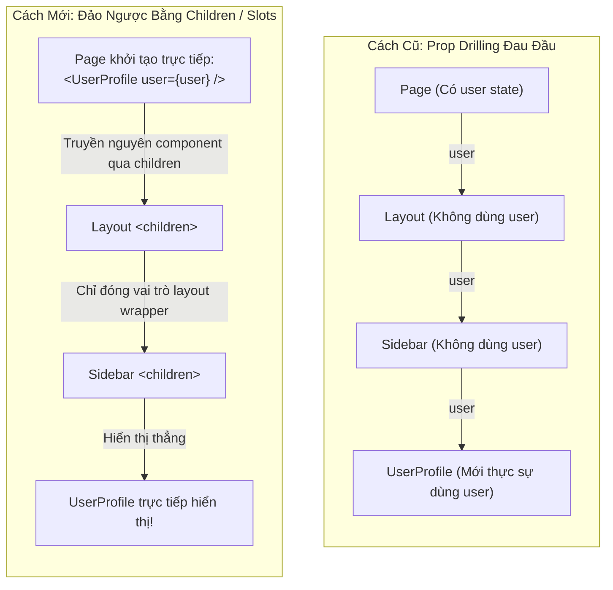

# Children Prop and Slot Pattern

> **Khóa học**: Modern Frontend Engineering (React + Vite)  
> **Phân nhóm**: Domain 2: React Core and Component Mental Model  
> **Chủ đề**: 2_2 Component Architecture and Composition  
> **Trạng thái**: [x] Đã hoàn thành  
> **Checklist đối chiếu**: [CHECKLIST](../../CHECKLIST.md)

---

## 1. Khái Niệm Cốt Lõi & Bản Chất Kỹ Thuật (Core Technical Deep Dive)

Trong thiết kế hướng đối tượng (OOP) truyền thống, các lập trình viên thường dùng **Kế thừa (Inheritance)** để chia sẻ logic và giao diện (`class AdminUserCard extends BaseUserCard`).

Tuy nhiên, trong React, đội ngũ kỹ sư Facebook/Meta đã đưa ra kết luận sau nhiều năm vận hành hàng nghìn component:
> **Ghép Nối Hơn Kế Thừa (Composition over Inheritance)**: Kế thừa tạo ra cấu trúc phân cấp cứng nhắc và liên kết lỏng lẻo. React giải quyết triệt để bài toán tái sử dụng giao diện bằng **Ghép nối (Composition)** thông qua thuộc tính đặc biệt `children` và mẫu thiết kế **Slot Pattern**.

---

### 1.1 Thuộc Tính `children` (The `children` Prop)
Khi bạn lồng các phần tử JSX vào giữa thẻ mở và thẻ đóng của một component:

```tsx
<ModalDialog>
  <h3>Xác nhận thanh toán</h3>
  <p>Bạn có chắc chắn muốn mua gói đăng ký này không?</p>
</ModalDialog>
```

React sẽ tự động gom toàn bộ nội dung nằm ở giữa và truyền vào component `ModalDialog` dưới dạng một prop có tên ngầm định là **`children`**.

#### Kiểu Dữ Liệu Trong TypeScript:
```tsx
import React, { ReactNode } from 'react';

interface ModalDialogProps {
  isOpen: boolean;
  onClose: () => void;
  children: ReactNode; // ReactNode chấp nhận mọi thứ: string, JSX, array, null...
}

export const ModalDialog: React.FC<ModalDialogProps> = ({ isOpen, onClose, children }) => {
  if (!isOpen) return null;

  return (
    <div className="modal-backdrop">
      <div className="modal-content">
        <button onClick={onClose}>✕</button>
        {/* Render toàn bộ nội dung mà component cha truyền vào */}
        {children}
      </div>
    </div>
  );
};
```

---

### 1.2 Mẫu Thiết Kế Nhiều Ngăn (Slot Pattern / Named Slots)
Thuộc tính `children` rất tuyệt vời khi bạn chỉ có một vùng chứa duy nhất. Nhưng nếu bạn cần đặt nội dung vào nhiều vị trí khác nhau (ví dụ: Thanh tiêu đề trên cùng, Nội dung ở giữa, và Các nút hành động ở chân trang)?

> **Bản chất của Slot Pattern trong React**: Trong React, JSX là các đối tượng JavaScript thông thường (`React Elements`). Vì vậy, bạn hoàn toàn có thể truyền JSX qua **bất kỳ prop nào**, không nhất thiết phải là `children`!

```tsx
interface CardLayoutProps {
  headerSlot?: React.ReactNode;
  contentSlot: React.ReactNode;
  footerSlot?: React.ReactNode;
}

export const CardLayout: React.FC<CardLayoutProps> = ({
  headerSlot,
  contentSlot,
  footerSlot,
}) => {
  return (
    <div className="border rounded-xl shadow-sm bg-white overflow-hidden">
      {headerSlot && <div className="border-b p-4 bg-gray-50">{headerSlot}</div>}
      <div className="p-4">{contentSlot}</div>
      {footerSlot && <div className="border-t p-3 bg-gray-50 flex justify-end gap-2">{footerSlot}</div>}
    </div>
  );
};
```

---

### 1.3 Giải Quyết Triệt Để "Prop Drilling" Bằng Composition
**Prop Drilling** xảy ra khi bạn phải truyền một dữ liệu (ví dụ: thông tin người dùng `user`) xuyên qua 4-5 tầng component trung gian (`Page -> Layout -> MainSection -> ProfileSummary`) chỉ để component ở đáy cây có thể đọc được.

Thay vì vội vàng lôi Redux hay Context API ra sử dụng, **Component Composition là vũ khí tinh giản và hiệu quả nhất**:
- Thay vì để `Layout` tự import và render `ProfileSummary`, bạn hãy biến `Layout` và `MainSection` thành các container nhận `children`.
- Ở tầng `Page`, bạn trực tiếp render `<ProfileSummary user={user} />` và đặt nó vào `children` của `Layout`.
- *Kết quả*: Các component trung gian hoàn toàn không cần biết dữ liệu `user` là gì, giải phóng chúng khỏi sự phụ thuộc không cần thiết!

---

## 2. Ví Dụ Đời Sống Thực Tế Dễ Hiểu (Intuitive Real-World Analogy)

### Khung Tranh Treo Tường & Hộp Cơm Bento Nhiều Ngăn

1. **Khung Tranh Treo Tường (Children Prop)**:
   - Một chiếc khung tranh sang trọng bằng gỗ sồi chỉ đảm nhận nhiệm vụ định hình kích thước, bo viền và gắn mặt kính trong suốt.
   - Khung tranh không quan tâm bạn lồng vào đó bức ảnh chân dung gia đình, một bức tranh sơn mài trừu tượng, hay một tấm bằng khen đại học. Bất kỳ thứ gì bạn nhét vào ruột khung tranh (`children`) đều được bảo vệ và đóng khung đẹp đẽ.

2. **Hộp Cơm Bento Nhật Bản (Slot Pattern)**:
   - Chiếc hộp bento có sẵn các ngăn chia kích thước chuẩn xác: Ngăn đựng cơm (`headerSlot`), ngăn thức ăn chính (`contentSlot`), ngăn rau xanh và nước sốt (`footerSlot`).
   - Bạn có thể biến hóa bữa trưa thành bento gà teriyaki hoặc bento chay đậu phụ tùy thích bằng cách đặt các món ăn khác nhau vào từng ô ngăn tương ứng mà không cần phải đúc lại chiếc vỏ hộp cơm!

---

## 3. Sơ Đồ Kiến Trúc & Hình Ảnh Trực Quan (Mermaid & Official Visual Media)

### 3.1 Minh Họa Chính Thức Từ React.dev

| Minh Họa Ghép Nối Với Children Prop |
| :---: |
|  |
| *Component bọc ngoài hoạt động như một lỗ hổng linh hoạt, sẵn sàng nhận bất kỳ JSX nào lồng vào giữa* |

---

### 3.2 Sơ Đồ Khắc Phục Prop Drilling Bằng Composition



---

## 4. Code Mẫu Trực Quan & Giải Thích Từng Dòng (Clean, Runnable Sample Code)

Dưới đây là một ví dụ thực tế hoàn chỉnh bằng TypeScript minh họa:
1. Component `DialogBox` sử dụng cả `children` và `Slot Pattern` (`actionsSlot`).
2. Cách ghép nối linh hoạt để tái sử dụng một container cho 2 mục đích hoàn toàn khác nhau (Hộp thoại xác nhận xóa & Hộp thoại giới thiệu thông tin).

### Tệp `DialogCompositionDemo.tsx`:
```tsx
import React, { useState, ReactNode } from 'react';

// 1. Định nghĩa Props sử dụng Slot Pattern kết hợp children
interface DialogBoxProps {
  isOpen: boolean;
  title: string;
  onClose: () => void;
  actionsSlot?: ReactNode; // Slot tùy chọn chứa các nút bấm hành động
  children: ReactNode;    // Thân nội dung chính của Dialog
}

const DialogBox: React.FC<DialogBoxProps> = ({
  isOpen,
  title,
  onClose,
  actionsSlot,
  children,
}) => {
  if (!isOpen) return null;

  return (
    // Lớp phủ mờ toàn màn hình
    <div className="fixed inset-0 z-50 bg-black/50 backdrop-blur-sm flex items-center justify-center p-4">
      {/* Khung chứa Modal */}
      <div className="w-full max-w-lg bg-white rounded-2xl shadow-2xl border border-gray-100 overflow-hidden animate-in fade-in zoom-in duration-200">
        {/* Phần Header */}
        <div className="flex justify-between items-center px-6 py-4 border-b bg-gray-50/50">
          <h3 className="text-base font-bold text-gray-800">{title}</h3>
          <button
            onClick={onClose}
            className="text-gray-400 hover:text-gray-600 rounded-lg p-1 text-sm font-semibold"
          >
            ✕
          </button>
        </div>

        {/* Phần Thân (Children Slot linh hoạt) */}
        <div className="p-6 text-sm text-gray-600 space-y-3">{children}</div>

        {/* Phần Chân (Actions Slot tùy biến) */}
        {actionsSlot && (
          <div className="px-6 py-3.5 bg-gray-50 border-t flex justify-end gap-3">
            {actionsSlot}
          </div>
        )}
      </div>
    </div>
  );
};

// 2. Component Cha Ứng Dụng Khảo Sát
export const DialogCompositionDemo: React.FC = () => {
  const [activeModal, setActiveModal] = useState<'none' | 'delete' | 'info'>('none');

  return (
    <div className="max-w-xl mx-auto p-6 bg-white border border-gray-200 rounded-2xl shadow-sm space-y-4">
      <div>
        <h2 className="text-lg font-bold text-gray-800">
          Minh Họa Component Composition & Slots
        </h2>
        <p className="text-xs text-gray-500 mt-1">
          Cùng một component DialogBox nhưng có thể hiển thị 2 loại giao diện hoàn toàn khác nhau mà không cần sửa code bên trong DialogBox.
        </p>
      </div>

      <div className="flex gap-3">
        <button
          onClick={() => setActiveModal('delete')}
          className="px-4 py-2 bg-red-600 text-white text-xs font-semibold rounded-lg hover:bg-red-700 transition"
        >
          Mở Dialog Cảnh Báo Xóa
        </button>
        <button
          onClick={() => setActiveModal('info')}
          className="px-4 py-2 bg-blue-600 text-white text-xs font-semibold rounded-lg hover:bg-blue-700 transition"
        >
          Mở Dialog Thông Tin
        </button>
      </div>

      {/* Trường hợp 1: Dialog Xóa - Truyền nút Hủy & Xóa vào actionsSlot */}
      <DialogBox
        isOpen={activeModal === 'delete'}
        title="⚠️ Cảnh báo xóa vĩnh viễn"
        onClose={() => setActiveModal('none')}
        actionsSlot={
          <>
            <button
              onClick={() => setActiveModal('none')}
              className="px-3 py-1.5 border border-gray-300 text-gray-700 text-xs font-medium rounded-lg hover:bg-gray-100"
            >
              Hủy bỏ
            </button>
            <button
              onClick={() => {
                alert('Đã xóa dữ liệu thành công!');
                setActiveModal('none');
              }}
              className="px-3 py-1.5 bg-red-600 text-white text-xs font-medium rounded-lg hover:bg-red-700"
            >
              Xác nhận xóa
            </button>
          </>
        }
      >
        <p className="text-red-700 font-medium">Hành động này không thể hoàn tác.</p>
        <p>Toàn bộ cơ sở dữ liệu của dự án sẽ bị xóa sạch khỏi máy chủ đám mây.</p>
      </DialogBox>

      {/* Trường hợp 2: Dialog Thông Tin - Chỉ có 1 nút Đóng */}
      <DialogBox
        isOpen={activeModal === 'info'}
        title="💡 Thông tin bản quyền phiên bản"
        onClose={() => setActiveModal('none')}
        actionsSlot={
          <button
            onClick={() => setActiveModal('none')}
            className="px-4 py-1.5 bg-blue-600 text-white text-xs font-medium rounded-lg hover:bg-blue-700"
          >
            Tôi đã hiểu
          </button>
        }
      >
        <p>Ứng dụng chạy trên nền tảng <strong>React 19 + Vite 6</strong>.</p>
        <p>Tuân thủ nghiêm ngặt các nguyên lý Clean Code và Component Composition.</p>
      </DialogBox>
    </div>
  );
};
```

---

## 📚 Nguồn Tài Liệu Chính Thống (Tier-1 Official References)
- [React Learn: Passing JSX as Children](https://react.dev/learn/passing-props-to-a-component#passing-jsx-as-children) - Hướng dẫn chính thức về thuộc tính `children`.
- [React Learn: Extracting Components & Composition](https://react.dev/learn/thinking-in-react) - Cách tách và ghép nối các thành phần nhỏ thành giao diện lớn.
