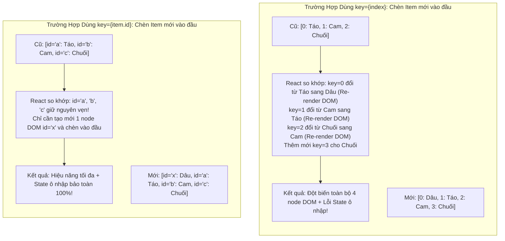

# Conditional Rendering and List Keys

> **Khóa học**: Modern Frontend Engineering (React + Vite)  
> **Phân nhóm**: Domain 2: React Core and Component Mental Model  
> **Chủ đề**: 2_2 Component Architecture and Composition  
> **Trạng thái**: [x] Đã hoàn thành  
> **Checklist đối chiếu**: [CHECKLIST](../../CHECKLIST.md)

---

## 1. Khái Niệm Cốt Lõi & Bản Chất Kỹ Thuật (Core Technical Deep Dive)

Trong các ứng dụng thực tế, giao diện không bao giờ tĩnh. Bạn liên tục phải giải quyết hai bài toán kinh điển:
1. **Render Theo Điều Kiện (Conditional Rendering)**: Hiển thị giao diện khác nhau tùy thuộc vào trạng thái (người dùng đã đăng nhập chưa, dữ liệu đang tải hay đã có lỗi).
2. **Render Danh Sách & Khóa Định Danh (Rendering Lists & The Key Prop)**: Hiển thị danh sách các mục dữ liệu động (danh sách bài viết, sản phẩm trong giỏ) và bảo đảm tính toàn vẹn trạng thái thông qua thuộc tính `key`.

---

### 1.1 Các Kỹ Thuật Render Theo Điều Kiện & "Cạm Bẫy Số 0" (The 0 Trap)

#### A. Câu Lệnh `if / else` Với Early Return
Phù hợp nhất khi bạn muốn chặn việc render toàn bộ component nếu chưa đủ điều kiện:
```tsx
if (isLoading) {
  return <LoadingSpinner />;
}
if (hasError) {
  return <ErrorMessage message="Không thể tải dữ liệu" />;
}
return <MainDashboard data={data} />;
```

#### B. Toán Tử Ba Ngôi (Ternary Operator: `condition ? <A /> : <B />`)
Lựa chọn ngắn gọn và rõ ràng nhất khi bạn muốn chuyển đổi qua lại giữa hai khối JSX ngay trong câu lệnh `return`:
```tsx
<button className={isSubscribed ? 'btn-secondary' : 'btn-primary'}>
  {isSubscribed ? 'Đã đăng ký' : 'Đăng ký ngay'}
</button>
```

#### C. Toán Tử Logic AND (`&&`) & Cạm Bẫy Số 0 Tai Hại!
Lập trình viên thường viết: `condition && <Component />` để chỉ hiển thị component khi điều kiện là `true`.

> [!CAUTION]
> **Cạm Bẫy Số 0 (The 0 Trap) Trong JavaScript**:  
> Trong JavaScript, toán tử `&&` không chuyển đổi vế trái thành boolean mà trả về **chính giá trị của biểu thức vế trái** nếu nó là falsy!
> ```tsx
> const unreadCount = 0;
> // SAI LẦM: Trình duyệt sẽ in ra số "0" lên màn hình!
> return <div>{unreadCount && <Badge count={unreadCount} />}</div>;
> ```
> *Giải pháp chuẩn*: Luôn ép kiểu vế trái thành Boolean hoặc so sánh rõ ràng:
> ```tsx
> // Cách 1: So sánh lớn hơn 0
> {unreadCount > 0 && <Badge count={unreadCount} />}
> 
> // Cách 2: Ép kiểu Boolean
> {Boolean(unreadCount) && <Badge count={unreadCount} />}
> 
> // Cách 3: Dùng toán tử ba ngôi với null
> {unreadCount ? <Badge count={unreadCount} /> : null}
> ```

---

### 1.2 Render Danh Sách & Vai Trò Sống Còn Của Thuộc Tính `key`
Khi chuyển đổi một mảng dữ liệu thành danh sách các phần tử JSX bằng hàm `.map()`, React bắt buộc bạn phải cung cấp thuộc tính `key` cho mỗi phần tử:

```tsx
const todoItems = todos.map((todo) => (
  <li key={todo.id}>{todo.text}</li>
));
```

#### Tại Sao React Bắt Buộc Phải Có `key`?
- **Thuật toán so khớp Fiber Reconciler**: Trong quá trình re-render, React tạo ra một cây Virtual DOM mới và so sánh với cây Virtual DOM cũ.
- Khi một phần tử trong danh sách bị xóa, chèn vào giữa, hoặc sắp xếp lại thứ tự, **làm sao React biết phần tử nào là phần tử nào** giữa hai lượt render?
- `key` đóng vai trò là **chứng minh nhân dân (Unique Identity)** vĩnh cửu của phần tử đó. Nhờ có `key`, React biết chính xác phần tử nào vẫn giữ nguyên, phần tử nào được thêm mới, và phần tử nào bị xóa bỏ để chỉ thao tác tối thiểu trên DOM thật.

---

### 1.3 Sai Lầm Chí Tử: Dùng Chỉ Số Mảng Làm Key (`key={index}`)

Rất nhiều lập trình viên mới thường viết tắt: `todos.map((todo, index) => <TodoItem key={index} />)`.

#### Hậu quả nghiêm trọng của `key={index}`:
1. **Lẫn lộn trạng thái người dùng (State Corruption Bug)**:
   - Nếu mỗi item trong danh sách có chứa state nội bộ (ví dụ: một ô `<input>` đang gõ dở, checkbox đang tích, hoặc animation đang chạy).
   - Khi bạn xóa phần tử ở vị trí đầu tiên (`index = 0`), phần tử thứ hai bị đôn lên thành `index = 0`.
   - Vì React thấy `key={0}` vẫn tồn tại, nó sẽ **tái sử dụng nguyên vẹn node DOM và State của phần tử cũ** cho phần tử mới! Kết quả là dữ liệu người dùng gõ trong ô input bị nhảy sang mục khác một cách quái đản!
2. **Hiệu năng suy giảm trầm trọng**:
   - Khi chèn một phần tử vào đầu danh sách với `key={index}`, toàn bộ các phần tử phía sau đều bị đổi key (`0 -> 1`, `1 -> 2`,...). React buộc phải hủy bỏ và render lại toàn bộ danh sách thay vì chỉ chèn đúng 1 node mới!

#### 2 Quy Tắc Của Key Hợp Lệ:
1. **Phải duy nhất giữa các anh chị em cùng cấp (Unique among siblings)**: Không bắt buộc phải duy nhất trên toàn bộ ứng dụng, chỉ cần duy nhất trong cùng một mảng danh sách.
2. **Phải ổn định theo thời gian (Stable)**: Tuyệt đối không sinh key ngẫu nhiên trong lúc render như `key={Math.random()}`. Việc này sẽ khiến React phá hủy và tạo mới toàn bộ cây DOM trong mỗi lần gõ phím!

---

## 2. Ví Dụ Đời Sống Thực Tế Dễ Hiểu (Intuitive Real-World Analogy)

### Thẻ Căn Cước Công Dân (Unique Key) vs Số Thứ Tự Xếp Hàng (Index)

1. **Số Thứ Tự Xếp Hàng Ngân Hàng (`key={index}`)**:
   - Khi khách hàng bước vào ngân hàng, bảo vệ phát cho số thứ tự: Anh An số 1, Chị Bình số 2, Em Cường số 3.
   - Bỗng nhiên Anh An (số 1) có việc gấp bỏ về. Nhân viên ngân hàng liền dồn hàng: Chị Bình bị đổi thành số 1, Em Cường thành số 2.
   - Nhân viên tại quầy gọi: *"Mời số 1 lên ký nhận rút 100 triệu của anh An!"*. Lúc này Chị Bình (đang mang số 1) bước lên và vô tình ký nhầm vào hồ sơ tài khoản của Anh An! Đây chính là lỗi **State Corruption** khi dùng `index` làm key.

2. **Thẻ Căn Cước Công Dân Gắn Chip (`key={todo.id}`)**:
   - Mỗi công dân có một số CCCD định danh duy nhất suốt đời.
   - Dù bạn chuyển nhà từ Hà Nội vào TP.HCM, đổi chỗ làm, hay đứng ở bất kỳ vị trí nào trong đám đông, cơ quan quản lý chỉ cần quét số CCCD là nhận diện chính xác 100% hồ sơ của bạn. Không ai có thể bị nhận nhầm hay tráo đổi thông tin.

---

## 3. Sơ Đồ Thuật Toán So Khớp Fiber (Reconciliation With Keys)



---

## 4. Code Mẫu Trực Quan & Giải Thích Từng Dòng (Clean, Runnable Sample Code)

Dưới đây là một ứng dụng nhỏ hoàn chỉnh chứng minh trực quan:
1. Cách tránh **Cạm bẫy số 0** trong Render có điều kiện.
2. Thử nghiệm trực tiếp lỗi mất trạng thái ô nhập khi chuyển đổi giữa `key={index}` và `key={item.id}`.

### Tệp `ConditionalAndListKeysDemo.tsx`:
```tsx
import React, { useState } from 'react';

interface Task {
  id: string;
  title: string;
  isImportant: boolean;
}

export const ConditionalAndListKeysDemo: React.FC = () => {
  // Dữ liệu ban đầu
  const [tasks, setTasks] = useState<Task[]>([
    { id: 'task-1', title: 'Học React Mental Model', isImportant: true },
    { id: 'task-2', title: 'Tìm hiểu Vite Native ESM', isImportant: false },
    { id: 'task-3', title: 'Luyện tập TypeScript Generics', isImportant: true },
  ]);

  const [useIndexAsKey, setUseIndexAsKey] = useState<boolean>(false);
  const [unreadNotificationCount, setUnreadNotificationCount] = useState<number>(0);

  // Thêm một task mới vào ĐẦU danh sách
  const handlePrependTask = () => {
    const newTask: Task = {
      id: `task-${Date.now()}`,
      title: `Công việc mới tạo lúc ${new Date().toLocaleTimeString()}`,
      isImportant: false,
    };
    setTasks((prev) => [newTask, ...prev]);
  };

  // Xóa task theo ID
  const handleDeleteTask = (id: string) => {
    setTasks((prev) => prev.filter((t) => t.id !== id));
  };

  return (
    <div className="max-w-2xl mx-auto p-6 bg-white border border-gray-200 rounded-2xl shadow-sm space-y-6">
      <div>
        <h2 className="text-xl font-bold text-gray-800">
          Khảo Sát Conditional Rendering & List Keys
        </h2>
        <p className="text-xs text-gray-500 mt-1">
          Nhập văn bản vào ô ghi chú của từng mục, sau đó bấm &quot;Thêm vào đầu&quot; để thấy sự khác biệt giữa key ID và key Index!
        </p>
      </div>

      {/* 1. MINH HỌA CONDITIONAL RENDERING & CẠM BẪY SỐ 0 */}
      <div className="p-4 border rounded-xl bg-amber-50/60 border-amber-200 space-y-2">
        <h4 className="text-sm font-semibold text-amber-900">
          1. Minh Họa Phòng Tránh Cạm Bẫy Số 0:
        </h4>
        <div className="flex items-center gap-3">
          <button
            onClick={() => setUnreadNotificationCount((prev) => (prev > 0 ? 0 : 3))}
            className="px-3 py-1 bg-amber-600 text-white rounded text-xs font-medium"
          >
            Chuyển số thông báo: {unreadNotificationCount}
          </button>

          {/* CÁCH VIẾT ĐÚNG: Ép kiểu so sánh > 0 */}
          {unreadNotificationCount > 0 ? (
            <span className="px-2.5 py-0.5 bg-red-600 text-white text-xs font-bold rounded-full">
              🔔 Có {unreadNotificationCount} thông báo mới!
            </span>
          ) : (
            <span className="text-xs text-gray-500">Không có thông báo mới (Đã xử lý an toàn)</span>
          )}
        </div>
      </div>

      {/* 2. CHỌN CHẾ ĐỘ KEY */}
      <div className="flex flex-wrap items-center justify-between gap-3 p-3 bg-gray-50 rounded-xl border">
        <div className="flex items-center gap-2">
          <input
            type="checkbox"
            id="keyToggle"
            checked={useIndexAsKey}
            onChange={(e) => setUseIndexAsKey(e.target.checked)}
            className="w-4 h-4 text-blue-600 rounded"
          />
          <label htmlFor="keyToggle" className="text-xs font-semibold text-gray-700 cursor-pointer">
            Chế độ nguy hiểm: Sử dụng <code className="text-red-600">key=&#123;index&#125;</code>
          </label>
        </div>

        <button
          onClick={handlePrependTask}
          className="px-3.5 py-1.5 bg-blue-600 text-white text-xs font-semibold rounded-lg hover:bg-blue-700 transition"
        >
          + Thêm Task Vào Đầu Danh Sách
        </button>
      </div>

      {/* 3. DANH SÁCH RENDER VỚI KEY */}
      <ul className="space-y-3">
        {tasks.map((task, index) => {
          // Quyết định key theo chế độ đang chọn
          const currentKey = useIndexAsKey ? index : task.id;

          return (
            <li
              key={currentKey}
              className="p-3.5 border rounded-xl bg-white shadow-sm flex flex-col sm:flex-row justify-between sm:items-center gap-3"
            >
              <div className="flex-1 space-y-1">
                <div className="flex items-center gap-2">
                  <span className="text-xs font-mono px-2 py-0.5 bg-gray-100 text-gray-600 rounded">
                    Key: {currentKey}
                  </span>
                  <span className="text-sm font-semibold text-gray-800">{task.title}</span>
                  {/* Conditional rendering toán tử ba ngôi */}
                  {task.isImportant && (
                    <span className="text-xs px-2 py-0.5 bg-red-100 text-red-700 rounded font-medium">
                      Quan trọng
                    </span>
                  )}
                </div>

                {/* Ô input có state nội bộ riêng của trình duyệt */}
                <input
                  type="text"
                  placeholder="Gõ ghi chú riêng cho task này..."
                  className="w-full text-xs p-1.5 border rounded border-gray-200 focus:outline-none focus:ring-1 focus:ring-blue-500"
                />
              </div>

              <button
                onClick={() => handleDeleteTask(task.id)}
                className="self-end sm:self-center text-xs text-red-500 hover:text-red-700 px-2 py-1 rounded hover:bg-red-50"
              >
                Xóa
              </button>
            </li>
          );
        })}
      </ul>
    </div>
  );
};
```

---

## 📚 Nguồn Tài Liệu Chính Thống (Tier-1 Official References)
- [React Learn: Conditional Rendering](https://react.dev/learn/conditional-rendering) - Hướng dẫn chi tiết các mẫu render theo điều kiện và lưu ý về toán tử `&&`.
- [React Learn: Rendering Lists](https://react.dev/learn/rendering-lists) - Cơ chế biến đổi mảng thành JSX và nguyên lý hoạt động của `key`.
- [React Learn: Keeping List Items in Order with Keys](https://react.dev/learn/rendering-lists#why-does-react-need-keys) - Giải thích vì sao việc dùng `index` làm key gây lỗi nghiêm trọng khi sắp xếp hoặc chèn phần tử.
