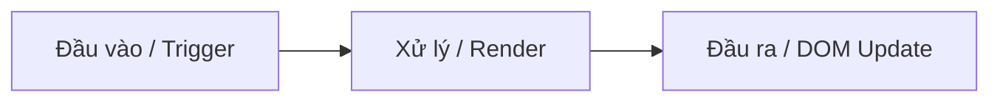

# Browser Paint and Layout Shift

> **Khóa học**: Modern Frontend Engineering (React + Vite)  
> **Phân nhóm**: Domain 3: Rendering Lifecycle and Fiber Reconciler  
> **Chủ đề**: The Rendering Pipeline  
> **Trạng thái**: [ ] Chưa hoàn thành (Chưa học / Chưa thực hành)  
> **Checklist đối chiếu**: [CHECKLIST](../../CHECKLIST.md)

---

## 1. Khái Niệm Cốt Lõi & Bản Chất Kỹ Thuật (Core Technical Deep Dive)
<!--
- Phân tích tường tận bản chất kỹ thuật, cơ chế hoạt động ngầm (under the hood).
- Giải thích bài toán cần giải quyết và lý do thiết kế kiến trúc như vậy.
-->

---

## 2. Ví Dụ Đời Sống Thực Tế Dễ Hiểu (Intuitive Real-World Analogy)
<!--
- Sử dụng các ví dụ so sánh đời thường gần gũi (nhà hàng/đầu bếp, chụp ảnh Polaroid, dây chuyền sản xuất...) giúp dễ hình dung bản chất.
-->

---

## 3. Sơ Đồ Kiến Trúc & Hình Ảnh Trực Quan (Mermaid & Official Visual Media)
<!--
- Sơ đồ trực quan Mermaid biểu diễn luồng xử lý hoặc cấu trúc thành phần.
- Nhúng các hình ảnh chính thức từ react.dev CDN hoặc vite.dev theo catalog trong react-sample-code-guide.
-->



---

## 4. Code Mẫu Trực Quan & Giải Thích Từng Dòng (Clean, Runnable Sample Code)
<!--
- Cung cấp mã nguồn mẫu TypeScript / ESNext hoàn chỉnh, có thể chạy trực tiếp.
- Chú thích rõ ràng các phần: Types, State, Handlers, JSX và logs quan sát.
-->

```tsx
import React from 'react';

export const SampleComponent: React.FC = () => {
  return (
    <div>
      <h2>Browser Paint and Layout Shift</h2>
    </div>
  );
};
```

---

## 📚 Nguồn Tài Liệu Chính Thống (Tier-1 Official References)
- [Browser Paint and Layout Shift Documentation](https://react.dev/learn/render-and-commit#epilogue-browser-paint) - Tài liệu chính thức từ nguồn Tier-1.
