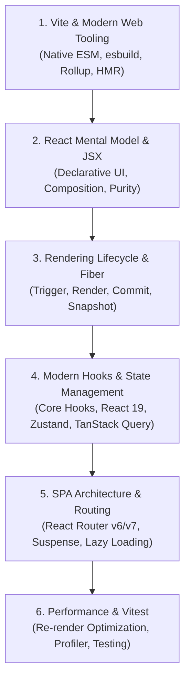

# React + Vite Curriculum (Frontend Engineering Track)

Chào mừng bạn đến với lộ trình học tập chuyên sâu về **Frontend Engineering với React và Vite** trong workspace `SelfLearn`.

Mục tiêu của lộ trình này là giúp người học nắm vững **bản chất lý thuyết kỹ thuật**, tư duy lập trình giao diện hiện đại (Declarative UI), cơ chế hoạt động của công cụ đóng gói thế hệ mới (Vite), đi kèm các **đoạn code mẫu thực chiến (TypeScript/ESNext)** và **sơ đồ trực quan chính thức**.

---

## 🎯 Bộ Kỹ Năng Hỗ Trợ Tự Động (Harness Skills)

Để học tập hoặc yêu cầu AI giải thích bất kỳ chủ đề nào trong thư mục này, hệ thống sử dụng các skill chuyên biệt:

1. [react-vite-curriculum-guide](../.agents/skills/react-vite-curriculum-guide/SKILL.md): Định hướng khung lý thuyết 6 Domain cốt lõi, quy chuẩn bài học 3 tầng và các ví dụ thực tế trực quan.
2. [react-sample-code-guide](../.agents/skills/react-sample-code-guide/SKILL.md): Quy chuẩn viết code mẫu runnable và **Catalog hình ảnh/sơ đồ public chính thức** từ `react.dev` CDN và `vite.dev`.
3. [official-doc-researcher](../.agents/skills/official-doc-researcher/SKILL.md): Cơ chế tra cứu tài liệu Tier-1 chính thống đảm bảo 100% trung thực, loại bỏ hallucination.

---

## 🗺️ 6 Domain Học Tập Cốt Lõi (Core Learning Domains)



### 1. Domain 1 - Vite and Modern Web Tooling
- Khởi tạo dự án chuẩn bằng `npm create vite@latest`, các template React (`react-ts`, `react-swc`).
- Vòng đời lệnh thực thi: `npm run dev` (dev server cổng 5173), `npm run build` (đóng gói Rollup), `npm run preview`.
- Giải phẫu cấu trúc dự án: Tại sao `index.html` nằm ở root thay vì `public/`, vai trò của `src/main.tsx` và `createRoot`.
- So sánh kiến trúc Server: Native ESM vs Traditional Bundlers (Webpack).
- Dev Server với `esbuild` (cực nhanh) và Production Build với `Rollup`.
- Cơ chế Hot Module Replacement (HMR) qua WebSocket.
- Cấu hình dự án `vite.config.ts`, alias `@/`, biến môi trường `import.meta.env`.

### 2. Domain 2 - React Core and Component Mental Model
- Chuyển đổi tư duy: Từ Imperative DOM sang Declarative UI (`UI = f(State)`).
- Bản chất JSX/TSX và cơ chế biên dịch JSX Transform.
- Phân rã Component, kỹ thuật Composition với `children` prop.
- Tính thuần khiết (Purity): Component không gây tác dụng phụ trong render phase.

### 3. Domain 3 - Rendering Lifecycle and Fiber Reconciler
- Quy trình 3 bước: **Trigger** -> **Render** (tính toán Virtual DOM) -> **Commit** (ghi vào Real DOM).
- Browser Paint: Thời điểm trình duyệt vẽ pixel lên màn hình.
- Bản chất "State as a Snapshot" và tương tác với Javascript Closures.
- Cơ chế Automatic Batching gom nhóm cập nhật trong React 18+.

### 4. Domain 4 - Modern Hooks and State Management
- Triết lý và Rules of Hooks.
- Các Hooks cơ bản: `useState`, `useEffect`, `useRef`, `useMemo`, `useCallback`, `useContext`.
- Các tính năng mới của React 19: `useActionState`, `useOptimistic`, `use` API.
- Kiến trúc quản lý trạng thái: Local State -> Global Client State (Zustand) -> Server State (TanStack Query).

### 5. Domain 5 - Routing and Single Page Application (SPA)
- Cơ chế Client-Side Routing và HTML5 History API.
- React Router (v6/v7): Route Data APIs (`createBrowserRouter`, `loader`, `action`).
- Layout lồng nhau (`<Outlet />`), Dynamic Parameters.
- Tối ưu tải trang: Phân tách mã nguồn (Code Splitting) với `React.lazy` và `<Suspense>`.

### 6. Domain 6 - Performance Optimization and Testing
- Đo lường và phân tích hiệu năng bằng React DevTools Profiler.
- Chiến lược hạn chế re-render thừa (`React.memo`, phân tách cây component hợp lý).
- Tối ưu bundle với Vite: Phân tích kích thước file, dynamic chunks.
- Kiểm thử hiện đại với Vitest và React Testing Library.

---

## 📁 Cấu Trúc Thư Mục Chuẩn Hóa 3 Tầng

Mọi bài học trong thư mục này tuân thủ cấu trúc phân cấp:

```text
react+vite/
├── CHECKLIST.md
├── 1 Domain 1 - Vite and Modern Web Tooling/
│   ├── 1_1 Project Initialization and Workflow/
│   │   ├── 1_1_1 Scaffold and Run a React + Vite Project.md
│   │   └── 1_1_2 Project Anatomy and Root index.html.md
│   ├── 1_2 Vite Architecture and Native ESM/
│   │   ├── 1_2_1 How Vite Uses Native ESM.md
│   │   └── ...
│   └── 1_3 Configuration and Asset Handling/
│       └── ...
├── 2 Domain 2 - React Core and Component Mental Model/
│   └── ...
```

Mỗi file bài học (`*.md`) luôn chứa:
1. **Khái Niệm Cốt Lõi & Bản Chất Kỹ Thuật**
2. **Ví Dụ Đời Sống Thực Tế Dễ Hiểu**
3. **Sơ Đồ Kiến Trúc & Hình Ảnh Public Chính Thống** (từ `react.dev` CDN / `vite.dev`)
4. **Code Mẫu Trực Quan & Chú Thích Từng Dòng** (TypeScript runnable)
5. **📚 Nguồn Tài Liệu Chính Thống (Tier 1: `react.dev`, `vite.dev`, MDN)**

---

## 📚 Nguồn Tài Liệu Chính Thống (Tier 1)
- [React Documentation](https://react.dev/) - Tài liệu chính thức về React 18 & 19
- [Vite Documentation](https://vite.dev/) - Tài liệu chính thức về Vite Tooling
- [MDN Web Docs](https://developer.mozilla.org/) - Tiêu chuẩn Web và JavaScript hiện đại
- [Vitest Documentation](https://vitest.dev/) - Framework kiểm thử cho Vite
- [React Router Documentation](https://reactrouter.com/) - Điều hướng và Routing cho React
